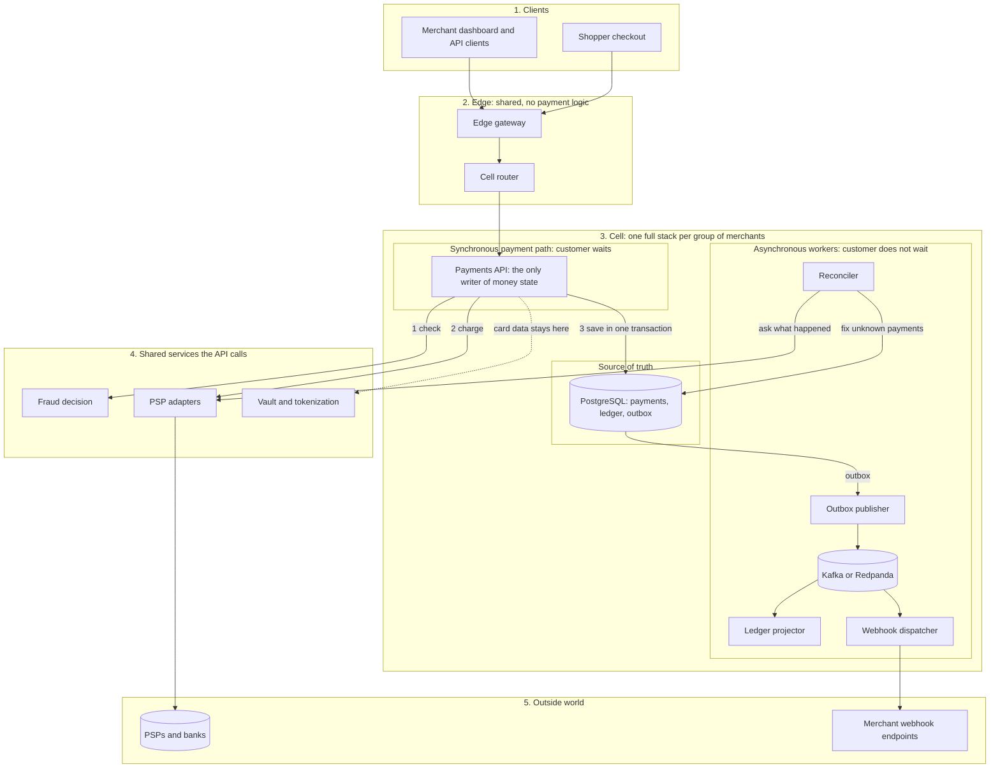

# Open Payments: project overview

A plain-language guide to what this project is, how it works, and where everything lives. Read this first, then the other documents.

Status: draft · Date: 2026-11-04 (documents synced 2026-11-05) · No code exists yet. This is a design-stage project.

## 1. What this project is

Open Payments is a plan for a **payment processing system**: software that lets a business (a "merchant") charge a customer's card, refund it, and see what happened, much like Stripe does.

The aim is to build it with open-source parts and C# (.NET), and to prove that it can handle **5,000 payments per second** without ever charging a customer twice or losing a record of money.

There are six parts of work so far:

| Part | What it is |
|---|---|
| The design | How the system is built and why it is correct (`payment-system-design.md`) |
| The scaling plan | How to prove it handles 1 to 5,000 requests per second (`scaling-playbook.md`) |
| The failure plan | What can go wrong, what the system does, and how people recover (`failure-scenarios.md`) |
| The payment lifecycle | Every state a payment can be in, the allowed moves between them, and the rules that keep them safe (`payment-lifecycle.md`) |
| The deadlock guide | Why locks collide at high volume, how to prevent it, and how the system recovers by itself (`deadlock-handling.md`) |
| The UX prototype | Clickable screens for the merchant dashboard and the shopper's checkout, plus a case study (built earlier as a design canvas, for your UX final project) |

## 2. The goal in numbers

| Goal | Meaning |
|---|---|
| 5,000 payments per second | "TPS" means transactions per second. Sustained, not just a short burst |
| Up to 15,000 per second in bursts | Three times the target, so a spike or a lost server does not break it |
| Zero duplicate charges | A customer is never charged twice for one purchase |
| Zero lost records | Every committed payment is stored and can be found |
| Always-balanced books | Money in always equals money out in the accounting records |
| Platform delay p99 ≤ 100 ms | For 99 of every 100 requests, our own processing takes 100 ms or less (not counting the bank's time) |

These are **targets**. Nothing has been measured yet.

## 3. What happens when someone pays

```
Customer pays $24
   |
   v
1. API receives the request and checks it is allowed
2. Fraud check (quick, must finish in about 50 ms)
3. Save the payment and an "attempt" in the database   <- written BEFORE asking the bank
4. Ask the payment provider (PSP / bank) to charge the card
5. Save the result, the accounting entries and a "tell others" note
   in ONE database transaction
6. Answer the customer: success, declined, or "still checking"
7. Later, in the background: tell the merchant (webhook), update balances
```

**What if something goes wrong?**

- **The customer clicks twice or the network retries.** The system recognises the same request (by its idempotency key) and returns the first answer. No second charge.
- **The bank approves but our server crashes before saving.** Step 3 saved the attempt first. A background job (the reconciler) asks the bank "what happened to attempt X?" and records the true answer.
- **The bank does not answer in time.** The payment is marked **unknown**, not failed. The reconciler finds out later.
- **The message to the merchant cannot be sent.** It waits safely in the outbox and is sent when the system recovers.

## 4. Key ideas explained simply

| Term | Plain explanation |
|---|---|
| **Idempotency** | Doing the same request twice has the same effect as doing it once, like pressing an elevator button twice. |
| **State machine** | A payment can only move along allowed steps (created, pending, authorized, captured, refunded). Anything else is rejected. |
| **Ledger / double-entry** | Every movement of money is written as two matching lines, one debit and one credit. If the totals do not match, something is wrong. |
| **Append-only** | Records are never edited or deleted. A mistake is fixed by adding a new correcting record. |
| **Outbox** | The note "tell other systems about this payment" is saved in the same database transaction as the payment, then delivered later. Either both exist or neither does. |
| **Unknown state and reconciliation** | When the outcome is not known, the system keeps the payment in a special state and a background job resolves it by asking the bank. |
| **PSP** | Payment service provider: the company or bank connection that actually moves the card money. |
| **Vault / tokenization** | Card numbers are kept in a separate locked service. The rest of the system only sees a token, which keeps security audits small. |
| **Cell** | A complete, independent copy of the system that serves some merchants. More cells means more capacity and a smaller blast radius when one fails. |
| **Backpressure / admission control** | When the system is overloaded it says "busy" quickly instead of letting requests pile up until everything breaks. |
| **p95 / p99** | 95 or 99 of every 100 requests are faster than this time. It shows the slow cases that averages hide. |
| **Little's Law** | Requests in progress = requests per second × seconds each takes. At 5,000 per second and 1 second per bank call, about 5,000 requests wait at once. |

## 5. High-level architecture

### 5.1 The idea in one sentence

A payment goes through a **short synchronous path** (the only part the customer waits for). Everything else runs **asynchronously**, fed from the database through the outbox, so a slow or broken helper can never slow down or corrupt a payment.

### 5.2 Five boundaries



Read it top to bottom. Money state is written in **one place** (the Payments API into PostgreSQL). Everything in box 3 under "Asynchronous workers" only reads what was already committed.

### 5.3 What each service does and where its boundary is

| Boundary | Service | Job | Owns (nobody else writes it) | Customer waits for it? | If it is down |
|---|---|---|---|---|---|
| 2 Edge | Edge gateway | TLS, authentication, rate limits, size limits | nothing | Yes | Nothing can enter; scale it out |
| 2 Edge | Cell router | Maps each merchant to a cell | merchant-to-cell table | Yes | Uses its last known mapping |
| 3 Cell, sync | **Payments API** | Payment lifecycle, idempotency, refunds, writes ledger and outbox | payments, attempts, idempotency keys, refunds, ledger, outbox | Yes | Payments stop; other cells keep working |
| 3 Cell, data | PostgreSQL (primary + synchronous replica, behind PgBouncer) | Stores all money state | all financial data | Yes | Replica takes over; committed payments are kept |
| 3 Cell, async | Outbox publisher | Moves committed events to the broker | nothing | No | Events wait in the outbox |
| 3 Cell, async | Broker (Kafka or Redpanda) | Carries events to workers | event log | No | Events wait in the outbox |
| 3 Cell, async | Ledger projector | Builds balances from ledger entries | balance snapshots | No | Balances lag; payments are unaffected |
| 3 Cell, async | Webhook dispatcher | Tells merchants what happened, signed, with retries | delivery log | No | Notifications are late, never lost |
| 3 Cell, async | Reconciler | Resolves unknown payments; compares with bank files | discrepancy records | No | Unknown payments stay unknown longer |
| 4 Shared | Fraud decision | Fast rules (about 50 ms), counters in Redis | rules, counters | Yes, with a time limit | A defined fallback applies |
| 4 Shared | PSP adapters | Talk to each bank or provider with time limit, circuit breaker and status inquiry | adapter metadata | Yes | Payment becomes unknown or fails fast |
| 4 Shared | Vault and tokenization | Keeps card data; issues tokens | encrypted card data | Yes | Card payments cannot start |
| 5 Outside | PSPs and banks | Move the card money | their own records | Yes | We cannot control it; hence "unknown" |
| 5 Outside | Merchant webhook endpoints | Receive notifications | their own records | No | We retry, then dead-letter |

Also part of the system but not on the diagram: observability (metrics, logs, traces, alerts), the Kubernetes platform, the mock PSP and load harness (built first), and settlement and payouts (later phase, not designed).

### 5.4 Boundary rules

1. **One writer.** Only the Payments API writes payments, the ledger and the outbox.
2. **One short transaction.** State change, ledger entries and outbox event commit together. No bank call, HTTP call or broker call happens inside it.
3. **Async never blocks sync.** Workers only read committed data, so they can lag or fail without touching a payment.
4. **Card data stays in the vault.** Everything else sees a token.
5. **A cell is a complete copy.** One cell failing affects only its merchants. Start with one cell; add more only if measurements show one database is not enough (design section 5).
6. **Merchant-facing screens** (dashboard and checkout) exist so far only as the UX prototype.

### 5.5 Why not many microservices?

Payment and ledger stay in one service on purpose: splitting them would turn the single database transaction into a network call and a saga, adding failure cases and latency on the hot path. The parts that can run independently (fraud, PSP adapters, webhooks, reconciler, projector) are already separate. See design sections 3 and 4.

### 5.6 Service list

Status: **Design** = in `payment-system-design.md`. **Later** = named in the design but not designed.

| # | Service | Main features | Status |
|---|---|---|---|
| 1 | Edge gateway | TLS; API key and token authentication; per-merchant rate limits; request size and slow-client limits; fast 429 or 503 with `Retry-After` when overloaded | Design |
| 2 | Cell router | Merchant-to-cell routing; cached mapping; keeps the last known mapping if its config store is down | Design |
| 3 | Payments API | Create, capture, refund; idempotency keys; payment state machine; atomic refund limit; double-entry ledger writes; outbox writes; query payment status | Design |
| 4 | Outbox publisher | Reads unpublished events in batches; publishes to the broker with delivery guarantees; marks them published | Design |
| 5 | Ledger projector | Builds account balances and snapshots from ledger entries; rebuildable read model | Design |
| 6 | Webhook dispatcher | Signed delivery; retries with backoff; dead-letter queue; per-endpoint isolation; duplicate-safe event IDs | Design |
| 7 | Reconciler | Resolves `UNKNOWN` and stuck payments by asking the PSP; compares with PSP settlement files; discrepancy records | Design |
| 8 | Fraud decision | Synchronous rules within about 50 ms; velocity counters in Redis; fallback policy by risk tier; async analytics | Design |
| 9 | PSP adapters | One adapter per PSP behind one interface; hard deadlines; circuit breaker; rate limit; status inquiry; PSP idempotency key (`attempt_id`); failover where the contract allows | Design |
| 10 | Vault and tokenization | Stores card data encrypted; issues tokens; separate network segment and audit scope | Design |
| 11 | Settlement and payouts | Pay merchants from settled funds; payout records; query the bank before retrying a payout | Later |

Infrastructure that is not a service but is on the diagram: PostgreSQL with a synchronous replica behind PgBouncer, Kafka or Redpanda, Redis, Kubernetes, observability, and the mock PSP with the load harness.

### 5.7 Feature list

| Area | Feature | Where | Status |
|---|---|---|---|
| Payments | Create a payment with an idempotency key (no duplicate charge) | Payments API | Design |
| Payments | Authorize, then capture (full, or partial in the extension) | Payments API, PSP adapters | Design / proposed partial |
| Payments | Payment states: created, pending, authorized, declined, unknown, captured | `payment-lifecycle.md` | Design |
| Payments | Void and authorization expiry | `payment-lifecycle.md` | Proposed |
| Refunds | Full and partial refunds; refund idempotency; total never above captured | Payments API | Design |
| Money correctness | Append-only double-entry ledger, written in the same transaction as the state change | Payments API, PostgreSQL | Design |
| Money correctness | Derived balances, hot accounts split into 64 sub-accounts | Ledger projector | Design |
| Money correctness | Unknown state and reconciliation after a bank timeout or crash | Reconciler | Design |
| Money correctness | Continuous ledger audit; reversing entries instead of edits | Operations | Design |
| Reliability | Safe retries, bounded queues, deadlines on every call | All | Design |
| Reliability | Deadlock prevention, safe retry and automated recovery | `deadlock-handling.md` | Design (prevention, retry); proposed (automation layers) |
| Reliability | Provider failover without duplicate authorization | PSP adapters | Design |
| Reliability | Cells: independent copies of the stack for capacity and blast radius | Cell router | Design (add only if measured) |
| Events | Transactional outbox to Kafka; consumers ignore duplicates | Outbox publisher | Design |
| Events | Merchant webhooks, signed, with retries and dead-letter queue | Webhook dispatcher | Design |
| Security | Card data only in the vault; tokens elsewhere; secrets rotation | Vault | Design |
| Security | Tenant isolation by `merchant_id`; row-level security as a backstop | Payments API | Design |
| Risk | Fast fraud rules with defined fallback; card-testing velocity blocks | Fraud decision | Design |
| Operations | Metrics, logs, traces and alerts; ledger and queue-age dashboards | Observability | Design |
| Operations | Runbooks and drills for 42 failure scenarios | `failure-scenarios.md` | Design (none rehearsed) |
| Merchant experience | Dashboard and shopper checkout screens | UX prototype | Prototype only |
| Later | Settlement matching and payouts | Settlement and payouts | Later |
| Later | Disputes and chargebacks | `payment-lifecycle.md` | Proposed |
| Later | Marketplace (Connect) features, billing, advanced fraud, formal PCI assessment | n/a | Not designed |

**Where the detail is:** services in design section 4, payment states in `payment-lifecycle.md`, database contention in `deadlock-handling.md`, failure behavior in `failure-scenarios.md`.

Build order: payments core, idempotency, ledger, one PSP adapter, outbox plus broker, reconciler. Settlement, payouts and marketplace features come later.

## 6. Why 5,000 per second is hard

- Money must be **exactly right** even when servers crash halfway.
- Many payments touch the **same accounts**, which can make them wait on each other.
- Banks are **slow and sometimes fail**, and we cannot control them.
- At this volume, a rare slowdown affects **dozens of payments every second**.
- Something is **always** partly broken, so the question is how the system behaves when it is.

The answer in this design: save intent first, make everything safe to repeat, treat "unknown" as a real state, bound every queue and timeout, and prove each claim with a test.

## 7. Document map

| File | What it is | Read when |
|---|---|---|
| `README.md` | This overview | First |
| `payment-system-design.md` | Full design, the test catalogue, and a 108-row checklist tying every known production problem to a fix and a test | When you want to know how and why |
| `scaling-playbook.md` | The step-by-step plan to prove 1 to 5,000 requests per second, gates, sizing, and a results log template | When you plan the benchmarks |
| `failure-scenarios.md` | 42 failure scenarios, 17 edge cases, 7 recovery runbooks and a drill plan, each tied to a test | When you plan for things going wrong |
| `payment-lifecycle.md` | Payment states, transitions, rules, worked examples, edge cases, and proposed extra states (void, expiry, settlement, disputes) | When you work on payment states or refunds |
| `deadlock-handling.md` | Deadlock causes, scenarios, prevention, safe retry, automated recovery and mitigation, with this project's settings | When you work on database transactions or load tests |
| `dotnet-for-payments.md` | Why .NET fits this system, and its risks | When you question the language choice |
| UX prototype (design canvas) | Clickable merchant dashboard and checkout, plus a UX case study | For the UX project |

## 8. Where the project stands

**Done**

- Architecture and design written, including data model, flows and failure handling.
- 108 production problems mapped to a fix and a test (none verified yet: **0 of 108**).
- Scaling plan with ramp steps, decision gates and a results template.
- Failure scenarios, edge cases, recovery runbooks and drills (none rehearsed yet).
- Payment lifecycle document and deadlock handling guide. Their extra states (void, expiry, settlement, disputes) and automation layers (circuit breaker, adaptive limiter, watchdog) are proposals, not yet part of the design.
- UX prototype and case-study template.

**Not done**

- No code, no benchmarks, no real measurements.
- Not designed yet: settlement and payouts, marketplace (Connect) features, billing, advanced fraud, and the formal card-industry (PCI) assessment.

**Next steps (suggested)**

1. A 2-3 day database spike: measure how many payment transactions one PostgreSQL primary sustains. This decides whether one cell is enough.
2. Write three short documents: API contract, state machine and event catalog, and decision records.
3. Write about 10 acceptance tests that fail first.
4. Phase 0: mock PSP, load scripts, automatic correctness checks. Then the payments core.

## 9. Suggested reading order for a newcomer

1. This file.
2. Design doc sections 1 to 3 (goals, principles, architecture).
3. Design doc sections 6 and 7 (payment lifecycle and the payment flow), then `payment-lifecycle.md` for the full state tables.
4. Design doc sections 8 and 9 (data model and ledger).
5. Scaling playbook sections 1 to 3 (process and ramp plan).
6. Skim the checklist in design doc section 19 to see how problems map to fixes.
7. `deadlock-handling.md` before writing any database transaction code.

## 10. Honest limits

- All numbers (latency, capacity, cost, effort) are estimates or targets until measured.
- A payment platform also needs legal, banking and card-industry compliance work that this design does not cover.
- A mock bank is not a real bank. Real provider testing is required before trusting any result.
