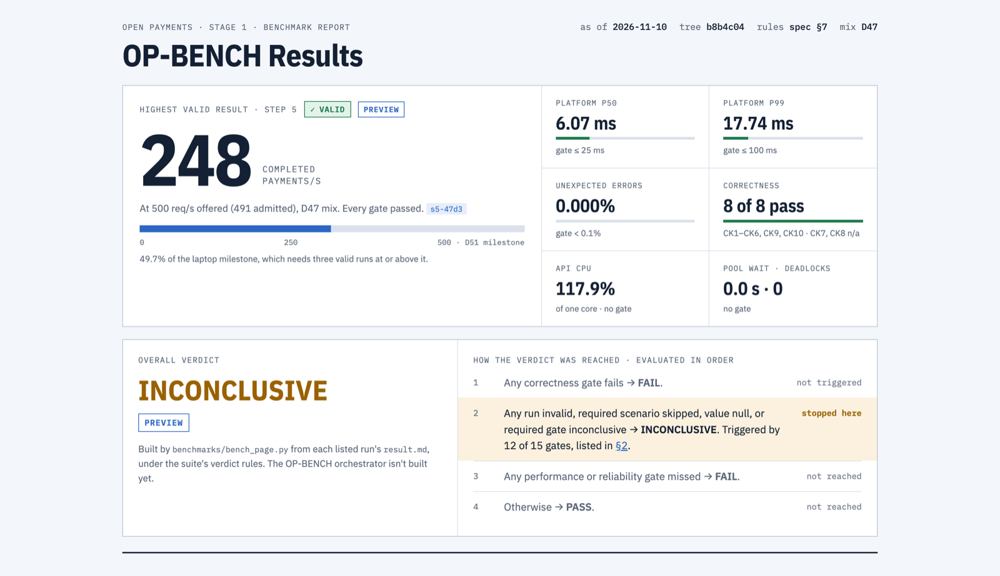

# Open Payments

An open-source payment processing system in C# (.NET), designed to handle 5,000 completed payments per second without double-charging anyone or losing a record of money.

Status: Stage 1 built and reviewed, D56 laptop verification not yet run · Last updated: 2026-11-10

**Stage 1 is built:** the payments core, API, mock PSP, correctness checks, load harness and the staff console's first screens. The 5,000/s target is not proven: the measurements so far are laptop previews ([BASELINE](benchmarks/BASELINE.md)), and a capacity number needs a Linux run ([D53](docs/decisions.md#d53)).

### Benchmark report

The [OP-BENCH Results](https://egannguyen.github.io/Open-Payments/) page shows the highest valid laptop result, then the overall verdict, every gate with its source, and every run, including excluded ones. It's generated from the recorded runs and is a laptop preview, not a capacity number. To update it, see [Keeping the results page in sync](docs/benchmarks/results-page.md).

<a href="https://egannguyen.github.io/Open-Payments/">
  <picture>
    <source media="(prefers-color-scheme: dark)" srcset="docs/design/op-bench-report/preview-dark.png">
    
  </picture>
</a>

## What it is

Open Payments lets a business (a "merchant") charge a customer's card through its own PSP account, refund it, and see what happened. It never holds the merchant's funds or card numbers.

| Goal | Target |
|---|---|
| Throughput | 5,000 completed payments/s, sustained |
| Overload | Survive 15,000 req/s by rejecting the excess quickly, without crashing |
| Duplicate charges | Zero |
| Lost records | Zero |
| Books | Always balanced |
| Our own delay | p99 ≤ 100 ms, not counting the PSP's time |

Full targets are in [Goals and SLOs](docs/architecture.md#goals-and-slos). New terms are explained in the [glossary](docs/glossary.md).

## What happens when someone pays

```
Customer pays $24
   |
   v
1. API receives the request and checks it is allowed
2. Fraud check (must finish in about 50 ms)
3. Save the payment and an "attempt" in the database   <- written BEFORE asking the PSP
4. Ask the PSP to charge the card
5. Save the result, the accounting entries and a "tell others" note
   in ONE database transaction
6. Answer the customer: success, declined (try again), action needed, or "still checking"
7. Later, in the background: tell the merchant (webhook), update balances
```

**If something goes wrong:**

- **The customer clicks twice or the network retries.** The idempotency key identifies the same request, so it returns the first answer with no second charge.
- **The PSP approves but our server crashes before saving.** The saved attempt lets the reconciler ask the PSP what happened and record the true answer.
- **The PSP does not answer in time.** The payment is marked `UNKNOWN`, not failed, and the reconciler finds out later.
- **The message to the merchant cannot be sent.** It waits in the outbox and is sent when the system recovers.

## Why this is hard

Money must be exactly right even when servers crash halfway, PSPs are slow and sometimes fail, and at this volume something is always partly broken. The design answers this by saving intent first, making everything safe to repeat, treating "unknown" as a real state, bounding every queue and timeout, and proving each claim with a test.

## Documents

Read them in this order if you are new.

| Doc | What it covers | Read when |
|---|---|---|
| [Architecture](docs/architecture.md) | Goals, components, payment flow, data model, ledger, PSP integration | First, to learn how and why |
| [Service catalog](docs/service-catalog.md) | Deployable services, dependencies, split rule, full capability map | You need to know what runs where |
| [Codebase structure](docs/architecture/codebase-structure.md) | Projects, dependency rules, data ownership, where new code goes | You add code or a project |
| [Payment lifecycle](docs/payment-lifecycle.md) | States, transitions, refund rules, merchant events | You work on payments or refunds |
| [Engineering standards](docs/engineering-standards.md) | Load control, .NET, database, Kubernetes, security, observability | You write or operate code |
| [Deadlock handling](docs/deadlock-handling.md) | Risks, prevention, retry behavior, proposed automation | Before writing database transaction code |
| [Failure scenarios](docs/failure-scenarios.md) | 51 failures, 29 edge cases, 7 runbooks, drills | You plan for things going wrong |
| [Scaling playbook](docs/scaling-playbook.md) | Ramp plan, sizing, decision gates, results log | You plan benchmarks |
| [Local deployment](docs/architecture/local-deployment.md) | The MacBook stacks: topology, resources, what stays fixed | You run it locally |
| [Production deployment](docs/architecture/prd-deployment.md) | Expected topology, sizing and estimate at 5,000 payments/s, not proven | You plan production |
| [Benchmark guide](docs/benchmarks/benchmark-guide.md) | The database-only spike: deploy, run, monitor, verify, compare and reset | You run a database benchmark |
| [MacBook summary](docs/benchmarks/spike/macbook-2026-11-05/summary.md) | Database spike results, bottlenecks and production capacity expectations | You need the database-tier measurements |
| [Verification](docs/verification.md) | Test IDs, 108 production problems, 25 readiness items, build phases | You need to prove a claim or plan a build phase |
| [API contract](api/openapi.yaml) | Draft routes and fields, frozen only after C39 ([draft guides](docs/integration-guides-draft.md)) | You call or build the API |
| [Event catalog](docs/event-catalog.md) | Shape and contents of published events | You publish or consume events |
| [Delivery workflow](docs/delivery-workflow.md) | Design, build and review gates, and who does each | You start any stage or task |
| [Implementation guide](docs/implementation-guide.md) | How to build and benchmark it, with links to the spec and plan | You start building or run a benchmark |
| [Decisions](docs/decisions.md) | Why key choices were made, assumptions, open questions | You question a choice |
| [Metrics](docs/metrics.md) | Metric names, labels and what the harness reads | You add or read a metric |
| [Load harness](benchmarks/README.md) | Running a ramp step against the API, reset, validity rules | You run a platform benchmark |
| [BASELINE](benchmarks/BASELINE.md) | Laptop ramp results at the D47 mix | You need the latest platform numbers |
| [Open experiments](docs/benchmarks/open-experiments.md) | What's still unmeasured, and in what order to run it | You plan the next benchmark |
| [Results page sync](docs/benchmarks/results-page.md) | Where each fact on the results page lives, and how to update and publish it | A run finishes or other evidence changes |
| [Development challenges](docs/development-challenges.md) | Problems found so far, their root causes, fixes and evidence | You want to know what went wrong and why |
| Gate records in [`docs/gates/`](docs/gates/) | Design approvals, build progress, escalations | You check what's approved, built or blocked |
| [Stripe research](docs/stripe-research.md) | What Stripe has published, proposed design changes, what not to copy | Before accepting the design or starting Phase 0 |
| [Glossary](docs/glossary.md) | Terms and standard names | Any time |

The clickable UX prototype and case study for the merchant dashboard and checkout are kept outside this repo, on a design canvas.

## Where the project stands

**Done:**

- Architecture, data model, flows and failure handling, on paper.
- Stage 1 build, Tasks 1-18: payments core, API, mock PSP, CK1-CK10, load harness, staff console. Evidence per task is in [Stage 1 progress](docs/gates/stage-1-progress.md).
- The Stage 1 [review gate](docs/gates/stage-1-review.md), closed 2026-11-10 with no critical, high or medium finding open.
- Crash tests K1-K3 against the real API, and alerts for unresolved payment outcomes ([runbook](docs/runbooks/unknown-outcomes.md)).
- A laptop limit search at the [D47](docs/decisions.md#d47) mix: steps 0, 1, 3 and 5 valid and passing, and step 6 over the p99 gate with one API instance, closing Task 17 under [D53](docs/decisions.md#d53). These are previews, not capacity ([BASELINE](benchmarks/BASELINE.md)).

**Not done:**

- The [D56](docs/decisions.md#d56) laptop verification: capacity with two API instances, soak, L3, C1, C2, C7 partial and alerts. The rows are in the [Phase 1 exit record](docs/phase-gates/phase-1.md#d56-laptop-verification).
- A capacity number `C`. It needs a Linux host ([D53](docs/decisions.md#d53)).
- [Verification](docs/verification.md#progress) rows stay unticked until a recorded run proves them.
- Not designed: payouts and settlement beyond file ingestion, marketplace features, billing, advanced fraud, and the formal PCI assessment.

**Next steps:**

1. Run step 4 once and step 6 three times from a reset on the two-API stack (`deploy/compose/two-api.yaml`) to set the stable rate under [D56](docs/decisions.md#d56).
2. Run the rest of D56 at that rate: soak, L3, C1, C2, C7 partial and alerts.
3. Start Stage 2's design gate: PSP sandbox, reconciler, callbacks.

The [implementation guide](docs/implementation-guide.md) has the details.

## Limits

- All numbers are estimates or targets until measured.
- A payment platform also needs legal, banking and card-industry compliance work that this design does not cover.
- A mock PSP is not a real PSP. Real provider testing is required before trusting any result.

More in [Assumptions and limits](docs/decisions.md#assumptions-and-limits).
