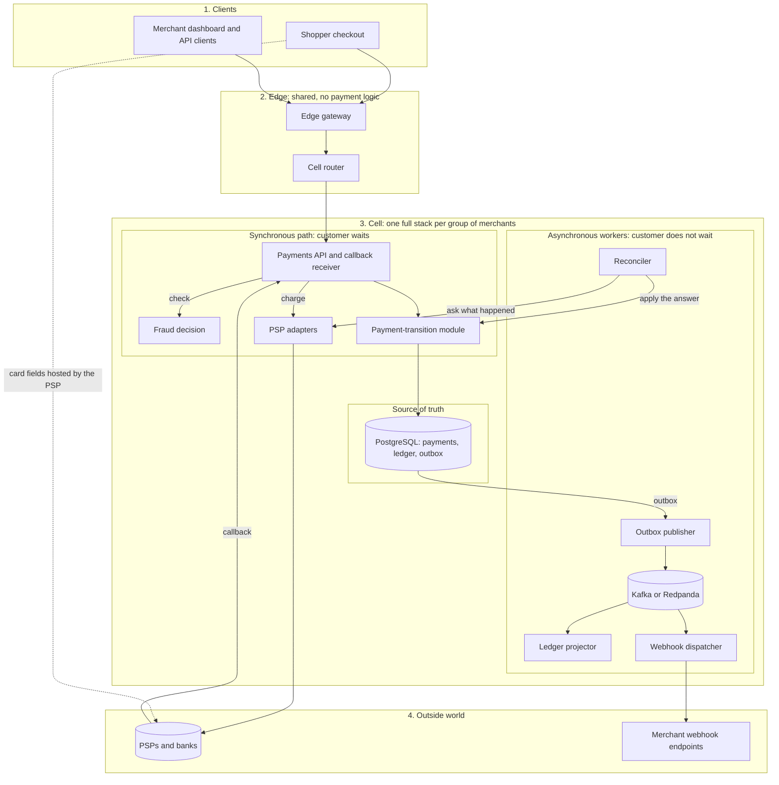

# Architecture

How Open Payments is built to process 5,000 completed payments/s without double-charging anyone or losing a record of money.

Status: Draft · Last updated: 2026-11-09

Stack: C# / .NET 10, ASP.NET Core, PostgreSQL, Kafka-compatible broker, Kubernetes. Stage 1 is built: the Payments API, payment-transition module, mock PSP adapter and staff console. Later components are design only. No production capacity is measured; laptop previews are in [BASELINE](../benchmarks/BASELINE.md). Reasoning behind major choices is in [Decisions](decisions.md).

## Goals and SLOs

| Area | Target |
|---|---|
| Throughput | 5,000 completed payments/s sustained |
| Overload | 15,000 req/s for 10 minutes is an overload survival test: excess is shed, 5,000 completed payments/s holds, nothing crashes ([D4](decisions.md#d4)) |
| Latency | Platform overhead p99 ≤ 100 ms and p50 ≤ 25 ms, excluding PSP time |
| Correctness | 0 duplicate charges, 0 lost financial records, ledger always balanced |
| Availability | 99.95% for the Payments API |
| Durability | RPO 0 for committed payments; RTO ≤ 60 s for database failover |
| Recovery | Automatic for loss of one node or one availability zone |

**What is counted.** Three rates are measured separately: *admitted* req/s (passed admission control), *rejected* req/s (shed with 429 or 503), and *completed payments/s* (attempts whose request got a final committed answer: authorized, or captured under auto-capture, or declined. An attempt in `UNKNOWN` or `ACTION_REQUIRED` is not counted until resolved, and a retried payment counts once per attempt, as [D16](decisions.md#d16) defines).

**Two latency measures.** *Platform overhead* excludes PSP wait time and carries the target above. *End to end* is recorded against the mock PSP at a fixed latency, and becomes a gate only once a target is chosen against the real PSP.

**Derived load (to validate in L1):**

- Our estimates, to be replaced by the spike ([D24](decisions.md#d24)). An auto-captured payment takes 2 commits and about 11-13 row writes as one PSP call ([D29](decisions.md#d29)), or up to 4 commits and about 20-22 row writes as two. Refunds add 2 commits each, and each PSP callback can add 1 ([D30](decisions.md#d30)).
- At target with the [benchmark mix](scaling-playbook.md#workload-and-load-generation) ([D47](decisions.md#d47)), that is about 14k commits/s, plus up to 7k/s for callbacks. Publishing the outbox adds more. The estimate is 5 active cells, so about a fifth of that per cell.
- PSP latency of 200 ms to 2 s means about 5,000 requests in flight at a 1 s average (Little's Law).

## Principles

1. **The database is the source of truth.** Nothing is confirmed to the payer before the commit.
2. **Intent before action.** The attempt is written to the database before the PSP is called.
3. **Every operation is idempotent end to end,** from client request to PSP call to event consumer. Database constraints enforce it. Redis may speed up checks but is never the only protection against duplicate charges.
4. **Unknown is a first-class state.** A PSP timeout is not a failure.
5. **Never hold a database transaction across a network call.**
6. **Bound everything:** concurrency, queues, retries, timeouts, payload sizes.
7. **The ledger is append-only and written in the same transaction as the state change.**
8. **Anything not needed to answer the payer runs asynchronously** from the outbox.
9. **Isolate failures:** cells, bulkheads, one circuit breaker per PSP.
10. **Prove with tests, not opinion.** See [Verification](verification.md).

## Components and boundaries

A payment takes a **short synchronous path**, the only part the customer waits for. Everything else runs **asynchronously** from the outbox, so a slow or broken helper cannot slow or corrupt a payment.



The [service catalog](service-catalog.md) lists each component's job, kind, deployment boundary, ownership and failure effect, plus [who calls whom](service-catalog.md#dependencies). The cell router, edge gateway and six cell workers and services are the eight deployables; the payment-transition module and PSP adapters are libraries. The vault is deferred ([D39](decisions.md#d39)).

Not on the diagram: observability, the Kubernetes platform, Redis, and the mock PSP with its load harness, which is built first. Settlement and payouts are not designed.

**Boundary rules:**

1. **There is one write path.** The payment-transition module is the only code that writes money state ([D2](decisions.md#d2)). It is a pure `Decide` function plus a thin database shell ([D22](decisions.md#d22)).
2. **One short transaction.** State change, ledger entries and outbox event commit together, with no PSP, HTTP or broker call inside.
3. **Async never blocks sync.** Workers read committed data and can lag or fail without touching a payment. The reconciler and timer jobs are the exceptions that write, and only through the module. Timer jobs run in the reconciler process.
4. **Card data never reaches us.** PSP-hosted fields collect it, and we see a PSP token ([D39](decisions.md#d39)).
5. **We never hold funds.** Money moves through the merchant's own PSP account ([D35](decisions.md#d35)).

**Why not more microservices?** Splitting payment and ledger would turn one database transaction into a network call and a saga, adding failure cases and latency on the hot path. The parts that benefit from independence are already separate, and [When to split a service](service-catalog.md#when-to-split-a-service) sets the rule for any more.

## Cells and routing

- A **cell** is a complete stack (API pods, fraud, PSP adapters, database, broker, workers) serving a subset of merchants. If cells are needed, plan for about 1.5-2k completed payments/s per cell: 4 active plus 1 spare.
- **Build one cell first** ([D14](decisions.md#d14)). Split only if gate [G1](scaling-playbook.md#decision-gates) requires it.
- Tenant-owned tables carry `merchant_id` from day one, so moving a merchant between cells needs no schema change. Moving its data is a separate job, and the routing update is only the last step ([Stripe research](stripe-research.md#5-moving-data-is-the-hard-part)).
- Test-mode requests are isolated from live data ([D20](decisions.md#d20)). The router considers the API key's mode as well as the merchant. The isolation mechanism is `Open`.
- The edge gateway and cell router are the only shared parts of the payment path, now the vault is deferred ([D39](decisions.md#d39)).
- The control plane (routing table, merchant config) is cached in each cell and can be stale without stopping payments.
- Each cell spans 3 availability zones. Active-active across regions is out of scope.
- A very large merchant can have its own cell, which bounds its blast radius and hot-account effects.

## Payment flow

**Create a payment.** A create request without a payment method commits the payment in `AWAITING_METHOD` and returns. With a method, it continues as the first attempt below.

**Make an attempt** ([D16](decisions.md#d16)):

1. **Admit.** Authenticate, rate-limit, take a concurrency permit. If none is available, reject at once with 429 or 503 and `Retry-After`.
2. **Read the key.** A finished or running request with this key answers now, with no fraud check ([D33](decisions.md#d33), [D31](decisions.md#d31)).
3. **Fraud check** within a 50 ms budget, for every new attempt. On timeout, apply the fallback for the payment's risk tier. A block commits a `FAILED` attempt with `fraud_blocked`, makes no PSP call and answers 402.
4. **Transaction A** (short, no network calls). Insert the idempotency record, insert the payment or conditionally move it from `AWAITING_METHOD` to `PSP_PENDING`, and insert an attempt with its own `attempt_id`. Commit, with no cancellation ([D28](decisions.md#d28)). If the commit fails, answer 503 and don't call the PSP.
   - A conflict on `(merchant_id, key)` means a duplicate, and is handled as in step 2. If the stored request hash differs, return 422. If the first request is still running, return 409 with `Retry-After`. Use `ON CONFLICT DO NOTHING`, so the transaction isn't aborted by the conflict.
   - A unique violation on `payment_attempts_one_live_authorize` means another attempt is live or succeeded, so return the current status, or 409 with `Retry-After`. The attempt cap is also checked here. These refusals store nothing, so the key can run later.
5. **Call the PSP** using `attempt_id` as the PSP idempotency key and as the reference, with a hard deadline, circuit breaker and rate limiter. From here on, the request's cancellation no longer applies, so a client disconnect can't strand a charged attempt.
6. **Transaction B** (short). Conditionally move the payment to its new state, update the attempt, insert any ledger entries and insert the outbox event. Commit, with no cancellation. If it fails, the attempt stays unresolved and the answer is 202, never a decline.
7. **Respond** with the result:

| PSP result | Payment | Attempt | API answer |
|---|---|---|---|
| Approved | `AUTHORIZED`, or `CAPTURED` for a sale | `SUCCEEDED` | Success |
| Declined | `AWAITING_METHOD` | `FAILED` with a `failure_code` | The decline, with a way to try again |
| Requires action | `ACTION_REQUIRED` | `ACTION_REQUIRED` | The action the customer must take ([Customer action](payment-lifecycle.md#customer-action)) |
| Timeout | `UNKNOWN` | `UNKNOWN` | `202 Accepted` with the payment ID; the result comes by webhook or polling |

**Void.** Works like capture, with its own attempt row and key. The PSP confirms, then the payment moves to `VOIDED` and the hold is released. A decline leaves it `AUTHORIZED`, and a timeout answers 202 with the attempt unresolved ([D37](decisions.md#d37)).

**Capture.** Insert a capture attempt with its own key. The unique index `payment_attempts_one_live_capture` allows one live or successful capture or void per payment, so a second request with a different idempotency key never reaches the PSP and gets the current status, or 409 with `Retry-After` while the first is running. Call the PSP, and move the payment to `CAPTURED` only after it confirms. A declined attempt is marked `FAILED`, which allows a new capture. On a timeout, the API answers `202 Accepted`, the payment stays `AUTHORIZED`, the attempt is marked `UNKNOWN`, and the reconciler resolves it ([D6](decisions.md#d6)).

**Refund.** Reserve, call the PSP, then confirm or release. On a timeout, the API answers `202 Accepted` with the refund ID and status. Merchants get final capture and refund results by [webhook](payment-lifecycle.md#merchant-events) or polling. The SQL is in [Refund rules](payment-lifecycle.md#refund-rules).

## Crash recovery

| Crash point | What the database holds | Recovery |
|---|---|---|
| Before transaction A commits | nothing | Client retries with the same key |
| After A, before the PSP call | payment in `PSP_PENDING`, attempt `PENDING` | After the attempt timeout, the reconciler recovers through the adapter's mode ([D27](decisions.md#d27)). It fails the attempt only with proof that it can't succeed. A replay may complete the charge instead |
| After the PSP call, before B | payment in `PSP_PENDING`, attempt `PENDING` | Same, and the reconciler applies the PSP's real answer |
| During a commit | Unknown until read | Read the row. Nothing is retried blind ([D28](decisions.md#d28)) |
| After B commits, before the response | final state and outbox event | Client retries; the idempotency record returns the stored result |

## Data model

Amounts are `bigint` minor units with a `currency` column. A currency table holds the exponent (2 for USD, 0 for JPY) and rounding rule. Floating point is never used for money. In code, `readonly record struct Money(long Minor, CurrencyCode Currency)` prevents mixing currencies.

`merchant_id` is on every tenant-owned table. Provider-scoped `psp_events` is excluded ([D8](decisions.md#d8)), and `settlement_lines` has it only once matched.

```sql
-- Hot tables are hash-partitioned 32 ways (D25). db/migrations/0001_initial.sql is the exact schema.
create table payments (
  id                   uuid not null,
  merchant_id          uuid not null,
  state                text not null,
  amount_minor         bigint not null check (amount_minor > 0),
  currency             char(3) not null,
  captured_minor       bigint not null default 0,
  refunded_minor       bigint not null default 0,
  refund_pending_minor bigint not null default 0,
  attempt_count        int not null default 0,
  event_seq            int not null default 0, -- rises by one per outbox event (D32)
  expires_at           timestamptz not null, -- payment window for AWAITING_METHOD
  authorized_until     timestamptz, -- set when AUTHORIZED, from the PSP's authorization window (D37)
  version              int not null default 0,
  created_at           timestamptz not null default now(),
  updated_at           timestamptz not null default now(),
  check (refunded_minor + refund_pending_minor <= captured_minor),
  primary key (id)
) partition by hash (id);
create index payments_merchant_created on payments (merchant_id, created_at desc);
create index payments_unresolved on payments (updated_at)
  where state in ('PSP_PENDING','UNKNOWN');
create index payments_awaiting on payments (expires_at)
  where state = 'AWAITING_METHOD';
create index payments_authorized on payments (authorized_until)
  where state = 'AUTHORIZED';

-- one merchant's connection to a PSP (D35); credentials stay in external secrets
create table psp_accounts (
  id             uuid primary key,
  merchant_id    uuid not null,
  psp            text not null,
  mode           text not null check (mode in ('live','test')),
  credential_ref text not null,
  rate_limit_per_s int not null,
  disabled_at    timestamptz
);

-- one row per authorize, sale, capture or void, each with its own key (D5, D29, D37)
-- refunds have their own row and key in the refunds table
create table payment_attempts (
  attempt_id    uuid not null, -- not unique alone (D25); a lookup needs payment_id
  payment_id    uuid not null references payments(id),
  merchant_id   uuid not null,
  operation     text not null check (operation in ('authorize','sale','capture','void')),
  psp           text not null,
  psp_account_id uuid not null references psp_accounts(id),
  target_attempt_id uuid, -- set when voiding a late approval, always on the same payment
  state         text not null,
  failure_code  text,
  -- how to pay: a PSP token and typed details, never card data; null on capture and void
  method_ref    text,
  method_type   text,
  method_details jsonb,
  action_details jsonb,
  action_expires_at timestamptz,
  psp_reference text,
  created_at    timestamptz not null default now(),
  check (operation in ('capture','void') or (method_ref is not null and method_type is not null)),
  primary key (payment_id, attempt_id),
  foreign key (payment_id, target_attempt_id) references payment_attempts (payment_id, attempt_id)
) partition by hash (payment_id);
create index payment_attempts_unresolved on payment_attempts (created_at)
  where state in ('PENDING','UNKNOWN');
create index payment_attempts_action_window on payment_attempts (action_expires_at)
  where state = 'ACTION_REQUIRED';
create index payment_attempts_psp_reference on payment_attempts (psp, psp_reference)
  where psp_reference is not null;
-- one live or successful authorize per payment (D16)
create unique index payment_attempts_one_live_authorize on payment_attempts (payment_id)
  where operation in ('authorize','sale')
    and state in ('PENDING','ACTION_REQUIRED','UNKNOWN','SUCCEEDED');
-- one live or successful capture or void per payment, so the two can't race (D37)
create unique index payment_attempts_one_live_capture on payment_attempts (payment_id)
  where operation in ('capture','void') and target_attempt_id is null
    and state in ('PENDING','UNKNOWN','SUCCEEDED');
-- one live or successful void of a late-approved attempt; never blocks the payment's capture
create unique index payment_attempts_one_late_void on payment_attempts (payment_id, target_attempt_id)
  where operation = 'void' and target_attempt_id is not null
    and state in ('PENDING','UNKNOWN','SUCCEEDED');

-- hash-partitioned by merchant_id so the unique key includes the partition key
create table idempotency_keys (
  merchant_id    uuid not null,
  key            text not null,
  request_hash   bytea not null,
  payment_id     uuid,
  attempt_id     uuid,
  refund_id      uuid,
  response_code  int,
  response_body  jsonb,
  created_at     timestamptz not null default now(),
  resolved_at    timestamptz, -- null while the operation is unresolved; never expired then (D19)
  primary key (merchant_id, key)
) partition by hash (merchant_id);
create index idempotency_keys_expirable on idempotency_keys (resolved_at)
  where resolved_at is not null;

-- time-partitioned, each range hash-partitioned by id; whole partitions are dropped once published and old
create table outbox (
  id             uuid not null,
  merchant_id    uuid not null,
  aggregate_id   uuid not null,
  event_type     text not null,
  sequence       bigint not null,
  schema_version int not null,
  payload        jsonb not null,
  created_at     timestamptz not null default now(),
  published_at   timestamptz,
  primary key (created_at, id)
) partition by range (created_at);
create index outbox_unpublished on outbox (created_at) where published_at is null; -- how the publisher finds rows

create table psp_events (
  psp_account_id uuid not null,
  psp_event_id text not null,
  payload      jsonb not null,
  received_at  timestamptz not null default now(),
  processed_at timestamptz, -- null means parked, to be retried (D30)
  primary key (psp_account_id, psp_event_id)
);

create table refunds (
  id              uuid primary key,
  payment_id      uuid not null references payments(id),
  merchant_id     uuid not null,
  amount_minor    bigint not null check (amount_minor > 0),
  state           text not null,
  psp             text not null,
  psp_account_id  uuid not null references psp_accounts(id),
  psp_reference   text,
  created_at      timestamptz not null default now()
);
create index refunds_unresolved on refunds (created_at)
  where state in ('PENDING','UNKNOWN');
create index refunds_psp_reference on refunds (psp, psp_reference)
  where psp_reference is not null;

-- one row per settlement file line (D18); re-ingesting a file changes nothing
create table settlement_lines (
  psp           text not null,
  psp_account_id uuid not null references psp_accounts(id),
  file_id       text not null,
  line_no       int not null,
  kind          text not null,
  psp_reference text,
  amount_minor  bigint not null,
  currency      char(3) not null,
  state         text not null,
  merchant_id   uuid, -- set when matched
  payment_id    uuid, -- set with attempt_id, which needs it to find the attempt
  attempt_id    uuid,
  refund_id     uuid references refunds(id),
  received_at   timestamptz not null default now(),
  primary key (psp_account_id, file_id, line_no),
  check (attempt_id is null or refund_id is null),
  check (attempt_id is null or payment_id is not null),
  foreign key (payment_id, attempt_id) references payment_attempts (payment_id, attempt_id)
);
-- one matched capture or refund line per operation, so a repeated line can't post twice
create unique index settlement_lines_one_attempt on settlement_lines (attempt_id)
  where state = 'MATCHED' and attempt_id is not null;
create unique index settlement_lines_one_refund on settlement_lines (refund_id)
  where state = 'MATCHED' and refund_id is not null;

create table currencies (
  code     char(3) primary key,
  exponent smallint not null,
  rounding text not null
);

-- D21; hot accounts use sub_account 0-63
create table accounts (
  id             uuid primary key,
  merchant_id    uuid, -- null for platform accounts
  account_type   text not null,
  sub_account    smallint not null default 0 check (sub_account between 0 and 63),
  class          text not null check (class in ('clearing','terminal')),
  class_of_money text not null check (class_of_money in ('real','logical')),
  currency       char(3) not null references currencies(code),
  unique nulls not distinct (merchant_id, account_type, sub_account, currency)
);

-- the only merchant record until the merchant platform is designed
create table api_keys (
  key_hash    bytea primary key, -- SHA-256; the key itself is never stored
  merchant_id uuid not null,
  mode        text not null check (mode in ('live','test')),
  scopes      text[] not null,
  revoked_at  timestamptz
);
```

`Open`: inbox, balance snapshot, delivery log and discrepancy tables are named in this doc but not yet specified. Partitioning and how data retires are in [D25](decisions.md#d25). How long data is kept stays open.

## Ledger

- **Append-only.** Corrections are new reversing entries. The application role has `INSERT` and `SELECT` only on ledger tables.
- **Same transaction as the state change,** so "payment succeeded but ledger failed" cannot happen by construction.
- **No balance column is updated on the payment path.** Inserting rows takes no lock on a shared account row, which removes the hot-row problem.
- **Balances are derived:** a snapshot plus entries since the snapshot, built by the ledger projector.
- **Hot accounts** (such as the platform fee account) are split into 64 sub-accounts chosen by `hash(payment_id) % 64` and summed on read.

```sql
create table ledger_transactions (
  id              uuid not null,
  merchant_id     uuid not null,
  payment_id      uuid,
  kind            text not null, -- authorization, capture, refund, fee, ...
  source_event_id uuid not null,
  effective_at    timestamptz not null, -- business date; a late PSP event keeps its earlier date
  created_at      timestamptz not null default now(),
  check (id = source_event_id), -- so the primary key allows one ledger transaction per business event (D25)
  primary key (id)
) partition by hash (id);

-- hash-partitioned by txn_id so the unique key includes the partition key
create table ledger_entries (
  txn_id       uuid not null,
  entry_no     smallint not null,
  merchant_id  uuid not null,
  account_id   uuid not null,
  subject_id   uuid not null, -- usually the payment, so clearing is checkable per payment
  direction    char(1) not null check (direction in ('D','C')),
  amount_minor bigint not null check (amount_minor > 0),
  currency     char(3) not null,
  created_at   timestamptz not null default now(),
  primary key (txn_id, entry_no)
) partition by hash (txn_id);
```

**Fund flows** ([D21](decisions.md#d21)). Clearing accounts return to zero when a flow finishes, so a nonzero balance past its allowed age means something is missing. Open Payments holds no funds ([D35](decisions.md#d35)), so these record the merchant's position with its own PSP.

| Event | Debit | Credit | Money | Clears when |
|---|---|---|---|---|
| Authorize | `auth_hold` | `auth_hold_contra` | Logical | Capture, void or expiry releases it |
| Capture, void or expiry: release the hold | `auth_hold_contra` | `auth_hold` | Logical | Clears the hold |
| Capture: record the money | `psp_receivable` | `merchant_payable` | Real | Settlement line matches |
| Settlement of a capture | `settlement_bank` | `psp_receivable` | Real | Clears the receivable |
| Refund reserved | `merchant_payable` | `refund_reserved` | Real | Confirm or release |
| Refund released | `refund_reserved` | `merchant_payable` | Real | Clears the reservation |
| Refund confirmed | `refund_reserved` | `psp_refund_payable` | Real | Settlement line matches |
| Settlement of a refund | `psp_refund_payable` | `settlement_bank` | Real | Clears the payable |

**Balance invariant.** The application inserts all entries of a transaction in one statement, and a deferred constraint trigger checks that debits equal credits per `txn_id` and currency. Its cost is measured in L1. If too high, a continuous audit query that pages on any imbalance replaces it, and property tests (U3) remain the main guard.

**Negative balance.** Can't happen in v1: with no payouts and no retained fees, the per-payment refund limit is enough ([D38](decisions.md#d38)). Fees or payouts must restore the per-account check in [D9](decisions.md#d9) before they ship.

## PSP integration

```csharp
public interface IPspAdapter
{
    PspCapabilities Capabilities { get; } // sale, recovery mode, key retention (D27, D29)
    Task<PspResult> AuthorizeAsync(AttemptId attempt, Money amount, PaymentMethodRef method, CancellationToken ct);
    Task<PspResult> SaleAsync(AttemptId attempt, Money amount, PaymentMethodRef method, CancellationToken ct); // authorize and capture in one call
    Task<PspResult> CompleteActionAsync(AttemptId attempt, CancellationToken ct); // after the customer acts
    Task<PspResult> CaptureAsync(AttemptId attempt, Money amount, CancellationToken ct);
    Task<PspResult> VoidAsync(AttemptId attempt, AttemptId authorized, CancellationToken ct); // D37
    Task<PspResult> RefundAsync(RefundId refund, Money amount, CancellationToken ct);
    Task<PspInquiry> RecoverAsync(AttemptId attempt, CancellationToken ct); // through the adapter's recovery mode
    Task<PspInquiry> RecoverRefundAsync(RefundId refund, CancellationToken ct);
    IAsyncEnumerable<SettlementLine> ReadSettlementAsync(SettlementFile file, CancellationToken ct);
}
```

`PspResult` is one of `Approved`, `Declined` (with a failure code) or `RequiresAction` (with what the customer must do). A `Pending` result is `Proposed`, for methods that finish later. `PspInquiry` adds `ProvenNotCharged` and `Inconclusive`, and only proof fails an attempt ([D27](decisions.md#d27)). `PaymentMethodRef` names a method by type and token, so a new method needs no interface change ([D17](decisions.md#d17)).

**Recovery modes.** PSPs differ in how a lost answer is found, so each adapter declares its mode:

| Mode | How it recovers | Proves "not charged"? | Example |
|---|---|---|---|
| Authoritative lookup | Reads the operation by our reference | Only after a quiet window, and only if the PSP documents the lookup as consistent | To be checked per PSP |
| Replay | Sends the same request with the same key, which returns the first answer or runs it now | No need: it ends with a real answer. Allowed only well inside key retention, starting at 1 hour | [Stripe](https://docs.stripe.com/error-low-level) |
| Technical cancel | Cancels by our reference, and the result arrives by callback | Yes, once the cancel is confirmed | [Adyen `/cancels`](https://docs.adyen.com/api-explorer/Checkout/latest/post/payments/_paymentPspReference_/cancels) |

Callbacks can resolve an attempt under any mode. If no mode can reach an answer, the attempt stays `UNKNOWN` and escalates to a person.

| Checked 2026-11-05 | Stripe | Adyen |
|---|---|---|
| Default rate limit | [100 requests/s per account, 25 per endpoint](https://docs.stripe.com/rate-limits) | Not confirmed; ask the PSP |
| Idempotency key retention | [At least 24 hours](https://docs.stripe.com/api/idempotent_requests); a new request may run after that | [7 days or more](https://docs.adyen.com/development-resources/api-idempotency); its pages differ on the upper bound |
| Lookup by our ID | [Search lags under a minute, up to an hour in outages](https://docs.stripe.com/search); not for read-after-write | Not confirmed; [webhooks are its advice for missing responses](https://docs.adyen.com/development-resources/api-idempotency) |

Provider facts change, so recheck them at adapter time, and record results in the adapter's contract tests.

- **Idempotency:** each `attempt_id` and `refund_id` is the PSP idempotency key for one operation, reused for any retry of that operation. Authorize and capture have different keys ([D5](decisions.md#d5)).
- **Deadline:** each call has an explicit deadline from the request budget (initially 2.5 s, configurable per PSP).
- **Accounts:** an adapter instance acts for one merchant's `psp_accounts` row and its credentials ([D35](decisions.md#d35)).
- **Resilience:** timeout, then circuit breaker (opens on a high failure ratio over a sampling window, then half-open probes), then a client-side token-bucket limiter per PSP account. A breaker per PSP catches an outage, and one per account catches that account's own failures, so a revoked credential fails one merchant fast and never opens the PSP's breaker. Nothing is global.
- **Retries:** automatic only before the request was sent (connection failures) or with the same idempotency key. Never a blind retry of a charge.
- **Failover:** when a PSP breaker is open, new payments route to a secondary PSP only if the merchant has an account there and the method can be charged on it, since PSP tokens don't move ([D39](decisions.md#d39)). In-flight attempts stay with the failed PSP and are resolved by recovery.
- **Provider changes:** adapters are versioned and covered by recorded-fixture contract tests (U5).
- **Callbacks:** each PSP account has its own callback URL and signing secret. The callback receiver in the Payments API verifies the signature, inserts into `psp_events` (`ON CONFLICT DO NOTHING`) and applies the event through the payment-transition module, in one transaction. An event that can't apply yet is parked and retried. Duplicate callbacks are no-ops ([D30](decisions.md#d30)).
- **Reconciler:**
  - Every few seconds it selects payments, attempts and refunds that are unresolved past the attempt timeout, calls `RecoverAsync` or `RecoverRefundAsync` within its own PSP quota ([D34](decisions.md#d34)), and applies the answer.
  - It ingests each PSP settlement file line by line, matches lines to operations, and writes any discrepancy to a table that pages on non-zero ([Settlement lines](payment-lifecycle.md#settlement-lines), [D18](decisions.md#d18)).

## Events and webhooks

- **Transactional outbox.** The event row is inserted in the same transaction as the state change. The publisher reads unpublished rows in batches, publishes with `Acks.All` and idempotence enabled, compresses batches, then records its progress. If the broker is down, events wait in the outbox. How it reads is `MEASURE-FIRST`: marking every row adds an update per event to the primary, so the spike compares that with a progress marker and with log-based capture, whose [replication slot can fill the disk if it stalls](https://www.conduktor.io/blog/transactional-outbox-pattern-database-kafka.md). Each payment has a single publisher at a time ([Stripe research](stripe-research.md#7-fix-event-ordering)).
- **Topics:** keyed by `payment_id`, so one payment's events stay ordered. Each event has `event_id`, a per-payment `sequence` and a schema version, and carries IDs and state rather than large blobs (about 32 KB at most). A partition plan per cell is reviewed in O3.
- **Broker:** replication factor 3, `min.insync.replicas=2`.
- **Consumers:**
  - Commit offsets only after the work is durably done.
  - Dedupe with an inbox table (`consumer`, `event_id` unique).
  - Reject events with a lower sequence than already applied.
  - Retry with backoff, then move to a dead-letter queue with an alert after N failures.
  - Use bounded prefetch, cooperative-sticky assignment and static membership.
- **Schemas:** a schema registry enforces backward compatibility. Consumer contract tests run in CI.
- **Merchant webhooks:** signed (HMAC with timestamp), retried with exponential backoff and jitter, isolated per endpoint, with a replay API. Event names are in [Merchant events](payment-lifecycle.md#merchant-events).
- **Limit:** producer idempotence only stops duplicates from producer retries. End-to-end safety comes from idempotent consumers and conditional state transitions.

## Scope and status

| Area | Feature | Status |
|---|---|---|
| Payments | Create with an idempotency key; authorize then full capture; one-call sale; void; authorization expiry; status query | `Committed` |
| Payments | Partial capture | `Proposed` |
| Refunds | Full and partial refunds, refund idempotency, total never above captured | `Committed` |
| Money correctness | Append-only double-entry ledger, derived balances, reconciliation, continuous audit | `Committed` |
| Reliability | Safe retries, bounded queues, deadlines, deadlock prevention and retry, provider failover | `Committed` |
| Reliability | Deadlock automation layers | `Proposed` |
| Reliability | Multiple cells | `Open` until G1 |
| Events | Transactional outbox; signed merchant webhooks with dead-letter queue | `Committed` |
| Security and risk | PSP-hosted card fields, merchant PSP credentials, tenant isolation, secrets rotation, fast fraud rules with fallback | `Committed` |
| Security and risk | Our own vault | Deferred ([D39](decisions.md#d39)) |
| Payments | Client-side API access | `Committed`; client secret design `Open` until Stage 4 |
| Operations | Metrics, logs, traces, alerts; runbooks and drills for 51 failure scenarios | `Committed` (none rehearsed) |
| Merchant experience | Dashboard and checkout screens | `Proposed`: prototype outside this repo |
| Operations | Staff console: payment search and detail, money actions through the API, audit log, staff roles with MFA | `Committed` ([console spec](superpowers/specs/2026-11-05-console-design.md)); first screens built in Stage 1 |
| Payments | Retry on the same payment, customer-action state, cancel | `Committed` ([D16](decisions.md#d16), [D17](decisions.md#d17)) |
| Payments | Merchant test mode | `Committed` ([D20](decisions.md#d20)); isolation mechanism `Open` |
| Payments | Delayed-result methods (`PROCESSING`), wider payment methods | `Proposed` |
| Money correctness | Settlement file ingestion | `Committed` ([D18](decisions.md#d18)); fee and adjustment lines `Open` |
| Future | Rest of settlement, payouts, disputes | `Proposed` in the [lifecycle](payment-lifecycle.md#proposed-rules); not designed |
| Future | Marketplace features, billing, fees, advanced fraud, formal PCI assessment | `Open` |
