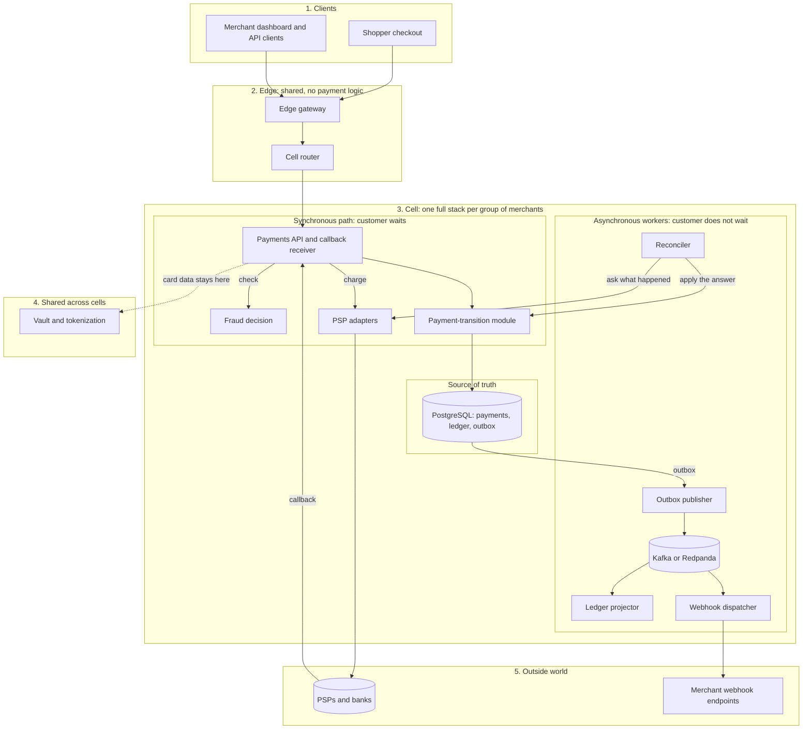

# Architecture

How Open Payments is built to process 5,000 completed payments/s without double-charging anyone or losing a record of money.

Status: Draft · Last updated: 2026-11-05

Stack: C# / .NET 10, ASP.NET Core, PostgreSQL, Kafka-compatible broker, Kubernetes. Nothing here is built or measured yet. Reasoning behind major choices is in [Decisions](decisions.md).

## Goals and SLOs

| Area | Target |
|---|---|
| Throughput | 5,000 completed payments/s sustained |
| Overload | 15,000 req/s for 10 minutes is an overload survival test: excess is shed, 5,000 completed payments/s holds, nothing crashes ([D4](decisions.md#d4)) |
| Latency | Platform overhead p99 ≤ 100 ms and p50 ≤ 25 ms, excluding PSP time |
| Correctness | 0 duplicate charges, 0 lost financial records, ledger always balanced |
| Availability | 99.95% for the Payments API |
| Durability | RPO 0 for committed payments; RTO ≤ 60 s for database failover |
| Recovery | Automatic for loss of one node or one availability zone |

**What is counted.** Three rates are measured separately: *admitted* req/s (passed admission control), *rejected* req/s (shed with 429 or 503), and *completed payments/s* (payments whose create request got a final committed answer: authorized, or captured under auto-capture, or declined. A payment in `UNKNOWN` is not counted until resolved).

**Two latency measures.** *Platform overhead* excludes PSP wait time and carries the target above. *End to end* is recorded against the mock PSP at a fixed latency, and becomes a gate only once a target is chosen against the real PSP.

**Derived load (to validate in L1):**

- Each payment causes roughly 8-10 database writes: payment, attempt, idempotency record, outbox event, 2-4 ledger entries. That is about 40-50k writes/s across the fleet, or 10-12k per cell with 4 active cells.
- PSP latency of 200 ms to 2 s means about 5,000 requests in flight at a 1 s average (Little's Law).

## Principles

1. **The database is the source of truth.** Nothing is confirmed to the payer before the commit.
2. **Intent before action.** The attempt is written to the database before the PSP is called.
3. **Every operation is idempotent end to end,** from client request to PSP call to event consumer. Database constraints enforce it. Redis may speed up checks but is never the only protection against duplicate charges.
4. **Unknown is a first-class state.** A PSP timeout is not a failure.
5. **Never hold a database transaction across a network call.**
6. **Bound everything:** concurrency, queues, retries, timeouts, payload sizes.
7. **The ledger is append-only and written in the same transaction as the state change.**
8. **Anything not needed to answer the payer runs asynchronously** from the outbox.
9. **Isolate failures:** cells, bulkheads, one circuit breaker per PSP.
10. **Prove with tests, not opinion.** See [Verification](verification.md).

## Components and boundaries

A payment takes a **short synchronous path**, the only part the customer waits for. Everything else runs **asynchronously** from the outbox, so a slow or broken helper cannot slow or corrupt a payment.



The [service catalog](service-catalog.md) lists each component's job, kind, deployment boundary, ownership and failure effect, plus [who calls whom](service-catalog.md#dependencies). The vault, cell router, edge gateway and six cell workers and services are the nine deployables; the payment-transition module and PSP adapters are libraries.

Not on the diagram: observability, the Kubernetes platform, Redis, and the mock PSP with its load harness, which is built first. Settlement and payouts are not designed.

**Boundary rules:**

1. **There is one write path.** The payment-transition module is the only code that writes money state ([D2](decisions.md#d2)).
2. **One short transaction.** State change, ledger entries and outbox event commit together, with no PSP, HTTP or broker call inside.
3. **Async never blocks sync.** Workers read committed data and can lag or fail without touching a payment. The reconciler and timer jobs are the exceptions that write, and only through the module. Timer jobs run in the reconciler process.
4. **Card data stays in the vault.** Everything else sees a token.

**Why not more microservices?** Splitting payment and ledger would turn one database transaction into a network call and a saga, adding failure cases and latency on the hot path. The parts that benefit from independence are already separate, and [When to split a service](service-catalog.md#when-to-split-a-service) sets the rule for any more.

## Cells and routing

- A **cell** is a complete stack (API pods, fraud, PSP adapters, database, broker, workers) serving a subset of merchants. If cells are needed, plan for about 1.5-2k completed payments/s per cell: 4 active plus 1 spare.
- **Build one cell first** ([D14](decisions.md#d14)). Split only if gate [G1](scaling-playbook.md#decision-gates) requires it.
- Tenant-owned tables carry `merchant_id` from day one, so moving a merchant between cells is a routing change, not a schema change.
- The vault is the one shared payment-path dependency, kept shared to limit PCI scope. Its availability is a stated cross-cell risk ([D10](decisions.md#d10)).
- The control plane (routing table, merchant config) is cached in each cell and can be stale without stopping payments.
- Each cell spans 3 availability zones. Active-active across regions is out of scope.
- A very large merchant can have its own cell, which bounds its blast radius and hot-account effects.

## Payment flow

**Create a payment:**

1. **Admit.** Authenticate, rate-limit, take a concurrency permit. If none is available, reject at once with 429 or 503 and `Retry-After`.
2. **Fraud check** within a 50 ms budget. On timeout, apply the fallback for the payment's risk tier.
3. **Transaction A** (short, no network calls). Insert the idempotency record, the payment (`CREATED` to `PSP_PENDING`) and an attempt with its own `attempt_id`. Commit.
   - A unique violation on `(merchant_id, idempotency_key)` means a duplicate. If the stored request hash matches, return the stored result. If not, return 422. If the first request is still in flight, return 409 with `Retry-After`.
4. **Call the PSP** using `attempt_id` as the PSP idempotency key, with a hard deadline, circuit breaker and rate limiter.
5. **Transaction B** (short). Conditionally move the payment to its new state, insert the ledger entries and insert the outbox event. Commit.
6. **Respond.** On a PSP timeout the state is `UNKNOWN` and the API answers `202 Accepted` with the payment ID. The merchant gets the result by webhook or polling.

**Capture.** Insert a capture attempt with its own key. The unique index `payment_attempts_one_live_capture` allows one live or successful capture per payment, so a second request with a different idempotency key never reaches the PSP and gets the current status, or 409 with `Retry-After` while the first is running. Call the PSP, and move the payment to `CAPTURED` only after it confirms. A declined attempt is marked `FAILED`, which allows a new capture. On a timeout, the API answers `202 Accepted`, the payment stays `AUTHORIZED`, the attempt is marked `UNKNOWN`, and the reconciler resolves it ([D6](decisions.md#d6)).

**Refund.** Reserve, call the PSP, then confirm or release. On a timeout, the API answers `202 Accepted` with the refund ID and status. Merchants get final capture and refund results by [webhook](payment-lifecycle.md#merchant-events) or polling. The SQL is in [Refund rules](payment-lifecycle.md#refund-rules).

## Crash recovery

| Crash point | What the database holds | Recovery |
|---|---|---|
| Before transaction A commits | nothing | Client retries with the same key |
| After A, before the PSP call | payment in `PSP_PENDING`, attempt `PENDING` | Reconciler inquires by `attempt_id`. The PSP reports "unknown attempt", so the payment is declined or retried safely |
| After the PSP call, before B | payment in `PSP_PENDING`, attempt `PENDING` | Reconciler inquires by `attempt_id` and applies the PSP's real answer |
| After B commits, before the response | final state and outbox event | Client retries; the idempotency record returns the stored result |

## Data model

Amounts are `bigint` minor units with a `currency` column. A currency table holds the exponent (2 for USD, 0 for JPY) and rounding rule. Floating point is never used for money. In code, `readonly record struct Money(long Minor, CurrencyCode Currency)` prevents mixing currencies.

`merchant_id` is on every tenant-owned table. Provider-scoped `psp_events` is excluded ([D8](decisions.md#d8)).

```sql
create table payments (
  id                   uuid primary key,
  merchant_id          uuid not null,
  state                text not null,
  amount_minor         bigint not null check (amount_minor > 0),
  currency             char(3) not null,
  captured_minor       bigint not null default 0,
  refunded_minor       bigint not null default 0,
  refund_pending_minor bigint not null default 0,
  version              int not null default 0,
  created_at           timestamptz not null default now(),
  updated_at           timestamptz not null default now(),
  check (refunded_minor + refund_pending_minor <= captured_minor)
);
create index payments_merchant_created on payments (merchant_id, created_at desc);
create index payments_unresolved on payments (updated_at)
  where state in ('PSP_PENDING','UNKNOWN');

-- one row per authorize or capture, each with its own key (D5); void is Proposed
-- refunds have their own row and key in the refunds table
create table payment_attempts (
  attempt_id    uuid primary key,
  payment_id    uuid not null references payments(id),
  merchant_id   uuid not null,
  operation     text not null check (operation in ('authorize','capture')),
  psp           text not null,
  state         text not null,
  psp_reference text,
  created_at    timestamptz not null default now()
);
create index payment_attempts_unresolved on payment_attempts (created_at)
  where state in ('PENDING','UNKNOWN');
-- one live or successful capture per payment
create unique index payment_attempts_one_live_capture on payment_attempts (payment_id)
  where operation = 'capture' and state in ('PENDING','UNKNOWN','SUCCEEDED');

-- hash-partitioned by merchant_id so the unique key includes the partition key
create table idempotency_keys (
  merchant_id    uuid not null,
  key            text not null,
  request_hash   bytea not null,
  payment_id     uuid,
  response_code  int,
  response_body  jsonb,
  created_at     timestamptz not null default now(),
  primary key (merchant_id, key)
) partition by hash (merchant_id);

-- time-partitioned; whole partitions are dropped once published and old
create table outbox (
  id             uuid not null,
  merchant_id    uuid not null,
  aggregate_id   uuid not null,
  event_type     text not null,
  sequence       bigint not null,
  schema_version int not null,
  payload        jsonb not null,
  created_at     timestamptz not null default now(),
  published_at   timestamptz,
  primary key (created_at, id)
) partition by range (created_at);

create table psp_events (
  psp          text not null,
  psp_event_id text not null,
  payload      jsonb not null,
  received_at  timestamptz not null default now(),
  primary key (psp, psp_event_id)
);

create table refunds (
  id              uuid primary key,
  payment_id      uuid not null references payments(id),
  merchant_id     uuid not null,
  idempotency_key text not null,
  amount_minor    bigint not null check (amount_minor > 0),
  state           text not null,
  created_at      timestamptz not null default now(),
  unique (merchant_id, idempotency_key)
);
create index refunds_unresolved on refunds (created_at)
  where state in ('PENDING','UNKNOWN');
```

`Open`: `accounts`, inbox, currency, balance snapshot, delivery log and discrepancy tables are named in this doc but not yet specified.

## Ledger

- **Append-only.** Corrections are new reversing entries. The application role has `INSERT` and `SELECT` only on ledger tables.
- **Same transaction as the state change,** so "payment succeeded but ledger failed" cannot happen by construction.
- **No balance column is updated on the payment path.** Inserting rows takes no lock on a shared account row, which removes the hot-row problem.
- **Balances are derived:** a snapshot plus entries since the snapshot, built by the ledger projector.
- **Hot accounts** (such as the platform fee account) are split into 64 sub-accounts chosen by `hash(payment_id) % 64` and summed on read.

```sql
create table ledger_transactions (
  id              uuid primary key,
  merchant_id     uuid not null,
  payment_id      uuid,
  kind            text not null,        -- authorization, capture, refund, fee, ...
  source_event_id uuid not null unique, -- one ledger transaction per business event
  created_at      timestamptz not null default now()
);

-- hash-partitioned by txn_id so the unique key includes the partition key
create table ledger_entries (
  txn_id       uuid not null,
  entry_no     smallint not null,
  merchant_id  uuid not null,
  account_id   uuid not null,
  direction    char(1) not null check (direction in ('D','C')),
  amount_minor bigint not null check (amount_minor > 0),
  currency     char(3) not null,
  created_at   timestamptz not null default now(),
  primary key (txn_id, entry_no)
) partition by hash (txn_id);
```

**Balance invariant.** The application inserts all entries of a transaction in one statement, and a deferred constraint trigger checks that debits equal credits per `txn_id`. Its cost is measured in L1. If too high, a continuous audit query that pages on any imbalance replaces it, and property tests (U3) remain the main guard.

**Negative balance.** Refund and payout checks take a per-account advisory transaction lock, read the available balance from the latest snapshot plus recent entries, and insert a reservation entry in the same transaction ([D9](decisions.md#d9)). The create-payment path never takes this lock. Payout reservation rules belong to the payout design, which is `Open`.

## PSP integration

```csharp
public interface IPspAdapter
{
    Task<PspResult> AuthorizeAsync(AttemptId attempt, Money amount, CardToken token, CancellationToken ct);
    Task<PspResult> CaptureAsync(AttemptId attempt, Money amount, CancellationToken ct);
    Task<PspResult> RefundAsync(RefundId refund, Money amount, CancellationToken ct);
    Task<PspInquiry> InquireAsync(AttemptId attempt, CancellationToken ct); // status by our idempotency key
    Task<PspInquiry> InquireRefundAsync(RefundId refund, CancellationToken ct);
}
```

- **Idempotency:** each `attempt_id` and `refund_id` is the PSP idempotency key for one operation, reused for any retry of that operation. Authorize and capture have different keys ([D5](decisions.md#d5)).
- **Deadline:** each call has an explicit deadline from the request budget (initially 2.5 s, configurable per PSP).
- **Resilience:** timeout, then circuit breaker (opens on a high failure ratio over a sampling window, then half-open probes), then a client-side token-bucket limiter sized to the PSP contract. The breaker is per PSP, never global.
- **Retries:** automatic only before the request was sent (connection failures) or with the same idempotency key. Never a blind retry of a charge.
- **Failover:** when a PSP breaker is open, new payments route to a secondary PSP if the merchant allows it. In-flight attempts stay with the failed PSP and are resolved by inquiry.
- **Provider changes:** adapters are versioned and covered by recorded-fixture contract tests (U5).
- **Callbacks:** the callback receiver in the Payments API verifies the signature, inserts into `psp_events` (`ON CONFLICT DO NOTHING`) and applies the event through the payment-transition module. Duplicate callbacks are no-ops.
- **Reconciler:**
  - Every few seconds it selects payments, attempts and refunds that are unresolved past a threshold, calls `InquireAsync` or `InquireRefundAsync`, and applies the answer.
  - Daily, it compares the PSP settlement file with ledger totals and writes any discrepancy to a table that pages on non-zero.

## Events and webhooks

- **Transactional outbox.** The event row is inserted in the same transaction as the state change. The publisher reads unpublished rows in batches with `FOR UPDATE SKIP LOCKED`, publishes with `Acks.All` and idempotence enabled, compresses batches, then marks rows published. If the broker is down, events wait in the outbox.
- **Topics:** keyed by `payment_id`, so one payment's events stay ordered. Each event has `event_id`, a per-payment `sequence` and a schema version, and carries IDs and state rather than large blobs (about 32 KB at most). A partition plan per cell is reviewed in O3.
- **Broker:** replication factor 3, `min.insync.replicas=2`.
- **Consumers:**
  - Commit offsets only after the work is durably done.
  - Dedupe with an inbox table (`consumer`, `event_id` unique).
  - Reject events with a lower sequence than already applied.
  - Retry with backoff, then move to a dead-letter queue with an alert after N failures.
  - Use bounded prefetch, cooperative-sticky assignment and static membership.
- **Schemas:** a schema registry enforces backward compatibility. Consumer contract tests run in CI.
- **Merchant webhooks:** signed (HMAC with timestamp), retried with exponential backoff and jitter, isolated per endpoint, with a replay API. Event names are in [Merchant events](payment-lifecycle.md#merchant-events).
- **Limit:** producer idempotence only stops duplicates from producer retries. End-to-end safety comes from idempotent consumers and conditional state transitions.

## Scope and status

| Area | Feature | Status |
|---|---|---|
| Payments | Create with an idempotency key; authorize then full capture; status query | `Committed` |
| Payments | Partial capture, void, authorization expiry | `Proposed` |
| Refunds | Full and partial refunds, refund idempotency, total never above captured | `Committed` |
| Money correctness | Append-only double-entry ledger, derived balances, reconciliation, continuous audit | `Committed` |
| Reliability | Safe retries, bounded queues, deadlines, deadlock prevention and retry, provider failover | `Committed` |
| Reliability | Deadlock automation layers | `Proposed` |
| Reliability | Multiple cells | `Open` until G1 |
| Events | Transactional outbox; signed merchant webhooks with dead-letter queue | `Committed` |
| Security and risk | Vault, tenant isolation, secrets rotation, fast fraud rules with fallback | `Committed` |
| Operations | Metrics, logs, traces, alerts; runbooks and drills for 42 failure scenarios | `Committed` (none rehearsed) |
| Merchant experience | Dashboard and checkout screens | `Proposed`: prototype outside this repo |
| Future | Settlement, payouts, disputes | `Proposed` in the [lifecycle](payment-lifecycle.md#proposed-rules); not designed |
| Future | Marketplace features, billing, advanced fraud, formal PCI assessment | `Open` |
