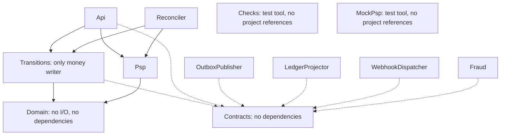

# Codebase Structure

How the repository is organized, which project may depend on which, and where new code goes. What each service does is in the [service catalog](../service-catalog.md), and why is in [Architecture](../architecture.md).

Status: Stage 1 layout `Committed` by the [plan](../superpowers/plans/2026-11-05-open-payments-implementation-and-benchmark.md) · Later stages `Proposed`, adopted at each stage's [design gate](../delivery-workflow.md#design-gate) · Last updated: 2026-11-09

**Summary:** one repository and one solution, with one project per deployable and a few libraries around one write path. The project graph itself should block the expensive mistakes: `Domain` can't do I/O, and `Transitions` can't reach a PSP.

## Top level

```
api/openapi.yaml       Draft API contract, frozen only after C39
benchmarks/            k6 mix, profiles, run.sh, report, recorded results
db/migrations/         The only source of schema, applied by scripts/migrate.sh
db/spike/              Spike schemas and workloads, kept to reproduce recorded results
deploy/compose/        Docker stack: replicated Postgres, PgBouncer, metrics
deploy/native/         Native macOS stack settings, used for durable results
docs/                  Design, plans, gates and benchmark write-ups
scripts/               Bootstrap, migrations, stack control, settings checks
src/                   Everything that ships to production
tools/                 Test tools that judge the system and never ship
tests/                 One test project per kind of proof
```

`scripts/check-migration.sh` runs `db/spike/verify.sql`, so `db/spike/` can't be deleted without changing that check.

## Projects

### Stage 1

| Project | Kind | Job | References |
|---|---|---|---|
| `src/OpenPayments.Domain` | Library | Money, IDs, states, commands, postings and `Decide`. No I/O | Nothing |
| `src/OpenPayments.Transitions` | Library | `TxRunner`, `PaymentStore` and SQL. The only money writer ([D2](../decisions.md#d2)) | `Domain`, Npgsql |
| `src/OpenPayments.Psp` | Library | `IPspAdapter` and `MockPspAdapter` | `Domain` |
| `src/OpenPayments.Api` | Deployable | Routes, `PaymentFlow`, auth, limits, metrics | `Domain`, `Psp`, `Transitions` |
| `src/OpenPayments.Reconciler` | Deployable | Recovery by lease, timers, parked-event and expiry workers ([D62](../decisions.md#d62)) | `Domain`, `Transitions`, `Psp` |
| `src/OpenPayments.Console` | Deployable | Staff console: Razor Pages and htmx, OIDC sign-in, money actions through the API ([console spec](../superpowers/specs/2026-11-05-console-design.md)) | Npgsql only, with the read-only `op_console_read` and `op_console` roles |
| `tools/OpenPayments.MockPsp` | Test tool | Test PSP with an effect log | Nothing |
| `tools/OpenPayments.Checks` | Test tool | CK1-CK10 as raw SQL. Independent of `src/` | Npgsql |

All of these are built, as of Stage 1. The API's routes are in `Program.cs` and `PaymentFlow.cs`, not the planned `Endpoints/` folder; this is a recorded deviation in [Stage 1 progress](../gates/stage-1-progress.md).

### Later stages (`Proposed`)

Each of the [eight deployables](../service-catalog.md#open-payments-today) gets its own project, so it can scale, fail and ship alone. Names aren't final until that stage's plan adopts them.

| Project | Kind | Stage | Job |
|---|---|---|---|
| `src/OpenPayments.Hosting` | Library | 2 | Startup, health, logs and metrics shared by deployables |
| `src/OpenPayments.Reconciler` | Deployable | 2 | Recovery, timer jobs, settlement ingestion |
| `src/OpenPayments.Contracts` | Library | 3 | Event payloads and service-to-service wire types. No dependencies |
| `src/OpenPayments.Messaging` | Library | 3 | Broker client and inbox dedupe |
| `src/OpenPayments.OutboxPublisher` | Deployable | 3 | Moves committed events to the broker |
| `src/OpenPayments.LedgerProjector` | Deployable | 3 | Builds balances from entries |
| `src/OpenPayments.WebhookDispatcher` | Deployable | 3 | Delivers signed events to merchants |
| `src/OpenPayments.Fraud` | Deployable | 4 | Rules and velocity counters behind `IFraudCheck` |
| `src/OpenPayments.CellRouter` | Deployable | 4 | Maps a merchant and key mode to a cell |
| Edge gateway | Deployable | 4 | [Built on an existing gateway](../service-catalog.md#platform), so possibly only configuration under `deploy/` |

**Create a shared library only when its second user arrives.** `CanonicalLog.cs`, `Metrics.cs` and `Json.cs` stay in `Api` as Task 14 plans, and move to `Hosting` when the reconciler needs them.

## Dependency rules



Solid lines are the core and dashed lines are `Proposed`. `Hosting` and `Messaging` are left out for clarity, and neither may reference `Domain` or `Transitions`.

| Rule | Why it matters |
|---|---|
| `Domain` references nothing | Keeps `Decide` pure, so it can be tested exhaustively |
| `Transitions` doesn't reference `Psp`, and `Psp` doesn't reference `Transitions` | A PSP call inside a transaction becomes hard to write. `Api` and `Reconciler` sequence the two |
| `Psp` doesn't use Npgsql | An adapter can't write money state |
| Only `Api` and `Reconciler` reference `Transitions` | These are the two hosts [allowed to write money state](../architecture.md#components-and-boundaries). The console moves money only through the API |
| `OutboxPublisher`, `LedgerProjector`, `WebhookDispatcher` and `Fraud` reference neither `Domain` nor `Transitions` | They can lag or fail without affecting payment rules, and can't start making payment decisions |
| Deployables never reference each other | They talk over HTTP or the broker, through `Contracts` |
| `Domain` doesn't reference `Contracts` | `Transitions` maps `Decide`'s output to the published payload, so a published field can't shape the state machine |
| `Checks` and `MockPsp` reference nothing in `src/` | A check that shares the system's code shares its bugs |
| `src/` never references `tools/` | Test tools can't reach a production build |

## Inside a project

- **Group by feature, not by layer.** Use `Endpoints/Refunds.cs` rather than `Controllers/`, `Services/` and `Repositories/`. Start flat, and add a folder when several files share a feature.
- **Keep the logic in `Decide`.** The shell loads, calls `Decide` and writes. If adding a transition changes the shell, a business rule has probably leaked.
- **Keep SQL in `Transitions/Sql.cs`, parameterized through Npgsql commands.** Stage 1 uses no Dapper; the plan named it, and the hand-written commands met S3 without it. Money SQL in one place is easy to review against the [lock order](../implementation-guide.md#lock-order).
- **Match the namespace to the project,** such as `OpenPayments.Transitions`.
- **Keep one adapter per folder in `Psp`,** such as `Adapters/<Psp>/`. Split out a project only if an adapter brings a dependency the others shouldn't load.

## Data ownership

All cell tables live in one database and one migration history. No project keeps its own schema, because the money tables must commit together.

| Tables | Writer | Status |
|---|---|---|
| `payments`, `payment_attempts`, `refunds`, `ledger_*`, `idempotency_keys`, outbox inserts | `Transitions`, hosted by `Api` or `Reconciler` | `Committed` |
| `outbox.published_at` | `OutboxPublisher` | `Proposed` |
| `psp_events` | The callback receiver in `Api` | `Proposed`; Stage 2 settles it |
| `settlement_lines` | `Reconciler`; any money it posts goes through `Transitions` | `Proposed`; Stage 2 settles it |
| Balance snapshots, delivery log, discrepancy records | Their [owning worker](../service-catalog.md#open-payments-today), in tables added by later migrations | `Proposed` |
| `accounts`, `currencies`, `api_keys`, `psp_accounts` | Read-only for `op_app`; seeded directly in Stage 1 | `Committed` |

Any project may read what its job needs. A migration is never edited once applied, and `scripts/migrate.sh` refuses to run if one changes.

## Tests

| Project | Proves | Uses |
|---|---|---|
| `tests/OpenPayments.Domain.Tests` | Money, transitions, invariants, golden cases | Nothing external |
| `tests/OpenPayments.Analyzers.Tests` | The banned-API list actually fails a build | Roslyn |
| `tests/OpenPayments.Checks.Tests` | Each check fails on injected corruption | Real Postgres, raw SQL |
| `tests/OpenPayments.MockPsp.Tests` | The mock's outcomes and effect log | The mock |
| `tests/OpenPayments.Integration.Tests` | `TxRunner`, `PaymentStore`, query plans (Task 13 on) | Real Postgres |
| `tests/OpenPayments.Acceptance.Tests` | Behavior through the real API (Task 14 on) | API, Postgres, mock PSP |
| `tests/OpenPayments.Console.Tests` | Console authorization, roles, money actions, audit | Real Postgres, test sign-in |
| `tests/OpenPayments.Console.Browser.Tests` | Console screens with Playwright and axe, at 1280 px and 390 px, both themes | Browser, console |

Test names carry the doc's ID where one exists, such as `C5_...`, so proof is searchable. A later deployable gets its own `tests/OpenPayments.<Project>.Tests`.

## How the rules are enforced

A rule without a check tends to wear away, so each one below names its check.

| Rule | Check | State |
|---|---|---|
| Warnings fail the build; CA2000 and CA2016 are errors | `Directory.Build.props`, CI | Exists |
| One version per package | `Directory.Packages.props` | Exists |
| Package licenses and known vulnerabilities | CI scans over `OpenPayments.slnx` | Exists |
| No blocking calls on the request path | `BannedSymbols.txt` | Exists in every `src/` project |
| `Domain` references no I/O | `Decide_project_references_no_io` | Exists |
| The other dependency rules above | None yet | **Gap** |
| `Checks` references nothing in `src/` | None yet; true today only by inspection | **Gap** |
| Only `Transitions` writes money tables | None yet | **Gap** |
| CI builds every project | None yet; a project missing from `OpenPayments.slnx` is silently skipped | **Gap** |

**Proposed fix:** add one fast test project, `tests/OpenPayments.Architecture.Tests`, that needs no database and:

1. Reads each `.csproj` and fails on any reference outside the rules above.
2. Fails if any `.csproj` under `src/`, `tools/` or `tests/` is missing from `OpenPayments.slnx`.
3. Fails if a `src/` project other than `Transitions` contains an `insert`, `update` or `delete` on a money table. This is a text search, so it's a guard against mistakes and can't prove the rule.

It's a change to the plan, so it needs the owner's approval first. Not yet approved.

## Where things go

| To add | Put it in | Also update |
|---|---|---|
| A state transition | `Decide` in `Domain` | [Transitions table](../payment-lifecycle.md#transitions) first, then state tests ([steps](../implementation-guide.md#adding-a-state-transition)) |
| A money write | `PaymentStore` and `Sql.cs` in `Transitions` | Integration test |
| An API route | `Api/Program.cs` and `PaymentFlow.cs` today; move to `Api/Endpoints/` when they grow | `api/openapi.yaml`, acceptance test |
| A PSP | `Psp/Adapters/<Psp>/`, behind `IPspAdapter` | Its declared recovery mode |
| A published event | `Contracts`, mapped in `Transitions` | [Event catalog](../event-catalog.md), with a new `schema_version` for any incompatible change |
| A schema change | A new file in `db/migrations/` | `scripts/check-migration.sh` |
| A correctness check | `tools/OpenPayments.Checks/sql/` | A corruption test that makes it fail |
| A metric | The owning project | [Metrics](../metrics.md) |
| A deployable | `src/OpenPayments.<Name>` | First pass the [split rule](../service-catalog.md#when-to-split-a-service), then update `OpenPayments.slnx` and the service catalog |
| A package | `Directory.Packages.props` | Check its license and .NET 10 support first (S6) |

## Alternatives considered

| Option | Why not |
|---|---|
| Clean Architecture layers in every project | Adds indirection to a hot path, and `Decide` plus a thin shell already separates rules from I/O |
| One worker binary with a mode flag | Simpler at first, but the workers scale and fail differently, and a shared process couples their failures |
| One repository per service | Versioning across repositories adds cost while one team changes everything together |
| A shared library holding all common code | Tends to become a dependency of everything, which would defeat the rules above |

## Open questions

| Question | Decide at |
|---|---|
| `MockPspAdapter` sits in `src/` per Task 14, so it could reach a production image. Move it out, or block it from live mode? A mock that approves payments must not be reachable in production | Stage 2 design gate |
| Should each deployable get its own database role? Today everything shares `op_app`. Separate roles would enforce write ownership in the database as well as in tests | Stage 2 or 3 design gate |
| Layout under `deploy/` for images and Kubernetes | Stage 4 design gate |
| Whether the edge gateway needs any C# | Stage 4 design gate |
