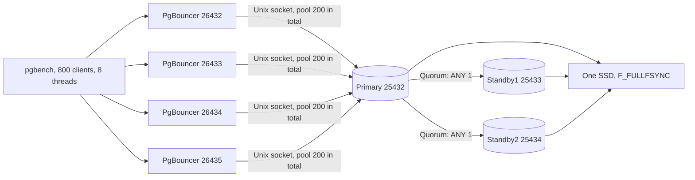

# Local Deployment

How Open Payments runs on the owner's MacBook, and why. The commands are in the [benchmark guide](../benchmarks/benchmark-guide.md), and the evidence is in the [MacBook summary](../benchmarks/spike/macbook-2026-11-05/summary.md). Production is in [Production deployment](prd-deployment.md).

Status: Database tier measured on both stacks · Platform runs on the Docker stack only · Last updated: 2026-11-09

## Hardware

| Resource | Capacity | What limits its use |
|---|---|---|
| CPU | Apple M5 Pro, 18 cores (6 + 12) | Not the limit: about 5 cores in use at saturation with schema C |
| Memory | 48 GB | Not the limit: at least 57% free in every run on the native stack |
| Disk | One internal SSD, 413 GB free | **The limit.** A real flush takes 3.26 ms and flushes the whole drive |
| Network | Loopback only | No real network delay, so production's zone-to-zone delay isn't represented |

## Two stacks

| | Native (use for results) | Docker Compose (use for development) |
|---|---|---|
| Start | `scripts/native-stack.sh up` | `docker compose ... --profile spike up` |
| Flush reaches stable storage | **Yes**, `fsync_writethrough` | **No**, the VM reports 60 µs against 3,263 µs for a real flush |
| Power-loss safe | Yes, for the primary's copy | No |
| Scripts/s at saturation | 2,300-2,800 (schema C, pool 200) | 4,880 (schema A, pool 100) |
| Same as production's OS | No, macOS | Closer, Linux in a VM |

**Native is the deployment for durable database results.** Docker is faster only because its flush doesn't reach stable storage, so its numbers can't count as durable. They're useful only as a view of how the software behaves when flushes are fast.

**The platform (API, mock PSP, console) runs only on the Docker stack** (`deploy/compose/compose.yaml` and `console.yaml`). So every platform ramp step in [BASELINE](../../benchmarks/BASELINE.md) is a fast-flush preview, and its latency is lower than a durable stack would give. Running the API against the native stack is not set up yet.

## Topology

All ports bind to `127.0.0.1`. Passwords are local-only development values. Data lives in `~/.local/share/open-payments-native`.

The topology above is the database tier. The Docker stack adds the API on `:8080`, the mock PSP on `:18080`, and, through `console.yaml`, the console and a pinned Keycloak.

## Resource allocation

macOS can't reserve cores for a process, so CPU isn't pinned. Each value below has a reason, and the measured ones are marked.

| Setting | Value | Why |
|---|---|---|
| Primary `shared_buffers` | 10 GB | About 20% of memory, leaving the rest to the OS cache |
| Standby `shared_buffers` | 6 GB each | They replay WAL and serve no load |
| Total Postgres buffers | 22 GB of 48 GB | Leaves room for the OS cache, the app tier and macOS |
| PgBouncer processes | 4 | **Measured:** one process reached 0.99 core and capped throughput; four removed that limit |
| Total pool | 200 | **Measured:** schema C's clean result used it. Pool 100 had a far lower ceiling on schema A. Pool 400 was no better at clean rates on schema A, and wasn't measured on schema C |
| `max_connections` | 1,100 | Fits the direct-connection test runs. Normal runs use only the pool |
| Clients and generator threads | 800 and 8 | **Measured:** the generator stayed under 30% CPU, far from its 80% limit |
| `wal_buffers` | 256 MB | Early runs filled the default buffers constantly. Benefit not measured alone |
| `max_wal_size`, `checkpoint_timeout` | 64 GB, 30 min | Fewer checkpoints and full-page images. Benefit not measured alone |
| Autovacuum | 6 workers, 15 s nap, cost limit 4,000 | Keeps up with constant updates. Not measured alone |

**The memory and WAL settings gave no measurable throughput gain on their own.** The larger VM and tuned settings left host-side throughput unchanged (2,018/s against 2,027-2,078/s), since other limits were reached first. They're reasoned sizing, not proven improvements.

## Expected end-to-end throughput

The durable estimate, about 650-750 payments/s with the SSD's flush as the limit, is calculated in the [summary](../benchmarks/spike/macbook-2026-11-05/summary.md#realistic-end-to-end-performance-expectations) and isn't repeated here. The measured platform previews are in [BASELINE](../../benchmarks/BASELINE.md); they ran on the Docker stack, so they don't test that estimate.

## What stays fixed

These protect financial correctness, and no benchmark result may change them:

| Guarantee | Setting |
|---|---|
| A commit reaches a standby | `synchronous_commit = on`, `ANY 1 (standby1, standby2)` |
| A commit reaches stable storage | `fsync = on`, `full_page_writes = on`, `wal_sync_method = fsync_writethrough` |
| Waits fail fast | Role `lock_timeout` 200 ms, `statement_timeout` 1 s, `idle_in_transaction_session_timeout` 2 s |
| Deadlocks are found before lock timeouts | `deadlock_timeout` 100 ms |
| Money rules hold | `db/spike/verify.sql` runs after every rate |

`scripts/native-stack.sh status` fails if the flush method, quorum setting or streaming state is wrong.

## Limits of this deployment

- **One SSD holds all three copies.** Losing the drive loses everything, so this tests the commit path and doesn't provide real redundancy.
- **The standby's copy can't protect against a machine failure,** because there's only one machine.
- **macOS isn't the production OS.** Scheduling, I/O and process costs differ from Linux.
- **Docker's limits were raised** to 18 CPUs and 40 GB in Docker Desktop's settings, from 14 and 20. Lower them when not running Docker benchmarks.

## Files

| Path | Purpose |
|---|---|
| `scripts/native-stack.sh` | Start, stop, check and reset the native stack; `CELL=2` runs a second cell |
| `deploy/native/native.conf` | The real-flush settings |
| `deploy/native/pgbouncer.ini.template` | Native PgBouncer settings |
| `deploy/compose/postgres/primary.conf` | Settings the design requires, shared by both stacks |
| `deploy/compose/postgres/primary.macbook.conf` | Sizes for this machine, shared by both stacks |
| `deploy/compose/compose.yaml` | The Docker stack, with extra poolers and a generator under `--profile spike` |
