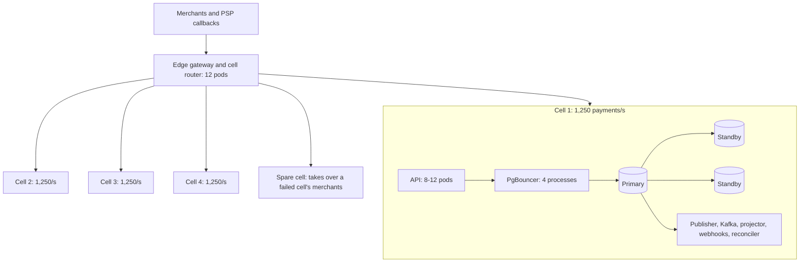

# Production Deployment

The expected Kubernetes deployment for 5,000 completed payments/s, and the estimate behind it. The measurements come from the [MacBook summary](../benchmarks/spike/macbook-2026-11-05/summary.md).

Status: Planning estimate · **Not deployed, and not proven** · Last updated: 2026-11-06

**Labels:** **M** measured on the MacBook · **X** extrapolated from a measurement · **A** assumption · **D** design requirement.

**Update for [D47](../decisions.md#d47):** the tables and totals below use 3.5 commits per payment, which assumes no separate capture requests. At the approved mix it is 4.2: 21,000 commits/s, or 23,100-26,250 with the 10-25% allowance. That needs 5 active cells plus the spare, at 1,000 payments/s and 4,200 commits/s (4,620-5,250 with the allowance) per cell. Refunds become 1,000/s and callbacks 7,000/s. The vCPU total and the rest of the sizing have not been recomputed, so expect them to rise.

## Estimate at 5,000 payments/s

**Throughput is plausible with 4 active cells plus 1 spare, at about 1,000 vCPUs. Latency is the bigger risk: the estimate sits right at the SLO, and may miss it.**

| Measure | Target | Estimate | Reading |
|---|---|---|---|
| Throughput | 5,000 payments/s | 4 cells × 1,250 | Plausible |
| Throughput ceiling | | 6,000-8,000 payments/s | The design's 1,500-2,000 per cell (A) |
| Errors | Below 0.1% | Not estimable | Needs a real run |
| Platform overhead p50 | ≤ 25 ms | **About 23-35 ms** | **At risk** |
| Platform overhead p99 | ≤ 100 ms | **About 104-154 ms** | **At risk** |
| Total with a 200 ms PSP | No target set | About 225-235 ms p50 | Calculated |
| Total with a 1 s PSP | No target set | About 1.02-1.04 s p50 | Calculated |

### Load

| Per second | Whole system | Per cell | Type |
|---|---|---|---|
| Payments | 5,000 | 1,250 | D |
| Refunds, at the example mix | 833 | 208 | D |
| PSP callbacks | 5,833 | 1,458 | D |
| API requests, before reads | 11,666 | 2,916 | X |
| Commits | 17,499 | 4,375 | D |
| Commits, plus 10-25% for writes the spike leaves out | 19,250-21,900 | 4,800-5,470 | A |

### Throughput

| Step | Value | Type |
|---|---|---|
| Commits/s on one laptop VM with fast flushes, reached twice | About 9,750 | M, not durable there |
| One cell's load as a share of that | 45-56% | X |
| Rate at that limit, per cell (9,750 ÷ 3.5, and again with 25% more writes) | 2,230-2,785 payments/s | X |
| Primary CPU per cell: 4,375 commits × 0.86 M5 cores per 1,000 | 3.8 M5 cores | M and X |
| The same in cloud vCPUs at the 60% limit | 10-19 vCPUs, within 32 planned | A: 1 M5 core is 1.5-3 vCPUs |
| Busy Postgres connections: 4,375 × 12 ms | About 53, in a pool of 100-200 | X and A |

**The key assumption:** production disks flush durably about as fast as the VM reported (60 µs), while a real flush on the MacBook's SSD took 3,260 µs. Fast-flush results apply only if this holds, so it's the first thing to validate.

### Latency

The estimate adds parts measured in different conditions, so treat it as a rough guide.

| Part | p50 | p99 | Type |
|---|---|---|---|
| Database work for a payment, fast flushes, 1,000 scripts/s | 11 ms | 50 ms | M, at under half of one cell's load |
| Zone delay, 1-2 ms on each of 2 commits | 2-4 ms | 4 ms | A |
| API, fraud and adapter | 10-20 ms | 50-100 ms | A |
| **Platform overhead** | **23-35 ms** | **104-154 ms** | X |

**To meet p99 ≤ 100 ms, the API and fraud check together must stay near 46 ms at p99,** which is less than fraud's 50 ms budget alone. So either typical fraud time must sit well under its budget, or the SLO will need revisiting with evidence. No low-latency point exists at one cell's load: the only run near it, at 2,000 scripts/s, had p99 455 ms, while its one PgBouncer was near its limit.

## Topology

Each cell spans 3 zones and shares only the edge and router with other cells (D). A single region is in scope ([decisions](../decisions.md)).

## Resources

A planning estimate, ±50%. Only the rates marked M rest on measurements, and on different hardware.

### Per cell

| Component | Count | vCPU each | Memory each | Basis |
|---|---|---|---|---|
| Postgres primary | 1 | 32 | 128 GB | X for CPU, A for memory |
| Postgres standbys, other zones | 2 | 32 | 128 GB | D: must be able to become primary |
| PgBouncer | 4 processes | 1 | 256 MB | M: 1 core per about 6,600 commits/s, run half busy |
| Payments API with PSP adapters | 8, up to 12 | 4 | 8 GB | A, below |
| Fraud decision | 3 | 2 | 4 GB | A |
| Outbox publisher | 2 | 2 | 2 GB | A |
| Kafka or Redpanda | 3 | 8 | 32 GB | A; replication factor 3 is D |
| Ledger projector | 3 | 2 | 4 GB | A |
| Webhook dispatcher | 6 | 2 | 4 GB | A; depends on merchants' endpoints |
| Reconciler | 2 | 2 | 4 GB | A |
| **Cell total** | | **About 190 vCPU** | **About 600 GB** | |

### Whole system

| Item | Count | vCPU | Memory |
|---|---|---|---|
| Cells, 4 active and 1 spare | 5 | About 950 | About 3 TB |
| Edge gateway and cell router | 12 pods at 4 vCPU, 8 GB (A) | 48 | 96 GB |
| **Total** | | **About 1,000** | **About 3.1 TB** |

### API pods

| Limit | Calculation | Pods needed |
|---|---|---|
| CPU at 1,250 payments/s | 1.6-3.6 ms per payment (A) × 1.5-3 vCPUs per M5 core, at 60% | 2-6 |
| In-flight cap, 1 s PSP | 1,458 operations/s × 1 s ÷ 500 per pod | 3 |
| In-flight cap, 2.5 s worst-case PSP | 1,458 operations/s × 2.5 s ÷ 500 per pod | 8 |
| Standard's minimum | 3 zones | 3 |

**Waiting on PSPs sizes the API more than CPU does.** That wait holds no database connection.

### Storage and network

| Per cell | Value | Type |
|---|---|---|
| WAL | 9-24 MB/s | X, at 2.0-5.4 KB per commit |
| Replication to 2 standbys | 18-48 MB/s, or 0.15-0.4 Gb/s | X |
| Database growth, if 1,250/s ran all day | About 219 GB/day | X, at 2.03 KB per payment |
| Disk | NVMe, with WAL on its own volume | D |

Whole-system growth is up to 877 GB/day. The real figure depends on whether 5,000/s is a peak or an average ([D36](../decisions.md#d36)) and on how long data is kept. Both are still open.

## Configuration

| Setting | Value | Source |
|---|---|---|
| Replication | Quorum `ANY 1` of 2 standbys, in other zones | [D7](../decisions.md#d7) |
| Durability | RPO 0, with failover in at most 60 s, by Patroni or a managed multi-AZ service | [Standards](../engineering-standards.md#database) |
| Primary CPU | At most about 60% at target | Standards, and G1 |
| Schema | 32 hash partitions on hot tables | [D25](../decisions.md#d25) |
| PgBouncer | Transaction mode, several processes with `so_reuseport`, 200 ms pool wait | Standards |
| Postgres pool | 100-200 per cell, tuned on the real disks | M: the best size changes with flush speed |
| Client connections | 12 pods × 20 = 240 per cell, within PgBouncer's limit | A, checked by the budget rule |
| Timeouts | `lock_timeout` 200 ms, `statement_timeout` 1 s, `deadlock_timeout` 100 ms | [D1](../decisions.md#d1) |
| API pods | Integer CPU, spread over 3 zones, with PodDisruptionBudgets | Standards |
| Autoscaling | HPA on in-flight requests and consumer lag, about 40% standing headroom | Standards |
| Overload | 429 or 503, with no queue. 15,000 req/s for 10 min must not stop 5,000/s | L3 |

**Not decided:** whether Postgres runs on Kubernetes with local NVMe, on dedicated nodes, or as a managed service. Measured flush time should decide it, since a managed service may not offer fast local disks.

## If something fails

| Failure | Expected effect | Basis |
|---|---|---|
| One node or pod | Traffic continues on the rest | D, test C10 |
| Primary | Failover in at most 60 s, losing no committed payment; that cell's writes stop until then | D |
| One zone | Quorum still holds with one standby. API falls to about 5 of 8 pods until replaced | D, X |
| One zone, with PSPs at 2.5 s | 5 pods can't hold 3,646 requests in flight, so excess sheds until HPA reaches 12 | X |
| One cell | Only its merchants are affected. The spare's takeover moves data, which is a real job and not instant | [Architecture](../architecture.md#cells-and-routing) |
| PSP slows or fails | Breaker opens, and in-flight limits shed the excess | D |

## Could one primary do it?

**Not shown.** It would need 17,499 commits/s, 1.8× the best measured, and about 350 pooled connections at 60%, near where pool 400 got worse on the old schema. Pipelining's +24% would reach about 12,100. A much larger server might close the gap, which would save cells, but contention rose with concurrency. [G1](../scaling-playbook.md#decision-gates) decides this on Linux ([D26](../decisions.md#d26)). **Until then, budget for cells.**

## What must be validated

In this order, since a failure early on changes everything after it.

| # | Check | Passes if | If it fails |
|---|---|---|---|
| 1 | Durable flush on the real disks, using `pg_test_fsync` | In the range of 50-200 µs (A) | Fast-flush results don't apply. Re-estimate, likely with more cells |
| 2 | Linux spike: commits/s at real flush and zone delay, 100M rows | One cell's 5,500 commits/s at 60% CPU or less | Lower the per-cell rate and add cells |
| 3 | Full mix, V13 on Linux | Replaces 4.2 commits per payment | Re-estimate |
| 4 | One cell through the real API, at 1,250 and then 2,000 payments/s | SLOs and checks pass (L1) | Fix the bottleneck found, or lower the per-cell rate |
| 5 | Two or more cells, on their own disks | Near-linear gain | Re-estimate the cell count |
| 6 | 5,000 payments/s for 60 min | L5 | Not ready |
| 7 | Overload and failures under load | L3 and the C-series | Not ready |

## Conclusion

**5,000 payments/s is a plausible target for this design, at about 1,000 vCPUs in 5 cells, but nothing here proves it.** Throughput depends mainly on fast durable flushes in production, and on cells scaling close to linearly. The p99 ≤ 100 ms target is the likeliest number to miss. No component above has run in production, and the API doesn't exist yet.
