# Failure Scenarios

What can go wrong in the payment system, what it does by itself, how people recover it, which test proves it, and the path from each failure back to normal operations.

Status: Draft · Last updated: 2026-11-10

**Nothing here is verified yet.** Every row is a design claim until its test has passed with a recorded run. Test IDs are defined in [Verification](verification.md), and thresholds and times are starting values to be replaced by measurements.

## Rules for every failure

These rules decide what the system protects first. Every scenario below is a case of one of them.

1. **Money is never lost or doubled.** If the system is unsure, it says "unknown" and finds out later. It never guesses.
2. **Save intent before acting.** The attempt is written to the database before the PSP is called ([Payment flow](architecture.md#payment-flow)), so a crash always leaves something the reconciler can find.
3. **Say "busy" quickly.** An overloaded service rejects extra work at once (429 or 503 with `Retry-After`). It does not queue it without limit.
4. **Every wait has a limit.** Every call to a PSP, database, broker or other service has a deadline.
5. **Every retry is safe.** Retries use the same idempotency key, and consumers ignore events they have already handled.
6. **Failure stays small.** A slow merchant, PSP or consumer must not slow everyone else (bulkheads, per-merchant limits, separate queues).
7. **Recovery is gradual.** After an outage, load and backlogs return in steps, not all at once.

**Order of protection when resources run short (`Proposed`, owner to confirm):**

| Priority | Protect | Shed first when overloaded |
|---|---|---|
| 1 | Correctness: no duplicate charge, no lost record, balanced ledger | never shed |
| 2 | Create-payment and its result | |
| 3 | Refunds and captures | |
| 4 | Webhook delivery (slow down, do not drop) | shed or slow earlier |
| 5 | Reports, exports and dashboards | shed first |

## Failure catalogue

Columns: **Detect** is the signal that shows it. **Automatic** is what the system does without a person. **Recovery** is what restores normal service. **Proof** is the test.

Each row also has a diagram of its recovery path under [Recovery flows](#recovery-flows). The table stays the source of truth for detect, automatic, recovery and proof; the diagrams show the same path as a sequence.

### Payment provider (PSP) and other outside services

| ID | Failure | Detect | Automatic | Recovery | Proof |
|---|---|---|---|---|---|
| FS-01 | PSP approves, but our call times out | PSP timeout counter; payments in `UNKNOWN` | On authorize the payment becomes `UNKNOWN`; on capture or refund its state is unchanged and the operation stays unresolved. API answers 202; no retry with a new attempt | Reconciler asks the PSP by `attempt_id` and applies the real answer; webhook goes out | C3, CK2, CK5 |
| FS-02 | PSP responds slowly (for example 2 s instead of 200 ms) | PSP latency p99; in-flight count rising | In-flight work rises (about 10,000 at 5k TPS and 2 s). Limiter sheds extra requests; deadline turns slow calls into `UNKNOWN`; breaker may open | Wait for the PSP, or fail over; reconciler clears `UNKNOWN`; raise instance count only if memory allows | C23, L6 |
| FS-03 | PSP is down | Error rate; breaker state open | Breaker opens; fail over to a second PSP where the contract allows, otherwise fast "unavailable" | Breaker half-opens with a few probe calls and closes when they succeed; reconcile payments that were in flight | C13 |
| FS-04 | PSP rate-limits us (429) | 429 count from PSP | Client-side limiter and backoff with jitter; no new attempt IDs | Lower send rate; ask the PSP for a higher limit | C12 |
| FS-05 | Duplicate, late or out-of-order PSP callbacks | Ignored-event counter; alert on a late event contradicting state | Conditional state update; stale events logged and ignored | Review the alert; no repair needed if state is correct | C9, U2 |
| FS-06 | PSP DNS fails or its TLS certificate expires | Connect and TLS error alerts | Breaker opens; fast failures | Fix DNS or certificate; breaker recovers; reconcile | C16 |
| FS-07 | PSP result disagrees with ours (amount or currency) | Amount-mismatch check on every PSP answer | Payment moves to `REVIEW`; no ledger entry for the disputed amount; alert | Person compares the PSP record, then corrects with a reversing entry | C32 |
| FS-08 | Fraud service is unavailable | Fraud timeout rate | Fallback policy per risk tier (for example allow low value, hold high value); each decision logged | Restore service; review payments decided by fallback | C14 |
| FS-44 | PSP lookup says "not found", but the request lands later | Late-approval alert; lookup age | The attempt stays `UNKNOWN` without proof, so no new attempt can charge. A late approval goes to `REVIEW` | Resolve through the adapter's recovery mode ([D27](decisions.md#d27)) | C44, CK2 |
| FS-45 | Attempt is still unresolved when the PSP's idempotency key expires | Unresolved age against key retention | Replay stops well before retention ends, so a new charge can't run | Escalate; a person compares the PSP's record | C45 |
| FS-46 | Crash during callback handling, or a callback arrives before transaction B | Parked event count and age | Insert and apply share one transaction; an early event parks and retries ([D30](decisions.md#d30)) | Worker clears parked events; alert past the limit | C46, CK5 |
| FS-47 | PSP slowdown creates thousands of `UNKNOWN` attempts | `UNKNOWN` count; recovery quota use | Recovery stays inside its own quota; live traffic keeps its share ([D34](decisions.md#d34)) | Backlog drains with a rate cap after the PSP recovers | C47, C23 |
| FS-48 | Callback flood from a PSP | Callback rate; rejected callbacks | Callbacks have their own concurrency limit; the PSP's retries deliver what was rejected | Raise the limit if sustained; reconcile anything late | C48 |
| FS-50 | Capture and void race, a void times out, or an authorization lapses | Live-operation count; hold age; `payment.void_failed` | One unique index allows one live capture or void. A timeout stays unresolved with no state change. Expiry waits for any live capture ([D37](decisions.md#d37)) | Reconciler resolves; a capture on a lapsed authorization is declined by the PSP, and the attempt is `FAILED` | C50, CK7 |
| FS-51 | A merchant's PSP credential is revoked or expires | Authentication errors per PSP account; account breaker state | That merchant fails fast with a stable code, and the PSP-wide breaker stays closed ([D35](decisions.md#d35)) | Merchant reconnects the account; alert and tell the merchant | C51 |

### Application and platform

| ID | Failure | Detect | Automatic | Recovery | Proof |
|---|---|---|---|---|---|
| FS-09 | API process killed at any point in a payment | Pod restart count; payments stuck in `PSP_PENDING` | [Crash recovery](architecture.md#crash-recovery) applies: nothing, a pending attempt, or a final state | Reconciler resolves pending attempts; client retry returns the stored result | C4, C15 |
| FS-10 | Deploy or scale-down (SIGTERM) | Release dashboards | Stop accepting, finish in-flight work within the grace period, drain the outbox | Roll back if errors rise | C20 |
| FS-11 | Bad release | Canary SLO breach | Promotion stops; automatic rollback | Fix forward after a postmortem; expand/contract migrations keep rollback safe | C19, S4 |
| FS-12 | Overload survival load (15,000 req/s) or stress | Rejected rate; in-flight count; CPU | Limiter rejects the excess with 429 or 503; no restart | Autoscaler adds replicas up to the connection-budget cap; rejected traffic retries later | L3, L6 |
| FS-13 | One merchant sends a large share of traffic | Per-merchant rate and concurrency | Per-merchant limits and bulkhead; other merchants keep their SLO | Contact merchant; move to its own cell if permanent | C30 |
| FS-14 | Memory growth, GC pauses, ThreadPool starvation | Gen 2 GC rate, ThreadPool queue, memory trend | Bounded queues; no blocking calls (build gate); pod restart as last resort | Take a dump and trace (runbook), fix, redeploy | L2, O2, S1, S2 |
| FS-15 | Clock skew on a node (for example 5 min) | NTP offset alert | Webhook signing window and token expiry use tolerance; ordering uses database time, not node time | Fix time sync; drain the node | C25 |
| FS-16 | Cache or Redis is unavailable | Cache error rate | Rate limits fall back to in-process limits; idempotency is unaffected because the database enforces it | Restore cache; warm gradually | C24 |
| FS-17 | Node or availability zone lost | Node and zone health | Remaining replicas serve; spread constraints keep replicas in several zones | Replace capacity; check headroom (40%) held | C10, C11 |
| FS-18 | Restart after a full outage (thundering herd) | Request spike and backlog right after recovery | Staged ramp; limiter; consumers resume at a capped rate | Follow runbook R7 | C28 |
| FS-19 | Cell router or its config store is unavailable (only if cells are adopted) | Routing error rate | Routers keep the last known mapping in memory; mapping changes are frozen | Restore the config store; verify mapping | C33 |
| FS-49 | Status-query flood | Read rate by merchant; shed count | Reads shed before writes; create-payment keeps reserved capacity | Contact the merchant; tighten its read limit | C49 |

### Database

| ID | Failure | Detect | Automatic | Recovery | Proof |
|---|---|---|---|---|---|
| FS-20 | Database is much slower | Query latency; pool wait | Statement timeouts; limiter sheds; no retry storm | Find the cause (locks, vacuum, plan change); scale or fix | C1 |
| FS-21 | Connection pool exhausted | Pool wait time; pool use | Bounded wait, then fast failure; connection budget prevents the autoscaler from making it worse | Fix the leak or reduce replicas; no restart needed | C2 |
| FS-22 | Primary fails | Health checks; failed writes | Automatic promotion of a synchronous standby; committed payments are present (RPO 0) | Applications reconnect; check CK1-CK6; rebuild a new standby | C7 |
| FS-23 | Replica lag causes a stale read | Replica lag metric | Reads that must be fresh (payment status right after create) go to the primary | Fix lag cause; route all reads to the primary if needed | C29 |
| FS-24 | Disk fills (database, broker, logs) | Alerts at 70% and 85% | Alerts only; no automatic delete of data | Expand volume, drop old partitions, or archive per runbook | C22 |
| FS-25 | Migration locks a table or breaks the app | `lock_timeout` errors; error spike | `lock_timeout` aborts the migration; expand/contract keeps old code working | Revert the migration step; retry off-peak | S4 |
| FS-26 | Data loss, corruption or a bad manual change | Continuous ledger audit; restore drill | Point-in-time recovery is available | Restore to a new instance, compare, then promote or repair with reversing entries | O5 |
| FS-42 | Deadlocks or lock contention on the same rows (for example capture, refund and reconciler updating one payment) | `pg_stat_database.deadlocks`; lock-wait counter; `40P01` and `55P03` error rate; retry budget use | `deadlock_timeout` 100 ms finds the cycle and aborts one victim; `40P01` is retried at most twice with jitter inside a retry budget; `lock_timeout` 200 ms turns other slow waits into `55P03`, which returns 503 with `Retry-After`; limiter sheds if retries pile up | Read the deadlock log, find the two statements, fix lock order or split the hot row; see [Deadlock handling](deadlock-handling.md) | L1, C6, C34 |
| FS-43 | Commit outcome is ambiguous: connection lost during `COMMIT`, or both standbys stalled past the commit wait limit | Commit wait time; commit error count; PostgreSQL's "committed locally" warning | No cancel is ever sent. The runner stops waiting at the limit, and the commit keeps running on its connection. After an unknown A, no PSP call. After an unknown B, the answer is 202. Those connections hold pool slots until their commits finish, so new work is shed ([D28](decisions.md#d28)) | Restore a standby; read the row; the reconciler completes anything unresolved. Any warning pages, because RPO 0 may be broken for that transaction | C43, CK2 |

### Messaging and webhooks

| ID | Failure | Detect | Automatic | Recovery | Proof |
|---|---|---|---|---|---|
| FS-27 | Broker is down or a broker is lost | Publish errors; outbox age | Outbox rows stay in the database; publisher retries | Backlog drains after recovery at a capped rate | C8, CK4, CK6 |
| FS-28 | Consumer crashes mid-batch or a rebalance happens | Consumer lag | Offsets commit after work; inbox table drops duplicates | Restart; lag drains | C17 |
| FS-29 | Poison message | Repeated failure count; DLQ depth | Limited retries, then dead-letter; the partition keeps moving | Fix the cause, then replay from the DLQ | C18 |
| FS-30 | Merchant webhook endpoint is slow or down for a long time | Delivery failure rate per merchant | Exponential backoff with jitter; per-merchant queue and concurrency limit; others unaffected | Merchant fixes endpoint; resend from the dashboard; events are kept for the retention period | C27 |
| FS-31 | Outbox or consumer backlog keeps growing | Outbox age; lag trend | Alert; publishers scale up to a cap | Find the slow stage (broker, consumer, downstream) | CK6, L5 |

### Money correctness

| ID | Failure | Detect | Automatic | Recovery | Proof |
|---|---|---|---|---|---|
| FS-32 | Same idempotency key sent many times at once | Duplicate-key counter | One payment and one charge; all callers get the same stored response | None needed | C5, U4 |
| FS-33 | Concurrent refunds above the captured amount | Rejected-refund counter | Atomic conditional update on the refunded and pending total | None needed | C6, CK3 |
| FS-34 | Ledger imbalance found | Continuous audit query; CK1 | Alert at once; the database never edits or deletes entries | Stop-the-line runbook R5: find the transaction, post a reversing entry, write a postmortem | CK1, U3 |
| FS-35 | Payments, capture attempts or refunds unresolved too long | CK5 and age alert | Reconciler retries inquiry with backoff | Escalate to manual review after the threshold; ask the PSP for its record | CK5, C3 |
| FS-36 | Reconciler is down, slow, or two run at the same time | Reconciler heartbeat; oldest unresolved age | Lease or advisory lock allows one active worker per batch; work is idempotent | Restart; backlog drains with a rate cap | C26 |

### Security and operations

| ID | Failure | Detect | Automatic | Recovery | Proof |
|---|---|---|---|---|---|
| FS-37 | Secret or certificate expires | Expiry alert in advance | Alerts at set days before expiry | Rotate with overlap (grace period) so nothing breaks | C21 |
| FS-38 | Secret or API key leaked | Anomaly alert, scanner hit, or report | Revoked key is rejected within the cache time | Runbook R6: revoke, rotate, review the audit log | O6 |
| FS-39 | Card-testing attack | Velocity rules; spike in small declines | Rate and velocity blocks; alert | Tighten rules; block sources | F1 |
| FS-40 | Slow-body clients, oversized bodies, connection floods | Connection and timeout counters | Kestrel limits cut them off | Block at the edge | L4 |
| FS-41 | Loss of a whole region | Region health | Not handled in version 1 (single region) | Restore from backup (RPO above 0); cross-region replica is a future decision | O5 (restore only) |

## Recovery flows

One diagram per scenario in the catalogue above. Each shows the same path: the **failure**, the **automatic recovery**, the point where a **person** is needed if any, and the **state the system resumes in**.

**How to read a diagram:**

| Shape | Meaning |
|---|---|
| `([ ])` Stadium | The failure that starts the flow, and normal operations at the end |
| `[ ]` Rectangle | Automatic: the system does this itself |
| `{ }` Diamond | A check or a branch |
| `[[ ]]` Subroutine | Manual intervention: a person does this |

Every branch ends at the same result: **normal operations resumed, payments still being accepted.** For every scenario except region loss, **nothing is lost or doubled**; region loss (FS-41) is restored from backup with a known RPO above 0, as the catalogue says. The attempt written before the PSP call (rule 2) and the idempotency key (rule 5) are what make that true, so they appear in the flows where a retry could otherwise repeat a charge. A flow with no manual step needs no person; the automatic path is enough. A diagram is a design claim like the row it restates, so its proof test still decides whether the claim holds.

### Payment provider (PSP) and other outside services

#### FS-01 · PSP approves, but our call times out

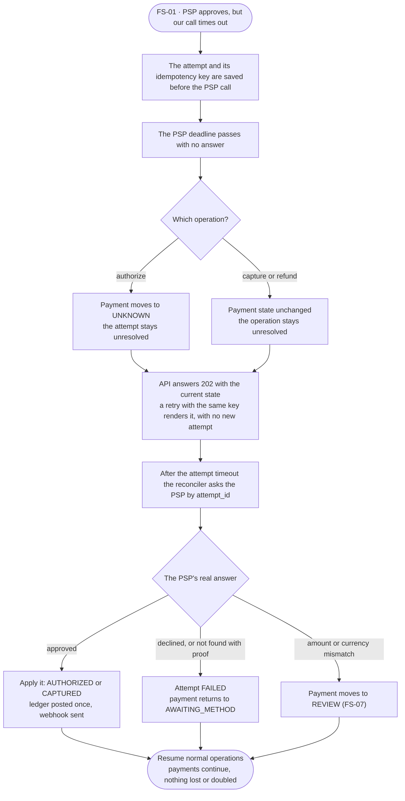

#### FS-02 · PSP responds slowly, for example 2 s instead of 200 ms

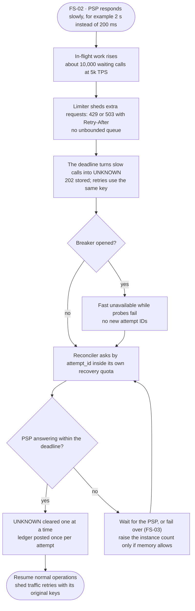

#### FS-03 · PSP is down

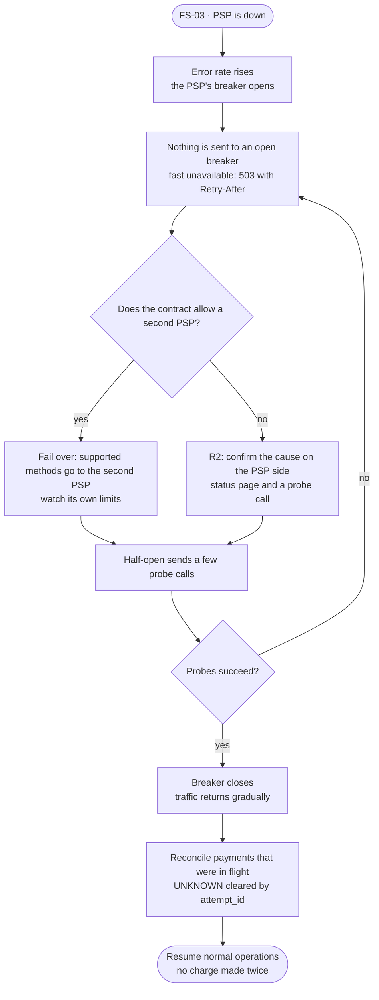

#### FS-04 · PSP rate-limits us, 429

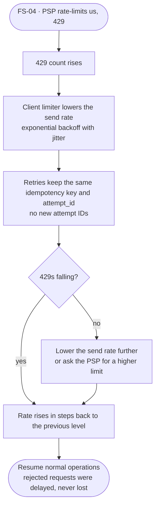

#### FS-05 · Duplicate, late or out-of-order PSP callbacks

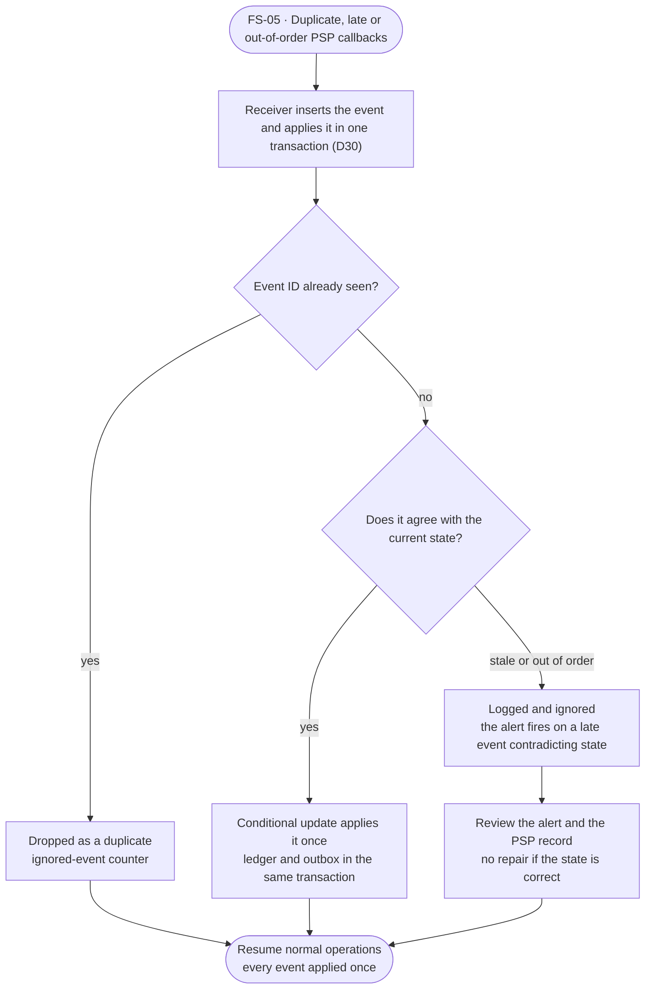

#### FS-06 · PSP DNS fails or its TLS certificate expires

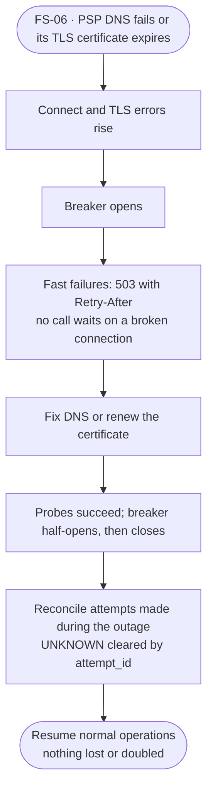

#### FS-07 · PSP result disagrees with ours on amount or currency

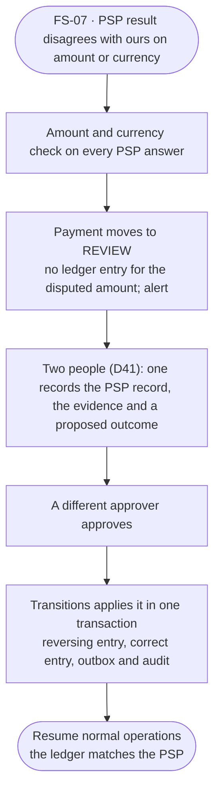

#### FS-08 · Fraud service is unavailable

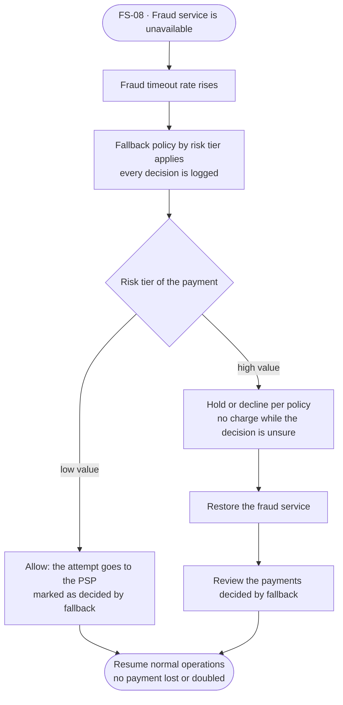

#### FS-44 · PSP lookup says not found, but the request lands later

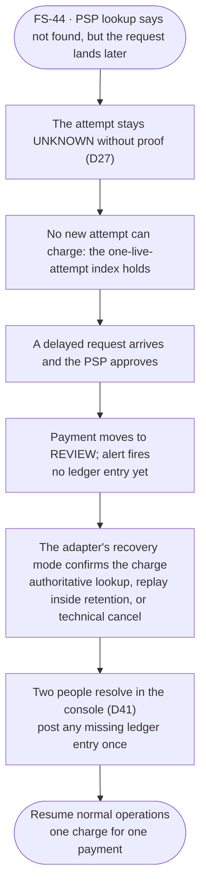

#### FS-45 · Attempt unresolved when the PSP's idempotency key expires

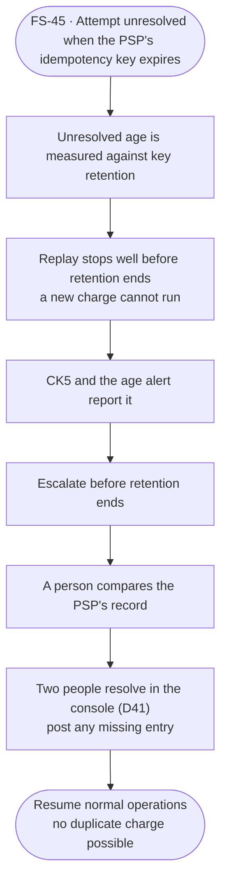

#### FS-46 · Crash during callback handling, or a callback arrives before transaction B

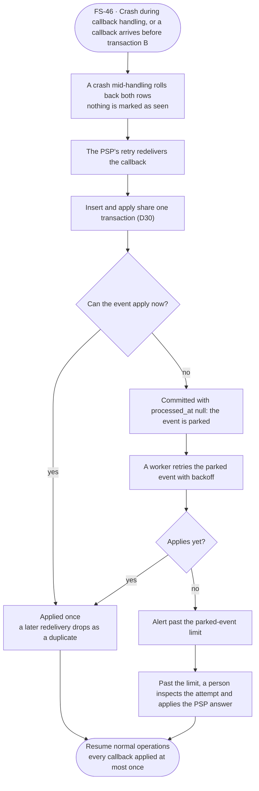

#### FS-47 · A PSP slowdown creates thousands of UNKNOWN attempts

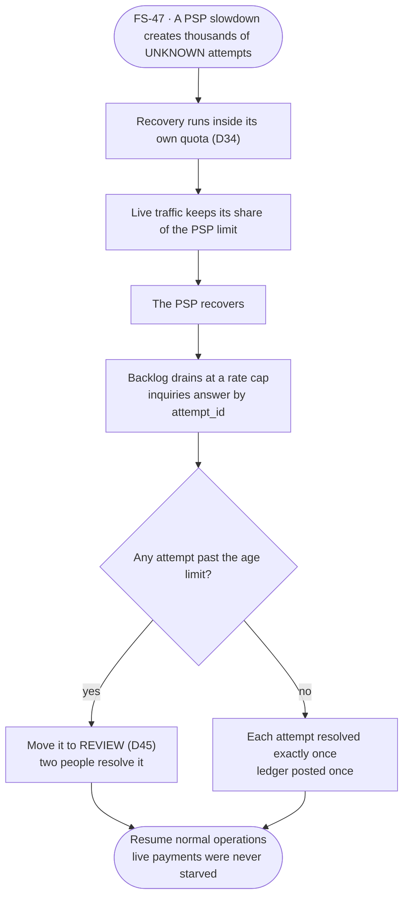

#### FS-48 · Callback flood from a PSP

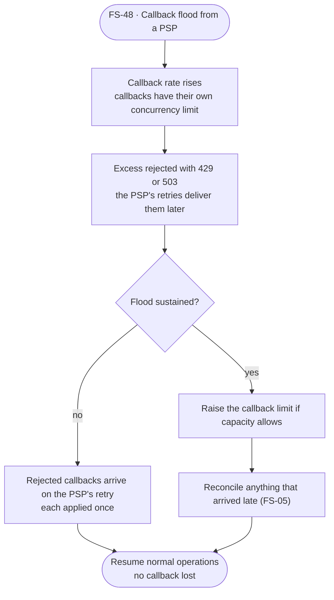

#### FS-50 · Capture and void race, a void times out, or an authorization lapses

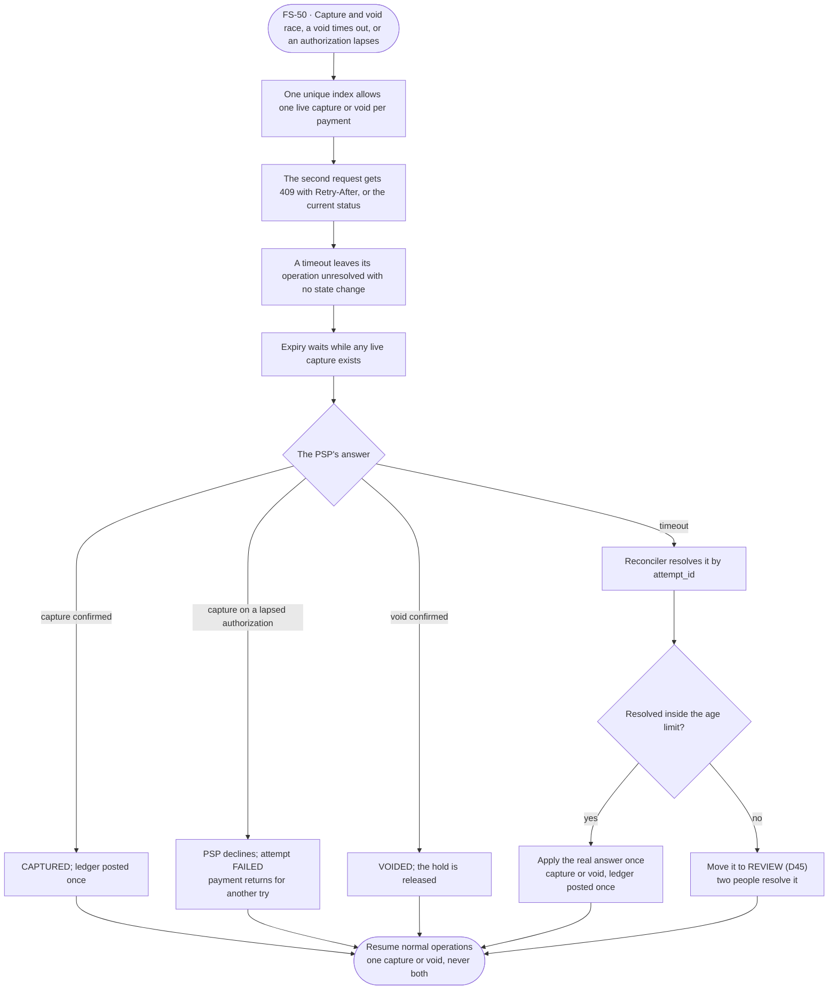

#### FS-51 · A merchant's PSP credential is revoked or expires

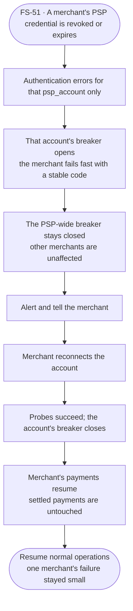

### Application and platform

#### FS-09 · API process killed at any point in a payment

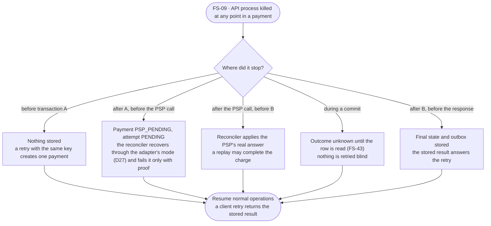

#### FS-10 · Deploy or scale-down sends SIGTERM

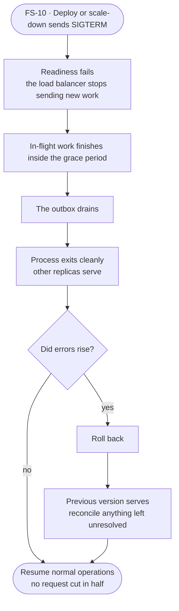

#### FS-11 · Bad release

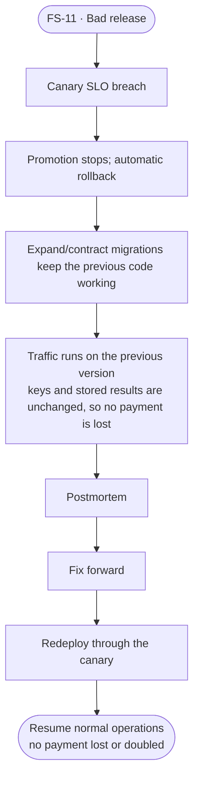

#### FS-12 · Overload: 15,000 req/s

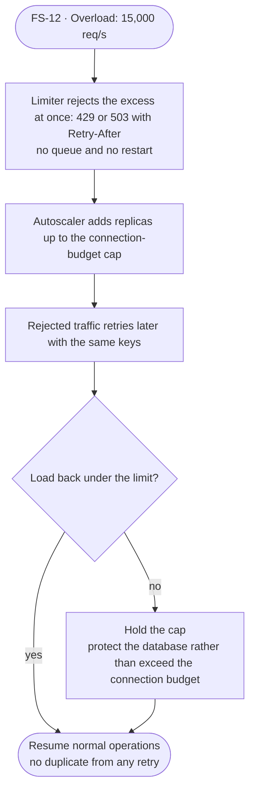

#### FS-13 · One merchant sends a large share of traffic

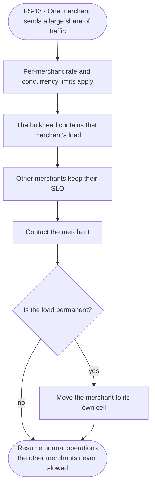

#### FS-14 · Memory growth, GC pauses, ThreadPool starvation

```mermaid
flowchart TD
  F(["FS-14 · Memory growth, GC pauses, ThreadPool starvation"]) --> A1["Bounded queues and no blocking calls (build gate) keep the damage small"]
  A1 --> A2["Gen 2 GC rate, ThreadPool queue and memory trend alert"]
  A2 --> A3["Pod restart as a last resort<br/>traffic moves to the other replicas"]
  A3 --> M1["Take a dump and a trace (runbook)"]
  M1 --> M2["Fix and redeploy"]
  M2 --> R(["Resume normal operations<br/>payments continued on other replicas"])
```

#### FS-15 · Clock skew on a node, for example 5 minutes

```mermaid
flowchart TD
  F(["FS-15 · Clock skew on a node, for example 5 minutes"]) --> A1["NTP offset alert"]
  A1 --> A2["Webhook signing window and token expiry use a tolerance"]
  A2 --> A3["Ordering uses database time, not node time"]
  A3 --> A4["No money decision depends on the skewed clock"]
  A4 --> M1["Fix time sync"]
  M1 --> M2["Drain the node"]
  M2 --> R(["Resume normal operations<br/>no payment misordered"])
```

#### FS-16 · Cache or Redis is unavailable

```mermaid
flowchart TD
  F(["FS-16 · Cache or Redis is unavailable"]) --> A1["Cache error rate rises"]
  A1 --> A2["Rate limits fall back to in-process limits"]
  A2 --> A3["Idempotency is unaffected: the database enforces it"]
  A3 --> A4["Payments keep working without the cache"]
  A4 --> M1["Restore the cache"]
  M1 --> M2["Warm it gradually"]
  M2 --> R(["Resume normal operations<br/>no duplicate and no lost payment"])
```

#### FS-17 · Node or availability zone lost

```mermaid
flowchart TD
  F(["FS-17 · Node or availability zone lost"]) --> A1["Node and zone health goes red"]
  A1 --> A2["Remaining replicas serve<br/>spread constraints keep them in several zones"]
  A2 --> A3["Requests in flight on the lost node fail<br/>a retry with the same key creates no duplicate"]
  A3 --> M1["Replace capacity"]
  M1 --> M2["Check that 40% headroom held"]
  M2 --> R(["Resume normal operations<br/>no payment lost or doubled"])
```

#### FS-18 · Restart after a full outage, thundering herd

```mermaid
flowchart TD
  F(["FS-18 · Restart after a full outage, thundering herd"]) --> A1["Requests spike as everything returns at once"]
  A1 --> A2["R7 order: database, then broker, then services"]
  A2 --> A3["Limiter low; the allowed rate rises in steps while latency and pool wait are watched"]
  A3 --> A4["Consumers and reconciler resume at capped rates"]
  A4 --> D1{"Do CK1-CK6 pass?"}
  D1 -->|yes| R(["Resume normal operations<br/>no payment lost or doubled"])
  D1 -->|no| M1["Stop the ramp and fix<br/>do not announce recovery"]
  M1 --> A3
```

#### FS-19 · Cell router or its config store is unavailable

```mermaid
flowchart TD
  F(["FS-19 · Cell router or its config store is unavailable"]) --> A1["Routers keep the last known mapping in memory"]
  A1 --> A2["Mapping changes are frozen<br/>requests still route"]
  A2 --> A3["Payments continue on the last mapping"]
  A3 --> M1["Restore the config store"]
  M1 --> M2["Verify the mapping"]
  M2 --> A4["Mapping changes resume"]
  A4 --> R(["Resume normal operations<br/>no request routed to a wrong cell"])
```

#### FS-49 · Status-query flood

```mermaid
flowchart TD
  F(["FS-49 · Status-query flood"]) --> A1["Read rate per merchant and shed count rise"]
  A1 --> A2["Reads are shed before writes"]
  A2 --> A3["Create-payment keeps its reserved capacity"]
  A3 --> D1{"Still flooding?"}
  D1 -->|no| R(["Resume normal operations<br/>no payment refused for lack of reads"])
  D1 -->|yes| M1["Contact the merchant and tighten its read limit"]
  M1 --> R
```

### Database

#### FS-20 · Database is much slower

```mermaid
flowchart TD
  F(["FS-20 · Database is much slower"]) --> A1["Query latency and pool wait rise"]
  A1 --> A2["Statement timeouts fire; the limiter sheds with 429 or 503"]
  A2 --> A3["No retry storm: failed calls are not retried blindly"]
  A3 --> A4["Attempts stay UNKNOWN with their key saved"]
  A4 --> M1["Find the cause: locks, vacuum or a plan change"]
  M1 --> M2["Scale or fix"]
  M2 --> A5["Reconciler clears UNKNOWN<br/>each ledger posted once"]
  A5 --> R(["Resume normal operations<br/>nothing lost or doubled"])
```

#### FS-21 · Connection pool exhausted

```mermaid
flowchart TD
  F(["FS-21 · Connection pool exhausted"]) --> A1["Pool wait time and pool use rise"]
  A1 --> A2["Bounded wait, then fast failure: 503 with Retry-After"]
  A2 --> A3["Connection budget stops the autoscaler from adding replicas that make it worse"]
  A3 --> M1["Find and fix the leak, or reduce replicas"]
  M1 --> A4["No restart needed; the pool recovers"]
  A4 --> R(["Resume normal operations<br/>payments accepted again"])
```

#### FS-22 · Primary fails

```mermaid
flowchart TD
  F(["FS-22 · Primary fails"]) --> A1["Health checks and writes fail"]
  A1 --> A2["Automatic promotion of the synchronous standby"]
  A2 --> A3["RPO 0: every committed payment is present"]
  A3 --> A4["Applications reconnect<br/>an interrupted commit is unknown until read (D28)"]
  A4 --> A5["Run CK1-CK6"]
  A5 --> D1{"Checks pass?"}
  D1 -->|yes| M1["Rebuild a new standby and confirm synchronous replication"]
  D1 -->|no| M2["Stop the line: ledger repair runbook R5"]
  M2 --> R(["Resume normal operations<br/>the ledger balances"])
  M1 --> R
```

#### FS-23 · Replica lag causes a stale read

```mermaid
flowchart TD
  F(["FS-23 · Replica lag causes a stale read"]) --> A1["Replica lag metric rises"]
  A1 --> A2["Reads that must be fresh go to the primary<br/>payment status right after create"]
  A2 --> A3["Replica reads still serve dashboards with a data-as-of time"]
  A3 --> M1["Fix the lag cause"]
  M1 --> D1{"Lag persists?"}
  D1 -->|no| R(["Resume normal operations<br/>no stale status shown to a payer"])
  D1 -->|yes| M2["Route all reads to the primary"]
  M2 --> R
```

#### FS-24 · Disk fills: database, broker or logs

```mermaid
flowchart TD
  F(["FS-24 · Disk fills: database, broker or logs"]) --> A1["Alerts at 70% and 85%"]
  A1 --> A2["No automatic delete of data"]
  A2 --> M1["Expand the volume, drop old partitions, or archive per the runbook"]
  M1 --> A3["Disk use falls below the alert"]
  A3 --> R(["Resume normal operations<br/>payments continue with space to spare"])
```

#### FS-25 · Migration locks a table or breaks the app

```mermaid
flowchart TD
  F(["FS-25 · Migration locks a table or breaks the app"]) --> A1["lock_timeout aborts the migration before it blocks traffic"]
  A1 --> A2["Expand/contract keeps the old code working"]
  A2 --> A3["Error spike alert"]
  A3 --> M1["Revert the migration step"]
  M1 --> M2["Retry off-peak"]
  M2 --> R(["Resume normal operations<br/>no payment failed on the migration"])
```

#### FS-26 · Data loss, corruption or a bad manual change

```mermaid
flowchart TD
  F(["FS-26 · Data loss, corruption or a bad manual change"]) --> A1["Continuous ledger audit and the restore drill detect it"]
  A1 --> A2["Point-in-time recovery is available<br/>no ledger row is ever edited or deleted"]
  A2 --> M1["Restore to a new instance"]
  M1 --> M2["Compare with the PSP record and the audit"]
  M2 --> D1{"Comparison clean?"}
  D1 -->|yes| M3["Promote the restored instance"]
  D1 -->|no| M4["Repair with reversing entries (R5)"]
  M4 --> M3
  M3 --> R(["Resume normal operations<br/>the ledger balances"])
```

#### FS-42 · Deadlocks or lock contention on the same rows

```mermaid
flowchart TD
  F(["FS-42 · Deadlocks or lock contention on the same rows"]) --> A1["deadlock_timeout 100 ms finds the cycle<br/>one victim aborted with 40P01"]
  A1 --> A2["Retry at most twice with jitter, inside the retry budget"]
  A2 --> A3["lock_timeout 200 ms turns other long waits into 55P03"]
  A3 --> A4["55P03 returns 503 with Retry-After<br/>no retry"]
  A4 --> A5["Limiter sheds if retries pile up"]
  A5 --> M1["Read the deadlock log and find the two statements"]
  M1 --> M2["Fix the lock order or split the hot row"]
  M2 --> R(["Resume normal operations<br/>no payment applied twice"])
```

#### FS-43 · Commit outcome is ambiguous

```mermaid
flowchart TD
  F(["FS-43 · Commit outcome is ambiguous"]) --> A1["No cancel is ever sent<br/>the runner stops waiting at its limit and the commit keeps running"]
  A1 --> D1{"Which transaction is unknown?"}
  D1 -->|A| A2["No PSP call; the client gets 503<br/>a retry with the same key runs safely"]
  D1 -->|B| A3["Client gets 202 and the attempt stays findable<br/>the reconciler completes it"]
  A1 --> A4["Connections hold pool slots until their commits finish"]
  A4 --> A5["The database concurrency limit sheds new work"]
  A5 --> M1["Restore a standby, then read the row"]
  M1 --> M2["Any warning pages: RPO 0 may be broken for that transaction"]
  A2 --> R(["Resume normal operations<br/>nothing retried blind"])
  A3 --> R
  M2 --> R
```

### Messaging and webhooks

#### FS-27 · Broker is down, or a broker is lost

```mermaid
flowchart TD
  F(["FS-27 · Broker is down, or a broker is lost"]) --> A1["Publish errors rise and outbox age grows"]
  A1 --> A2["Outbox rows stay in the database<br/>the publisher retries and nothing is deleted"]
  A2 --> A3["Payments are still accepted and committed"]
  A3 --> D1{"Broker back?"}
  D1 -->|no| M1["R3: watch database disk and escalate if it fills (FS-24)"]
  D1 -->|yes| A4["Backlog drains at a capped rate"]
  M1 --> A4
  A4 --> A5["Consumers catch up<br/>CK4 and CK6 pass"]
  A5 --> R(["Resume normal operations<br/>no event lost"])
```

#### FS-28 · Consumer crashes mid-batch, or a rebalance happens

```mermaid
flowchart TD
  F(["FS-28 · Consumer crashes mid-batch, or a rebalance happens"]) --> A1["Offsets commit only after the work"]
  A1 --> A2["The inbox table drops duplicates"]
  A2 --> A3["The consumer restarts and reprocesses the batch"]
  A3 --> A4["Duplicates are ignored; each event applied once"]
  A4 --> A5["Consumer lag drains"]
  A5 --> R(["Resume normal operations<br/>no double count in the ledger"])
```

#### FS-29 · Poison message

```mermaid
flowchart TD
  F(["FS-29 · Poison message"]) --> A1["Repeated failure count rises for one message"]
  A1 --> A2["Limited retries, then dead-letter<br/>the partition keeps moving"]
  A2 --> M1["Fix the cause"]
  M1 --> M2["Replay from the DLQ"]
  M2 --> A3["Replay is idempotent: the inbox drops anything already handled"]
  A3 --> R(["Resume normal operations<br/>no duplicate ledger entry"])
```

#### FS-30 · A merchant's webhook endpoint is slow or down

```mermaid
flowchart TD
  F(["FS-30 · A merchant's webhook endpoint is slow or down"]) --> A1["Delivery failure rate rises for one merchant"]
  A1 --> A2["Exponential backoff with jitter<br/>per-merchant queue and concurrency limit"]
  A2 --> A3["Other merchants are unaffected<br/>events kept for the retention period"]
  A3 --> D1{"Endpoint back inside retention?"}
  D1 -->|yes| A4["Backlog delivered in order per payment"]
  D1 -->|no| M1["Merchant fixes the endpoint"]
  M1 --> M2["Resend from the dashboard"]
  M2 --> A4
  A4 --> R(["Resume normal operations<br/>no event dropped"])
```

#### FS-31 · Outbox or consumer backlog keeps growing

```mermaid
flowchart TD
  F(["FS-31 · Outbox or consumer backlog keeps growing"]) --> A1["Outbox age and lag trend alert"]
  A1 --> A2["Publishers scale up to a cap"]
  A2 --> D1{"Backlog still growing?"}
  D1 -->|no| R(["Resume normal operations<br/>lag back to normal"])
  D1 -->|yes| M1["Find the slow stage: broker, consumer or downstream"]
  M1 --> M2["Fix that stage"]
  M2 --> A3["Backlog drains at a capped rate"]
  A3 --> R
```

### Money correctness

#### FS-32 · Same idempotency key sent many times at once

```mermaid
flowchart TD
  F(["FS-32 · Same idempotency key sent many times at once"]) --> A1["All requests read the key, then contend on the unique index"]
  A1 --> A2["One payment and one charge are created"]
  A2 --> A3["Competing duplicates wait briefly, then get 409 with Retry-After until the first finishes"]
  A3 --> A4["Every caller then gets the same stored response"]
  A4 --> R(["Resume normal operations<br/>no manual step needed"])
```

#### FS-33 · Concurrent refunds above the captured amount

```mermaid
flowchart TD
  F(["FS-33 · Concurrent refunds above the captured amount"]) --> A1["Atomic conditional update on refunded plus pending total"]
  A1 --> A2["One reservation succeeds<br/>the rest are rejected"]
  A2 --> A3["Rejected-refund counter rises<br/>the total never exceeds the capture"]
  A3 --> R(["Resume normal operations<br/>no over-refund possible"])
```

#### FS-34 · Ledger imbalance found

```mermaid
flowchart TD
  F(["FS-34 · Ledger imbalance found"]) --> A1["Continuous audit query alerts at once (CK1)"]
  A1 --> A2["The database never edits or deletes entries"]
  A2 --> M1["Stop-the-line R5: pause refunds and payouts if the imbalance grows"]
  M1 --> M2["Find the transaction IDs from the audit query"]
  M2 --> M3["Post a reversing entry and a correct entry"]
  M3 --> M4["Postmortem, plus a test that would have caught it"]
  M4 --> R(["Resume normal operations<br/>the ledger balances again"])
```

#### FS-35 · Payments or operations unresolved too long

```mermaid
flowchart TD
  F(["FS-35 · Payments or operations unresolved too long"]) --> A1["CK5 and the age alert fire"]
  A1 --> A2["Reconciler retries the inquiry with backoff"]
  A2 --> D1{"Resolved?"}
  D1 -->|yes| R(["Resume normal operations<br/>no payment lost or doubled"])
  D1 -->|no| D2{"Past the threshold?"}
  D2 -->|no| A2
  D2 -->|yes| M1["Move the operation to REVIEW (D45)"]
  M1 --> M2["Two people record the PSP's answer and resolve (D41)"]
  M2 --> A3["The console posts any missing ledger entry, once"]
  A3 --> R
```

#### FS-36 · Reconciler is down, slow, or two run at once

```mermaid
flowchart TD
  F(["FS-36 · Reconciler is down, slow, or two run at once"]) --> A1["Heartbeat missing, or the oldest unresolved age grows"]
  A1 --> A2["A lease or advisory lock allows one active worker per batch"]
  A2 --> A3["A second worker waits; all of the work is idempotent"]
  A3 --> M1["Restart the reconciler"]
  M1 --> A4["Backlog drains at a capped rate<br/>each attempt resolved once"]
  A4 --> R(["Resume normal operations<br/>nothing lost or doubled"])
```

### Security and operations

#### FS-37 · Secret or certificate expires

```mermaid
flowchart TD
  F(["FS-37 · Secret or certificate expires"]) --> A1["Expiry alert at the set number of days before"]
  A1 --> M1["Rotate with overlap: issue the new secret and accept it"]
  M1 --> A2["Both secrets are valid during the grace period"]
  A2 --> A3["Retire the old secret after every consumer has moved"]
  A3 --> R(["Resume normal operations<br/>no failed authentication"])
```

#### FS-38 · Secret or API key leaked

```mermaid
flowchart TD
  F(["FS-38 · Secret or API key leaked"]) --> A1["Anomaly alert, scanner hit, or a report"]
  A1 --> M1["R6: revoke the key or secret"]
  M1 --> A2["The revoked key is rejected within the cache time"]
  A2 --> M2["Review the audit log for use of the leaked secret"]
  M2 --> M3["Rotate; notify merchants if their data or keys were exposed"]
  M3 --> M4["Rescan code and logs; record the incident"]
  M4 --> R(["Resume normal operations<br/>payments continue under the new key"])
```

#### FS-39 · Card-testing attack

```mermaid
flowchart TD
  F(["FS-39 · Card-testing attack"]) --> A1["Velocity rules fire; small declines spike"]
  A1 --> A2["Rate and velocity blocks apply<br/>alert fires"]
  A2 --> M1["Tighten the rules"]
  M1 --> M2["Block the sources"]
  M2 --> A3["Attack traffic rejected<br/>real payments continue"]
  A3 --> R(["Resume normal operations<br/>legitimate payments unaffected"])
```

#### FS-40 · Slow-body clients, oversized bodies, connection floods

```mermaid
flowchart TD
  F(["FS-40 · Slow-body clients, oversized bodies, connection floods"]) --> A1["Kestrel limits cut them off<br/>body size, minimum data rate, header timeout"]
  A1 --> A2["Connection and timeout counters alert"]
  A2 --> M1["Block the source at the edge"]
  M1 --> R(["Resume normal operations<br/>payment traffic keeps its capacity"])
```

#### FS-41 · Loss of a whole region

```mermaid
flowchart TD
  F(["FS-41 · Loss of a whole region"]) --> A1["Region health lost"]
  A1 --> A2["Not handled in version 1: single region<br/>no automatic failover"]
  A2 --> M1["Restore from backup; RPO above 0"]
  M1 --> M2["Reconcile every payment against the PSP record"]
  M2 --> M3["Run CK1-CK6 and confirm the ledger balances"]
  M3 --> R(["Resume normal operations<br/>in a new region, with a known data gap"])
```

## Edge cases

These are not outages. They are unusual but valid situations that must give a defined result. All are covered by the edge-case test suite **C31** unless another test is named.

| ID | Situation | Defined behavior |
|---|---|---|
| E1 | Same idempotency key, different request body | Reject with 422; do not run |
| E2 | Same key while the first request is still running | Return 409 with `Retry-After`; do not start a second one |
| E3 | Client disconnects after transaction A | Processing continues; the result is stored; a retry with the same key returns it |
| E4 | Key reused after the retention period | Treated as a new request. Retention is at least 24 hours after the operation resolves, is documented to merchants, and never ends while the operation is unresolved ([D19](decisions.md#d19)) |
| E5 | Merchant retries with a new key after a timeout | Cannot be detected by key; guidance is to poll the payment ID or use one key per order. Optional: warn on a repeated merchant order reference (`Open`) |
| E6 | Refund on a payment that is not captured, or is `UNKNOWN` | Reject with a clear error |
| E7 | Refund larger than the remaining amount | Reject; the atomic reservation protects the total (C6) |
| E8 | Capture after the authorization expired or was voided | Reject; state machine forbids it |
| E9 | Late "declined" callback on a captured payment | Ignore, log, alert (FS-05) |
| E10 | PSP callback arrives before our transaction B commits | Conditional update finds the old state; event is parked and retried briefly, then reconciled |
| E11 | Zero, negative or very large amount | Reject at validation |
| E12 | Currency with a different number of decimals (for example JPY has 0, KWD has 3) | Integer minor units with a per-currency exponent; no floating point (U1) |
| E13 | Capture and refund requests at the same moment | Conditional updates serialize them; one wins, the other re-reads |
| E14 | Webhook delivered twice or out of order | Each event has an ID and a sequence; merchants are told to deduplicate; documented |
| E15 | Event larger than the size limit or schema mismatch | Rejected at publish; contract tests catch it in CI (U5) |
| E16 | Card data appears in logs or error messages | Redaction and a log scan (U8) |
| E17 | Tenant A uses a key against tenant B's data | Rejected by tenant checks (U6) |
| E18 | New attempt while another is live, or two at once | One proceeds; the unique index gives the other the current status or 409 with `Retry-After` (C37) |
| E19 | Late approval on an attempt already marked `FAILED` | Attempt moves to `REVIEW` and an alert fires, with no ledger entry. A payment in `AWAITING_METHOD` also moves to `REVIEW` (C38) |
| E20 | Customer abandons 3D Secure | Action window ends, state becomes `UNKNOWN`, the reconciler inquires, and the payment returns to `AWAITING_METHOD` (C39) |
| E21 | Retry of a declined request with the same key | Stored decline is returned, with no new PSP call. A new try needs a new key |
| E22 | Settlement line with no matching operation, or a different amount | Line is `UNMATCHED` or `MISMATCH`; a discrepancy pages; nothing is posted (C40) |
| E23 | Same settlement file ingested twice | The primary key makes it a no-op; no second ledger entry (C40) |
| E24 | Key older than 24 hours whose payment is still `UNKNOWN` | Key is kept, so a retry returns the current state and can't charge again (C41) |
| E25 | Same key used on a different route | Reject with 422; the hash covers method, route and body ([D31](decisions.md#d31)) |
| E26 | Fraud check blocks an attempt | Attempt `FAILED` with `fraud_blocked`, no PSP call, 402, counts toward the cap, and a retry with a new key can run ([D33](decisions.md#d33)) |
| E27 | Retry with the same key while the operation is `UNKNOWN` | Renders the current state; no PSP call and no new attempt ([D31](decisions.md#d31)) |
| E28 | Retry with the same key of a finished request | Stored answer, with no fraud check and no change to velocity counters ([D33](decisions.md#d33)) |
| E29 | Request refused before its work began (attempt live or cap reached), then retried with the same key | The refusal stored nothing, so the retry is evaluated fresh ([D31](decisions.md#d31)) |

## Runbooks

Short, ordered steps. Each runbook is rehearsed in a [drill](#drills) before it is trusted. Times are starting targets.

**R1. Database primary failed (FS-22)**
1. Confirm the standby was promoted and the old primary is fenced (cannot accept writes).
2. Check applications reconnected and error rate is falling.
3. Run CK1-CK6 against the new primary.
4. Rebuild a new standby; confirm synchronous replication is back.
5. Record the downtime against the RTO target.

**R2. PSP outage or slowdown (FS-02, FS-03)**
1. Confirm the breaker is open and the cause is on the PSP side (their status page, a probe call).
2. If a second PSP is allowed, confirm traffic is moving and watch its limits.
3. Tell merchants (status page): new payments may be declined or delayed.
4. When the PSP recovers, let the breaker close by itself; do not force it.
5. Wait for the reconciler to clear `UNKNOWN`; confirm CK2 and CK5.

**R3. Broker outage (FS-27)**
1. Confirm the outbox is growing and payments are still being accepted.
2. Do not delete anything. Watch disk on the database.
3. After recovery, let publishers drain at the capped rate; watch consumer lag.
4. Confirm CK4 and CK6.

**R4. Many payments or operations stuck unresolved (FS-35)**
1. Check whether the PSP inquiry works (a manual call by `attempt_id`).
2. Check the reconciler is running and its rate is not capped too low.
3. Past the threshold, the remainder moves to `REVIEW` ([D45](decisions.md#d45)).
4. For each, two people record the PSP's answer and resolve it in the console, which posts any missing ledger entries ([D41](decisions.md#d41)).

**R5. Ledger imbalance (FS-34): stop-the-line**
1. Pause refunds and payouts if the imbalance is growing; keep accepting payments only if the bad path is isolated.
2. Find the transaction IDs from the audit query.
3. Never edit or delete ledger rows. Post a reversing entry and a correct entry.
4. Write a postmortem and add a test that would have caught it.

**R6. Secret or key leaked (FS-38)**
1. Revoke the key or secret; rotate with a short grace period only if the leak is minor.
2. Review the audit log for use of the leaked secret.
3. Notify affected merchants if their data or keys were exposed.
4. Rescan code and logs for the secret; record the incident.

**R7. Restart after a full outage (FS-18)**
1. Bring up the database, then the broker, then services, in that order.
2. Keep the limiter low; raise the allowed rate in steps while watching latency and pool wait.
3. Resume consumers and reconciler at capped rates.
4. Run CK1-CK6 before announcing recovery.

## Drills

| Order | Drill | Tests | Notes |
|---|---|---|---|
| 1 | In a test environment, break one thing at a time under 1k TPS | C3, C4, C5, C6, C15, C36, C37, C38, C41, C43, C44, C45, C46, C50 | Money-correctness faults first |
| 2 | PSP and dependency faults under 5k TPS | C9, C12, C13, C14, C16, C23, C32, C39, C40, C47, C48, C51 | Use the mock PSP in slow, error and down modes |
| 3 | Data faults under 5k TPS | C1, C2, C7, C22, C29, C34, C49 | Database slow, pool exhausted, failover, disk, lock races, read flood |
| 4 | Messaging faults | C8, C17, C18, C26, C27 | Broker down, poison, webhook endpoints failing |
| 5 | Platform faults | C10, C11, C19, C20, C24, C25, C28, C30, and C33 only if cells are adopted | Node, zone, release, cache, clock, restart, routing |
| 6 | Security and recovery | C21, C42, O5, O6, F1 | Rotation, restore, leak response |

Rules for every drill: define the expected result first, run CK1-CK6 afterwards, record the run ID, and file a fix for anything that surprised the team. A drill does not count if it only passed because the fault was not really injected (verify the fault happened).

## Open questions

- **Fallback policy for the fraud service** (allow, hold or reject, by risk tier) needs a business owner.
- **A warning on repeated order references (E5)** is optional and not designed yet.
- **Region loss (FS-41)** is out of scope for version 1.
- **The order of protection** is `Proposed` until the owner confirms it.
- **All times and thresholds** are starting values until measured.
