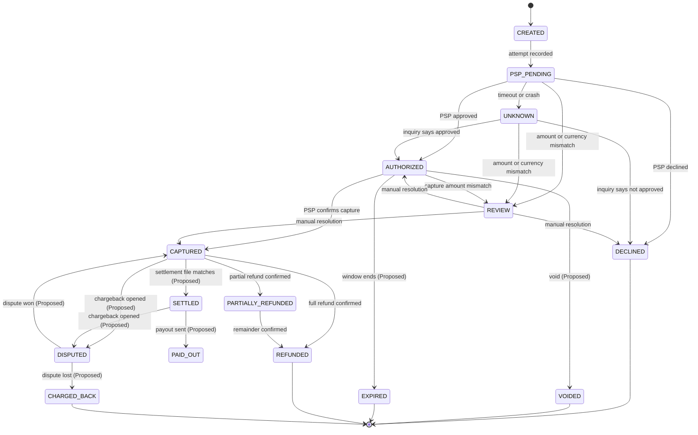

# Payment Lifecycle

The states a payment can be in, the allowed moves between them, and the rules that keep those moves safe.

Status: Draft · Last updated: 2026-11-05

Rows marked `Proposed` need a decision before they are built. Everything else is `Committed`.

## Overview

A payment is not one write. It moves through several states, and some moves are driven by outside parties that can report late, twice or out of order.

Three ideas run through the lifecycle:

1. **Money moves in two steps.** Authorization reserves funds. Capture takes them.
2. **Unknown is a real state.** A PSP timeout is not a failure; the outcome is not known yet.
3. **Every transition is a conditional, idempotent, ledgered write,** made through the [payment-transition module](architecture.md#components-and-boundaries).



## States

`CREATED` is never visible outside transaction A, because the payment moves to `PSP_PENDING` in the same commit.

| State | Meaning | Final? | Money position | Moved out by | Status |
|---|---|---|---|---|---|
| `CREATED` | Payment record being written | No | None | Transaction A | `Committed` |
| `PSP_PENDING` | Attempt recorded; PSP call in flight | No | None | PSP answer, timeout or crash recovery | `Committed` |
| `UNKNOWN` | PSP outcome not known | No | Maybe reserved | Reconciler | `Committed` |
| `REVIEW` | PSP answer disagrees on amount or currency | No | Under review | Manual resolution | `Committed` |
| `AUTHORIZED` | PSP approved; funds reserved | No | Reserved, not taken | Capture | `Committed` |
| `DECLINED` | PSP refused | Yes | None | n/a | `Committed` |
| `CAPTURED` | Funds taken from the customer | No | With the PSP, owed to the merchant | Refund | `Committed` |
| `PARTIALLY_REFUNDED` | Part of the captured amount returned | No | Partly returned | Further refund | `Committed` |
| `REFUNDED` | Full captured amount returned | Yes | Fully returned | n/a | `Committed` |
| `VOIDED` | Authorization cancelled before capture | Yes | Reservation released | n/a | `Proposed` |
| `EXPIRED` | Authorization window ended without capture | Yes | Released by the issuer | n/a | `Proposed` |
| `SETTLED` | PSP settlement file confirms money reached us | No | In our settlement account | Payout | `Proposed` |
| `PAID_OUT` | Merchant has been paid | Yes, on the happy path | With the merchant | Open question | `Proposed` |
| `DISPUTED` | Customer's bank opened a chargeback | No | Held pending outcome | Dispute result | `Proposed` |
| `CHARGED_BACK` | Dispute lost; funds reversed | Yes | Returned to the customer | n/a | `Proposed` |

## Transitions

Each row is one allowed transition. Anything not listed is forbidden.

| From | To | Trigger | Source | Ledger effect | Status |
|---|---|---|---|---|---|
| `[*]` | `CREATED` | Create-payment request | Merchant | None | `Committed` |
| `CREATED` | `PSP_PENDING` | Attempt recorded | Internal | None | `Committed` |
| `PSP_PENDING` | `AUTHORIZED` | PSP approved | PSP response, callback or reconciler | Authorization hold | `Committed` |
| `PSP_PENDING` | `DECLINED` | PSP declined | PSP response, callback or reconciler | None | `Committed` |
| `PSP_PENDING` | `UNKNOWN` | Timeout, or reconciler finds a stale attempt | Internal | None | `Committed` |
| `PSP_PENDING` or `UNKNOWN` | `REVIEW` | Amount or currency mismatch | PSP response, callback or reconciler | None for the disputed amount | `Committed` |
| `UNKNOWN` | `AUTHORIZED` | Inquiry says approved | Reconciler | Authorization hold | `Committed` |
| `UNKNOWN` | `DECLINED` | Inquiry says not approved | Reconciler | None | `Committed` |
| `AUTHORIZED` | `CAPTURED` | PSP confirms capture | PSP response, callback or reconciler | Debit customer funds, credit merchant payable | `Committed` |
| `AUTHORIZED` | `REVIEW` | Capture amount mismatch | PSP response, callback or reconciler | None for the disputed amount | `Committed` |
| `REVIEW` | `AUTHORIZED`, `DECLINED` or `CAPTURED` | Person compares the PSP record | Manual | Matching entries, or a reversing entry | `Committed` |
| `CAPTURED` | `PARTIALLY_REFUNDED` | PSP confirms a partial refund | PSP response, callback or reconciler | Reverse part of the entries | `Committed` |
| `CAPTURED` | `REFUNDED` | PSP confirms a full refund | PSP response, callback or reconciler | Reverse all entries | `Committed` |
| `PARTIALLY_REFUNDED` | `REFUNDED` | PSP confirms the remainder | PSP response, callback or reconciler | Reverse remaining entries | `Committed` |
| `AUTHORIZED` | `VOIDED` | Void request | Merchant | Release hold | `Proposed` |
| `AUTHORIZED` | `EXPIRED` | Window ends | Timer job | Release hold | `Proposed` |
| `CAPTURED` | `SETTLED` | Settlement file matches | Reconciler | Move payable to settled | `Proposed` |
| `SETTLED` | `PAID_OUT` | Payout sent | Payout service | Pay merchant from settled | `Proposed` |
| `CAPTURED` or `SETTLED` | `DISPUTED` | Chargeback notice | PSP | Hold disputed amount | `Proposed` |
| `DISPUTED` | `CAPTURED` | Dispute won | PSP | Release hold | `Proposed` |
| `DISPUTED` | `CHARGED_BACK` | Dispute lost | PSP | Reverse entries, add dispute fee | `Proposed` |

## Transition rules

### Every transition is a conditional update

```sql
update payments
   set state = 'CAPTURED', captured_minor = $amount,
       version = version + 1, updated_at = now()
 where id = $payment_id and merchant_id = $merchant_id
   and state = 'AUTHORIZED' and $amount = amount_minor; -- full capture; partial capture is Proposed
```

Zero rows updated means someone else already moved the payment. The caller re-reads and decides; it never overwrites.

### State, ledger and outbox commit together

In one short transaction: conditionally update the state, insert the ledger entries, insert the outbox event. The PSP call happens before this transaction, never inside it.

### Idempotency

- Every create, capture and refund request carries an `Idempotency-Key`, as would `Proposed` void requests.
- A retry with the same key returns the stored result and does not repeat the transition.
- The same key with a different body is rejected with 422.
- The same key while the first request is running returns 409 with `Retry-After`.
- Refunds use their own key on the `refunds` table.

### Late, duplicate and out-of-order events

Each PSP event is recorded once in `psp_events`. A conditional update that finds the payment already in a later or final state does nothing. The event is logged, and an alert is raised if it contradicts stored state, such as "declined" on a `CAPTURED` payment.

### Amounts and currency

Every PSP answer is checked. On an authorize or capture mismatch the payment moves to `REVIEW`, and no ledger entry is written for the disputed amount ([D12](decisions.md#d12)). A refund mismatch moves the [refund](#refund-rules) to `REVIEW` instead.

### Final states

`DECLINED`, `REFUNDED`, and the `Proposed` `VOIDED`, `EXPIRED` and `CHARGED_BACK` accept no further transitions. A new attempt creates a new payment.

## Refund rules

Total refunded and pending must never exceed the captured amount, and state changes only after the PSP confirms ([D6](decisions.md#d6)). Refund states are `PENDING`, `UNKNOWN`, `SUCCEEDED`, `FAILED` and `REVIEW`.

**1. Reserve.** In one transaction, in this [lock order](deadlock-handling.md#prevention): take the per-account [advisory lock](architecture.md#ledger) and check the available balance, reserve the amount as below, insert the `refunds` row as `PENDING`, and insert a ledger reservation entry. If the balance is too low or the update returns 0 rows, roll back and reject.

```sql
update payments
   set refund_pending_minor = refund_pending_minor + $amount,
       version = version + 1, updated_at = now()
 where id = $payment_id and merchant_id = $merchant_id
   and state in ('CAPTURED','PARTIALLY_REFUNDED')
   and refunded_minor + refund_pending_minor + $amount <= captured_minor
returning refund_pending_minor;
```

**2. Call the PSP** with `refund_id` as the idempotency key, outside any transaction.

**3. Confirm.** On approval, in one transaction, run the update below, then conditionally move the refund from `PENDING` or `UNKNOWN` to `SUCCEEDED`. If that moves no row, another worker got there first, so roll back. Otherwise post the ledger entries that reverse the reservation and record the refund, then the outbox event.

```sql
update payments
   set refunded_minor = refunded_minor + $amount,
       refund_pending_minor = refund_pending_minor - $amount,
       state = case when refunded_minor + $amount = captured_minor
                    then 'REFUNDED' else 'PARTIALLY_REFUNDED' end,
       version = version + 1, updated_at = now()
 where id = $payment_id and merchant_id = $merchant_id
   and refund_pending_minor >= $amount;
```

**Or release.** On a PSP decline, subtract the amount from `refund_pending_minor`, conditionally move the refund to `FAILED`, post a reversing entry for the reservation, and insert the outbox event. Roll back if the refund moved no row.

**On a timeout,** the refund becomes `UNKNOWN`, the amount stays reserved, and the reconciler confirms or releases it. If the PSP reports no such refund, for example after a crash before the call, the reconciler releases it.

**On an amount or currency mismatch,** the refund moves to `REVIEW` and the payment state does not change. The amount stays reserved until a person confirms or releases it.

## The Unknown state

A PSP timeout does not tell us whether the customer was charged.

- The API returns `202 Accepted` with the payment ID. The merchant learns the result by webhook or polling.
- The reconciler asks the PSP for the attempt's status and applies the answer.
- Never retry a charge without the same PSP idempotency key, or the customer can be charged twice.
- If the PSP reports an unknown attempt, an authorize is declined or retried safely, and a capture attempt is marked `FAILED` so a new capture can be requested.
- Capture attempts and refunds stay unresolved on their own rows, and the payment state does not change until they resolve.
- A payment, capture attempt or refund unresolved beyond a time limit raises an alert. A stuck refund also blocks its reserved amount.

## Capture modes

| Mode | Behavior | Use when | Status |
|---|---|---|---|
| Authorize, then capture | Funds are reserved, and the merchant captures later | Physical goods, hotels, rentals | `Committed` |
| Auto-capture | Capture is triggered right after authorization | Digital goods, instant services | `Committed` |
| Partial capture | Capture less than authorized; the remainder is released | Partial shipment | `Proposed` |

The capture amount must not exceed the authorized amount. Capture and refund requests at the same moment are serialized by conditional updates: one wins and the other re-reads.

## Timers

Timer jobs use the same conditional update, so a job and a manual capture cannot both win.

| Timer | Applies to | Action | Status |
|---|---|---|---|
| Attempt timeout | `PSP_PENDING` | Move to `UNKNOWN`, then inquire. These payments are found through the partial index `payments_unresolved` | `Committed` |
| Unknown age limit | `UNKNOWN` | Alert and escalate to manual review | `Committed` |
| Unresolved operation | Capture attempts and refunds, through `payment_attempts_unresolved` and `refunds_unresolved` | Inquire; alert and escalate past the age limit | `Committed` |
| Authorization window (for example 7 days, depending on card scheme) | `AUTHORIZED` | Move to `EXPIRED` and release the hold | `Proposed` |
| Dispute response deadline | `DISPUTED` | Alert so evidence is submitted in time | `Proposed` |

## Worked examples

**Happy path with a partial refund:**

| Step | Action | State after | Ledger |
|---|---|---|---|
| 1 | Merchant creates a payment of 100.00; API records the attempt and calls the PSP | `PSP_PENDING` | none |
| 2 | PSP approves | `AUTHORIZED` | hold 100.00 |
| 3 | Merchant captures 100.00; PSP confirms | `CAPTURED` | customer funds to merchant payable, 100.00 |
| 4 | Merchant refunds 30.00; reserved while the PSP is called | `CAPTURED` | reservation entry 30.00, `refund_pending_minor = 30.00` |
| 5 | PSP confirms the refund | `PARTIALLY_REFUNDED` | reservation reversed, refund recorded, `refunded_minor = 30.00`, `refund_pending_minor = 0` |
| 6 | Merchant refunds 70.00; reserved, then the PSP confirms | `REFUNDED` | same steps, `refunded_minor = 100.00` |

**Timeout, then recovery:**

| Step | Event | State after |
|---|---|---|
| 1 | API calls the PSP; no answer within the deadline | `UNKNOWN` |
| 2 | API returns `202 Accepted` with the payment ID | `UNKNOWN` |
| 3 | Reconciler asks the PSP about the attempt; PSP says approved | `AUTHORIZED`, webhook sent |
| 4 | A late "declined" callback arrives | No change; logged and alerted |

## Merchant events

An outbox event is written in the same transaction as every state change, and the outbox publisher moves it toward delivery. Delivery is at-least-once, so each event has a unique ID and the merchant de-duplicates. `REVIEW` sends no event until it is resolved.

| Event | Sent on | Status |
|---|---|---|
| `payment.authorized` | `AUTHORIZED` | `Committed` |
| `payment.declined` | `DECLINED` | `Committed` |
| `payment.captured` | `CAPTURED` | `Committed` |
| `payment.refunded` | `PARTIALLY_REFUNDED`, `REFUNDED` | `Committed` |
| `payment.capture_failed` | A capture attempt ends `FAILED` | `Committed` |
| `payment.refund_failed` | A refund ends `FAILED` | `Committed` |
| `payment.voided`, `payment.expired` | `VOIDED`, `EXPIRED` | `Proposed` |
| `payment.disputed` | `DISPUTED` | `Proposed` |

## Proposed rules

- **Void and expiry:** capture after `VOIDED` or `EXPIRED` is rejected ([E8](failure-scenarios.md#edge-cases)).
- **Dispute after a full refund:** reject or defend, showing the refunded amount in evidence.
- **Payouts:** query the PSP before retrying a payout.

Other unusual cases are [edge cases](failure-scenarios.md#edge-cases) E6, E7, E8 and E10, and [failures](failure-scenarios.md#failure-catalogue) FS-07, FS-09 and FS-32.

## Open questions

1. Which `Proposed` states to build first, and which wait for the settlement and payout phase.
2. Authorization window per card scheme and per PSP.
3. Whether auto-capture is a flag on the payment or a merchant setting.
4. How long a payment may stay `UNKNOWN` before manual review.
5. Whether `PAID_OUT` and `CHARGED_BACK` belong in the payment record or a separate settlement record.
6. Whether refunds are allowed after `SETTLED` or `PAID_OUT`. A real system needs this, but no transition exists yet.
7. Whether disputes can open from `PARTIALLY_REFUNDED`, `PAID_OUT` or `REFUNDED`.
