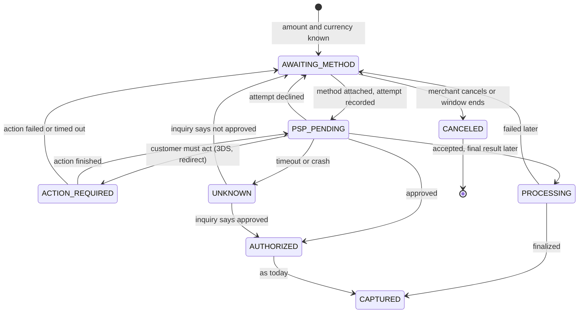

# Stripe Research

What Stripe has published about building payment systems, what it means for the Open Payments design, and what to change before writing code.

Status: Draft · Last updated: 2026-11-05

Recommendations here are `Proposed`, except the [five decisions](#decisions-for-the-owner) the owner has made. Nothing else changes the design until it is accepted, and then each fact moves to its usual home: decisions to [Decisions](decisions.md), tests to [Verification](verification.md), states to [Payment lifecycle](payment-lifecycle.md).

## The short version

The current design is strong on one question: **did our own write succeed safely?** Atomic commits, idempotency, `UNKNOWN` and the outbox all answer it. Stripe's publications point at questions the design doesn't answer yet:

| # | Finding | Why it matters | Act |
|---|---|---|---|
| 1 | **A balanced ledger can still be wrong.** Stripe checks that money flows finish, on time, with nothing missing | CK1 only proves debits equal credits. A missing settlement or a wrong merchant still balances | Before first migration |
| 2 | **Cards are the unusual payment method, not the normal one.** Stripe spent about two years rolling out a replacement for card-shaped abstractions | Our states and `CardToken` adapter are card-shaped, and 3D Secure appears nowhere in the docs | Before the API contract |
| 3 | **Keep the money decision free of I/O** so it can be simulated, replayed and compared | Makes state-machine tests exhaustive and lets later rewrites be compared against recorded inputs | Before Phase 1 |
| 4 | **Moving data is the hard part, routing is the last step.** Stripe's process has six steps and a write fence | D14 calls moving a merchant "a routing change", which understates it | Correct the wording now; design only if G1 requires cells |
| 5 | **Data lifecycle is decided by the first schema** | At target rate, `ledger_entries` adds about 0.9-1.7 billion rows a day and has no time-based way out | Before first migration |

The rest of this doc gives the evidence, and [Build order](#build-order) puts it in sequence. [What not to copy](#what-not-to-copy) matters as much as what to adopt.

## How to read this

Each lesson separates three things, because mixing them is how research becomes false confidence:

- **Stripe says:** stated in a linked Stripe source.
- **Open Payments today:** what this repo's docs say.
- **Proposal:** our own inference. Stripe did not recommend it to us, and it may do something different internally.

**Sources are not equal.** Stripe's engineering posts describe its internal systems. Its developer guides advise people *integrating with* Stripe, and don't describe how Stripe works inside. [Sources](#sources) marks which is which.

**Limits:** Stripe's numbers are self-reported and can't be checked from outside. Posts show selected systems at a point in time, not a full architecture. 21 sources were read on 2026-11-05, chosen from the 128 posts on [stripe.dev/blog](https://stripe.dev/blog) plus older Stripe posts. Most unread posts are integration guides.

## Scale check

| Measure | Stripe, as published | Open Payments target | Note |
|---|---|---|---|
| Peak-period volume | 300 million transactions, Black Friday to Cyber Monday, 2023 ([Ledger][ledger]) | 5,000 completed payments/s sustained | Stripe's figure averages about 870/s over four days. Our arithmetic: an old, average figure, not its peak, and "transaction" may be counted differently |
| Reliability | 99.9995% target ([mesh-proxy][mesh]) | 99.95% | About 2.6 minutes a year against about 4.4 hours a year |
| Database | 5M+ queries/s, 2,000+ shards ([DocDB][docdb]) | One cell first ([D14](decisions.md#d14)) | Not comparable, and no reason to copy the machinery |
| Ledger | 5 billion events a day ([Ledger][ledger]) | About 0.9-1.7 billion entries a day at target | 2-4 entries × 432M payments a day |
| Fraud decision | Under 100 ms ([Radar][radar]) | About 50 ms for rules | Radar's figure covers its whole fraud decision |

**Takeaway:** 5,000 completed payments/s sustained is a very demanding target, even next to a published Stripe peak period. It stays the goal, but gates [G1 and G2](scaling-playbook.md#decision-gates) deserve real weight, and a PSP contract may set the limit before our code does.

## Lessons

### 1. Balanced is not the same as correct

**Stripe says** ([Ledger][ledger]):

- Ledger is an immutable log modelling each producer system as a state machine, with money moving between accounts. Stripe describes it as a projection of those systems, fed by events that may arrive out of order.
- Data quality rests on three questions: **clearing** (did the flow complete?), **timeliness** (did the data arrive on time?) and **completeness** (do we have all of it?).
- Clearing accounts should reach zero at steady state. Water left in the pipes means a problem, so one query finds it: clearing accounts with a nonzero balance.
- Completeness includes checking that every ID in a producer database has a matching Ledger event.
- Problems found this way mostly reveal real faults in systems, integrations or physical money movement, not in Ledger itself. 99.99% of dollar volume is ingested and verified within four days.
- Corrections go through a two-phase review, with an out-of-band report of their impact.

**This is not the same thing as our ledger:**

| | Open Payments ledger | Stripe Ledger, as described |
|---|---|---|
| Written | In the payment transaction | From events published by many systems |
| Protects against | Payment and ledger disagreeing | Any system or partner silently doing the wrong thing |
| Blind spot | A bug in the one write path produces wrong but balanced entries | Lag, since verification can take days |

These are complementary. Stripe's post doesn't say whether its producers commit atomically, so it neither supports nor undermines [D15](decisions.md#d15). **Keep same-transaction writes, and add the independent check they can't provide.**

**Open Payments today:** CK1 checks balance and immutability, and CK3 checks refund totals. The reconciler compares settlement files with ledger totals daily. Nothing checks that a flow finished, or that the ledger agrees with `payments.captured_minor` in production. The `accounts` table is unspecified.

**Proposal:** define accounts and fund flows before the first migration, and classify every account as `clearing` or `terminal`. Entries gain a `subject_id`, usually the payment, so one clearing account type can be checked per payment.

| Event | Debit | Credit | Clears when |
|---|---|---|---|
| Authorize (logical, see [lesson 2](#2-keep-logical-entries-away-from-real-money)) | `auth_hold` | `auth_hold_contra` | Capture, void, expiry |
| Capture 100 | `psp_receivable` | `merchant_payable` | Settlement line matches |
| Fee 3 | `merchant_payable` | `fee_revenue` | Terminal |
| Settlement 100 | `settlement_bank` | `psp_receivable` | Clears the receivable |
| Refund reserved 30 | `merchant_payable` | `refund_reserved` | Confirm or release |
| Refund confirmed 30 | `refund_reserved` | `psp_refund_payable` | Settlement line matches |
| Refund settled 30 | `psp_refund_payable` | `settlement_bank` | Clears the payable |

End state: all clearing accounts are 0; `settlement_bank` is 70 debit; `merchant_payable` is 67 credit and `fee_revenue` is 3 credit, so 70 = 70. Gross settlement is shown for simplicity; a real file may net fees, and needs its own flow. This also corrects the lifecycle's "debit customer funds", since customer funds are not an account we hold.

**New correctness checks** (would become CK7-CK10):

| Check | Asks | Example |
|---|---|---|
| Clearing | Is any clearing balance nonzero past its allowed age? | `psp_receivable` for a payment captured 5 days ago, with no settlement line |
| Timeliness | Did data arrive within its window? | Settlement file late for a PSP; outbox-to-warehouse lag |
| Completeness | Does each source record have its ledger match, both ways? | Settlement line with no ledger entry; `CAPTURED` payment with no capture transaction |
| Cross-check | Do independent records agree? | `payments.captured_minor` against the ledger sum for that payment |

```sql
-- runs on a replica or warehouse, never on the payment path
select a.account_type, e.subject_id, e.currency,
       sum(case e.direction when 'D' then e.amount_minor else -e.amount_minor end) as balance,
       min(e.created_at) as oldest
  from ledger_entries e
  join accounts a on a.id = e.account_id
 where a.class = 'clearing'
 group by a.account_type, e.subject_id, e.currency
having sum(case e.direction when 'D' then e.amount_minor else -e.amount_minor end) <> 0
   and min(e.created_at) < now() - interval '4 days';
```

The checks must be **separate code from the payment-transition module**, or they share its bugs. Start with SQL on a replica; a warehouse can wait. Report impact in money, not row counts.

**Consequence for scope:** settlement file ingestion can't wait for the payout design, because it is what clears `psp_receivable`. Split "settlement ingestion" from "payouts", which remain later work.

### 2. Keep logical entries away from real money

**Stripe says** ([Credits][credits]): Stripe added purely logical financial accounts that carry a ledger balance but aren't backed by a bank account. The most dangerous failure it names is a logical entry triggering a real cash movement. It rejects transfers between logical and real accounts at the platform level, and excludes logical entries from automated cash sweeps. Two credit types with the same user experience have separate fund flows, because a shared flow would have made auditing far harder. Accruals use the fee's creation date as the effective timestamp, not the later invoice date. Every state change records actor, timestamp and approval link, with dual approval.

**Open Payments today:** the lifecycle writes an "authorization hold" to the ledger, though no money has moved. `ledger_transactions` has only `created_at`. [Runbook R5](failure-scenarios.md#runbooks) says to post correcting entries, without saying who approves them or how.

**Proposal:**

- Add `accounts.class_of_money` (`real` or `logical`), and reject a transaction that mixes them, in the module and as a constraint.
- Add `ledger_transactions.effective_at`, separate from `created_at`, so as-of balances and period reporting are possible. A late PSP event has a late `created_at` but an earlier business date.
- Define a correction path: dry run, impact report, second person approves, posted through the module with `kind = 'correction'`, recording actor and approval.
- Give different economics their own flow rather than a flag.

### 3. Cards are the special case

This is the most expensive lesson to learn late.

**Stripe says** ([First 10 years][api]): Charges and Tokens became foundational because they came first, not because they suited global payments. New methods were added as extra states, ending with two state machines across client and server. Stripe's table of methods has two axes, and cards are alone in the easy corner:

| | Finalized immediately | Finalized later |
|---|---|---|
| **No customer action** | Cards | ACH, SEPA, Bacs and BECS debit |
| **Customer action** | iDEAL, Alipay, WeChat Pay, cards with 3D Secure | Bitcoin, Multibanco, paper checks |

Its answer separated the **PaymentMethod** (the "how", with no transaction state) from the **PaymentIntent** (the "what", with all the state). A failed attempt doesn't fail the intent: there is no failed state, and it returns to `requires_payment_method` so the customer can try again. Each attempt creates a Charge. Method-specific data sits in a typed, polymorphic field. The one required webhook is not in the critical path to collecting money. Rollout took almost two years, because public API changes can't be forced on users.

The current [lifecycle docs][lifecycle] list the states, including `requires_capture` and `canceled`.

**Open Payments today:**

- `AuthorizeAsync` takes a `CardToken`, and `PspResult` has no way to say "the customer must act".
- 3D Secure is not mentioned anywhere in the docs. Without an authentication path, cards in markets requiring strong customer authentication can't be fully served.
- `DECLINED` is final, and a retry makes a new payment. That leaves two payments for one order, which is the double-charge risk Stripe's two-Source design created. [E5](failure-scenarios.md#edge-cases) already shows it can't be caught by key.
- `UNKNOWN` means "we don't know". Nothing can yet say "the PSP accepted it, and the result comes in days".
- `payment_attempts` has a one-live-capture index, but none for authorize.

**Proposal:** build for cards first, but don't let the shape assume cards. Don't copy Stripe's object names.



Only the changes are shown. `AUTHORIZED` and later states, and `REVIEW`, stay as in the [lifecycle](payment-lifecycle.md#states).

| Change | Detail |
|---|---|
| Three concepts | **Payment** (what, stateful, one per order), **payment method** (how, a reference with no transaction state), **attempt** (one try, already `payment_attempts`) |
| Declines | `DECLINED` becomes an attempt outcome. The payment returns to `AWAITING_METHOD`, keeping one payment per order |
| Double-charge guard | Add a unique index allowing one live or successful authorize per payment, mirroring `payment_attempts_one_live_capture` |
| Adapter | Replace `CardToken` with a `PaymentMethodRef`; let `PspResult` return `RequiresAction` and `Pending` |
| Method data | A typed, per-method field, so `payments` doesn't accumulate columns (Charge grew from 11 to 36 properties) |
| Simple start | One optional flag making the API fail if action is required, like `error_on_requires_action`, so a simple card integration stays a single call |
| Metric | [D3](decisions.md#d3) counts a decline as completed. Redefine it per attempt so the 5,000 goal still means the same thing |

**Scope:** version 1 can still ship one card flow. The point is that adding a method later adds a few values, not a new state machine. Try the shape as Stripe did: write hypothetical integration guides for card, 3D Secure, bank debit and a voucher, *before* freezing the API contract.

### 4. Keep the money decision free of I/O

Two unrelated Stripe teams reached the same structure.

**Stripe says:**

- [Replay testing][spark1]: split deterministic logic from requests, live dependencies and side effects. Then the same engine runs online and offline, and history becomes a test suite. A useful diff explains why a result changed, not just that it did ([part 2][spark2]). Curated golden datasets run on every pull request, and full replay is for high-risk changes. Replay has limits: it only models the state it can reconstruct, and data needs a privacy boundary.
- [Fleet remediation][fleet]: one abstraction runs the same logic against real infrastructure or in memory, so "what you simulate is what you execute". Simulation turned minutes of I/O into milliseconds of computation.
- [Online migrations][migrations]: compare old and new read paths in production, alerting on any difference, before switching.

**Open Payments today:** the payment-transition module "writes state, ledger and outbox". The docs don't separate deciding from writing. U2 tests every transition and U3 tests ledger properties, which is good, but no doc plans for replay, golden data or old-against-new comparison.

**Proposal:** split the module in two.

```csharp
// Pure: no database, clock, random or network. Time and IDs are inputs.
public static TransitionResult Decide(
    PaymentSnapshot current, PaymentCommand command, RuleVersion rules);
// Returns the new state, ledger lines and outbox events, or a rejection with a reason.

// Thin shell: loads the snapshot, calls Decide, runs the conditional update
// and inserts in one transaction. It has no business rules.
```

| What it allows | How |
|---|---|
| Exhaustive state tests (strengthens U2) | Breadth-first search over payment state × events (capture, refund, callback, timeout, inquiry), checking every invariant at every step, not just final states |
| Golden dataset in CI | Inputs and expected outputs, including recorded PSP sandbox answers. Add a case after every incident |
| Safe rewrites | Run old and new `Decide` over recorded inputs and review the diff, including the rule path taken |
| Rule what-ifs | Replay history under a proposed fee or rule change |

No Spark is needed. With no production data yet, this costs nearly nothing now, and a golden file is enough until there is real traffic. Replay inputs must carry tokens and needed fields only, never card data.

### 5. Moving data is the hard part

**Stripe says** ([DocDB][docdb]): moves follow six steps, run by a coordinator: register intent and build target indexes; bulk import from a snapshot at time T; replicate writes from T through CDC, so the source isn't slowed; compare point-in-time snapshots; switch traffic; deregister and drop the source copy. Replication runs in both directions, so traffic can move back. The switch uses versioned gating: the source shard rejects requests with the old version token, outstanding writes drain, and then the route updates. It takes under two seconds, and failed requests succeed on retry. Inserting in index order raised bulk load throughput 10x. Stripe also moves large users from shared databases to their own.

**Open Payments today:** [D14](decisions.md#d14) says "moving merchants later is a routing change". The schema makes that *possible*, but the routing update is only the last step of six.

**Proposal:** correct that sentence now. Write a data-movement decision only if G1 requires cells. Things it must cover:

| Topic | Stripe's approach | Open Payments issue (our analysis) |
|---|---|---|
| Fence | Version token enforced by the shard, via a custom MongoDB patch | Needs a per-merchant epoch checked inside each write transaction. Measure the cost |
| In-flight work | Not discussed for external calls | A PSP call can't be fenced. Stop new attempts, then either wait one PSP deadline (2.5 s, longer than Stripe's switch) or let the target's reconciler resolve by inquiry |
| Callbacks | Not applicable | `psp_events` has no `merchant_id`, so the router needs another way to find the cell during a move |
| Shared accounts | Not discussed | Platform accounts and their 64 sub-accounts live per cell, so moved entries need a defined home |
| Rollback | Two-way replication with tagged writes | Check PostgreSQL logical replication with row filters and loop prevention in a spike, not on paper |
| Verification | Snapshot comparison | CK1-CK10 on both sides, plus per-merchant money totals |

Keep the switch inside the retry budget, as Stripe does: shorter than a planned failover. Moving a single tenant between shared and dedicated cells is the same operation, which fits [one large merchant, one cell](architecture.md#cells-and-routing).

### 6. Decide the data lifecycle in the first schema

**Stripe says** ([DocDB][docdb], [Ledger][ledger]): change data flows through Kafka to object storage, and past state can be rebuilt by replaying events. The move to thousands of small shards made splitting and merging routine.

**Our analysis of the current schema, from no Stripe source:**

| Table | Today | Problem at 5,000/s | Option |
|---|---|---|---|
| `ledger_entries` | Hash-partitioned by `txn_id` | 0.9-1.7 billion rows a day, and no partition ever becomes old | Range-partition on a time-ordered `txn_id` (UUIDv7), which keeps the primary key valid and allows old partitions to detach to cold storage. Spike it first |
| `ledger_entries` | No index on `account_id` | The [balance check](architecture.md#ledger) reads "recent entries" per account, across every partition | Define the index with the check, and measure its write cost in L1 |
| `idempotency_keys` | Hash-partitioned by merchant, no stated retention | 432M rows a day, and expiry means row deletes and bloat. [D19](decisions.md#d19) sets at least 24 hours after an operation resolves. Stripe's [guide][twice] says it recognizes keys for 24 hours | Time partitions break the unique key, so test batched deletes first |
| `payments`, `payment_attempts` | Not partitioned | 432M rows a day with long-lived indexes | Decide now. Foreign keys and partitioning interact, so it is costly to retrofit |
| Balance snapshot | Table unspecified | `created_at` from `now()` is transaction start. A transaction that starts before a snapshot's watermark but commits after can be missed by both snapshot and delta | Track a commit-safe position, not a wall-clock time. Test it in C35 |

Append-only doesn't mean kept on the primary forever. Detach and archive ledger partitions, keeping them queryable and never editing them.

### 7. Fix event ordering

**Stripe says:** nothing specific about this; the finding is ours. Stripe's [Ledger][ledger] accepts out-of-order events and resolves them by identifier, which is a useful contrast.

**Open Payments today:** the [outbox publisher](architecture.md#events-and-webhooks) uses `FOR UPDATE SKIP LOCKED`, [publishers scale up](failure-scenarios.md#messaging-and-webhooks), and consumers "reject events with a lower sequence than already applied".

**The problem:** two publishers can send one payment's sequence 2 before sequence 1, since skipping locked rows gives no per-payment order. The consumer applies 2, then rejects 1 as stale. For a webhook, `payment.authorized` is lost silently, which breaks CK4. The sketch needs a real test, but nothing in the docs prevents it.

**Proposal:** give each payment a single publisher at a time, for example by partitioning publishers on `hash(aggregate_id)`. Make consumers tell a duplicate (already applied) from a gap (earlier sequence never seen), and park on a gap instead of dropping. Add this race to C17.

**Merchant events:** consider [thin events][thin]: small unversioned notifications, with the current state fetched by API. Stripe's reason is that event shapes tied to API versions make upgrades risky. The cost for us is extra status reads. Decide this in the event catalog that is [already planned](decisions.md#open-questions).

### 8. Separate rate limits from load shedding

**Stripe says** ([Rate limiters][limiters]): a rate limiter looks at *the user*, and a load shedder looks at *the system*. It runs four kinds:

| Stripe's limiter | Open Payments today | Gap |
|---|---|---|
| Requests per second per user | Edge token bucket | None |
| Concurrent requests per user | Per-merchant limits named in [FS-13](failure-scenarios.md#application-and-platform) | Not in the [load control layers](engineering-standards.md#load-control); add it |
| Fleet reservation: a share kept for critical methods | [Shed order](failure-scenarios.md#rules-for-every-failure) is `Proposed`, with no mechanism | **A status-query flood can take create-payment capacity** |
| Worker utilization: sheds by class, slowly | Global in-flight cap, blind to class | No priority; risk of flapping |

Further advice from the same post: limiters fail open if their own code or Redis fails, have a kill switch, and are **dark launched** to see what they would block before enforcing. Stripe sheds test traffic first.

**Proposal:** give each request a class (critical, write, read, test), and reserve capacity for critical. Restore shed traffic slowly. Dark launch every limiter. Add a test that floods status queries and shows create-payment holding its SLO.

**Test mode:** [D20](decisions.md#d20) adds one, with isolated data, the same limits as live, and first place in the shed order.

### 9. Log one wide line per request

**Stripe says** ([Canonical log lines][logs]): in addition to normal logs, each unit of work emits one line with its key facts: identity, limiter results, database time and query count, status. Stripe has them in nearly every service, including its PCI vault and webhook sends. They're written in a guaranteed-to-run block, and a failure building the line never fails the request. The schema is a stable contract, and the lines also flow to the warehouse.

**Open Payments today:** metrics, traces and redaction are well specified, but the docs have no per-request summary.

**Proposal:** add this in Phase 0. Fields: `merchant_id`, `payment_id`, `attempt_id`, state from and to, limiter outcome, class, PSP, breaker state, PSP wait, database time, pool wait, `Decide` rule version. This also directly measures [platform overhead](architecture.md#goals-and-slos), which is PSP wait subtracted from total. Run the [log scan](verification.md#unit-and-property-tests) (U8) on it.

### 10. Define invariants, not only runbooks

**Stripe says** ([Fleet remediation][fleet]): hand-ordered repair plugins broke because of hidden ordering dependencies, multi-failure cases and cancelled workflows that stranded shards. The fix was to define safe states and allowed operations, and let a search find the path. Because each run starts from current reality, an interrupted run just computes a new path. Pages fell 30%, about 200 a year. Node rebuilds use Temporal for durable execution. Stripe's point is that runbooks capture only the recoveries someone foresaw, while the search can find new ones.

**Open Payments today:** seven [runbooks](failure-scenarios.md#runbooks), and one cell. Patroni or a managed service handles failover.

**Proposal:** don't build a planner. Stripe needed one for 2,000 shards across 40+ layouts. Take two cheap ideas:

- **Reconciler:** each pass reads current state and decides, keeping no "step I was on". The design already leans this way, so make it a rule. Fix the safest and cheapest problems first, which is Stripe's weighting of misconfiguration × time.
- **Runbooks:** state the invariant before the steps. For example, "at least one synchronous standby" and "exactly one writable primary". CK checks and alerts can then test the invariant directly.

Don't put Temporal on the payment path. Stripe's post covers infrastructure operations, not payments.

### 11. Networking: small changes, no mesh

**Stripe says** ([mesh-proxy][mesh]): after almost 10 years on Envoy, Stripe replaced it with a Go proxy, because its fleet was large and custom enough. Results were about half the CPU under load and about 50% less latency. A key cause was connections: Envoy holds one per worker per upstream, while mesh-proxy multiplexes over one per host. In one upgrade, an HTTP/2 change rejected legitimate traffic and was caught only by a QA load test that happened to match that traffic pattern.

**Open Payments today:** few synchronous hops ([dependencies](service-catalog.md#dependencies)), several of them in-process.

**Proposal:** no service mesh and no custom proxy, and no separate networking doc. Add three points to [Engineering standards](engineering-standards.md):

- **Count connections to shared services.** The vault serves every cell, so it is our version of Stripe's fleet-wide service. Set a budget, as for the database, and use HTTP/2 multiplexing.
- **Re-run load tests after infrastructure upgrades,** using production-shaped traffic.
- **Cap the retry and hedge budget across hops.** Never hedge a call with a side effect at the PSP.

### 12. Fraud: record decisions now, machine learning later

**Stripe says:**

- [Radar][radar]: fraud is about 1 in 1,000 payments, and the post reports wrongly blocking 0.1% of legitimate payments. Its main strength is breadth of network data. Users need to see *why* a payment was blocked.
- [Scaling Radar][scaling]: training grew from 800 million to 11 billion transactions, and an epoch fell from 24 to 4.8 hours. **Yet that model looked better at first, then fell behind and was rolled back.** Fraud reports take weeks to arrive, so recent "legitimate" labels were wrong, and removing downsampling added about 20 times more mislabelled fraud. A later, separate configuration improved recall by over 8%.
- [Shepherd][shepherd]: define a feature once for both training and serving, and model data delay to avoid training-serving skew. p99 feature freshness is 150 ms.

**Open Payments today:** rules, Redis counters and a fallback policy. Machine learning is `Open`, and rightly later.

**Proposal:** don't build machine learning, and don't assume Radar's results transfer. An open-source deployment has no network-wide data, which is the source of Radar's strength. Do these now, because history can't be collected later:

- Store each fraud decision: rule version, input values at that moment, outcome, reason, and whether the fallback decided it. Without inputs as they were then, later features can't be backtested.
- Add a shadow mode: new rules log what they would do, without blocking.
- Measure false positives and fraud with **mature labels**, and show a metric's label age. A rule that looks great this week may not be.
- Link disputes back to the decision when disputes are designed.
- Give merchants a reason code from the start.

## What not to copy

| Tempting | Why not |
|---|---|
| Queue payments before processing, from ["charged twice"][twice] | That post advises Stripe's integrators. Inside a processor it conflicts with [D13](decisions.md#d13), because it accepts a payment before commit and hides overload |
| Treat webhooks as the source of truth, from the [mental model][mental] post | Correct for a merchant integrating with Stripe. Inside Open Payments the database is the source of truth |
| Make the ledger an asynchronous pipeline | Stripe's verification layer lags by design. Add verification; keep [atomic writes](architecture.md#ledger) |
| MongoDB or a DocDB-style platform | Stripe chose MongoDB in 2011 and built years of tooling around it. The lessons are about moving and fencing data, not the engine |
| A Go proxy or service mesh | It solved a problem at thousands of services. Stack choice stays [D11](decisions.md#d11) |
| Graph-search remediation, or Temporal for payments | Needed at 2,000 shards, not one cell |
| A 20-service catalog | [D15](decisions.md#d15) already rejects it, with reasons |
| Stripe's object and state names | Names carry assumptions. Borrow the separation, not the vocabulary |
| A deep-learning fraud stack | It depends on network data we won't have |

## Review of the pasted research

The research supplied for this work points in the right direction, and its dates and headline numbers matched the sources wherever checked. Corrections:

| Claim or omission | Finding |
|---|---|
| Ledger article summarized as general financial tracking | Misses its main idea: clearing, timeliness and completeness. Stripe describes a downstream projection, a different thing from our same-transaction ledger |
| "Charged twice" ranked P0 | It's a developer guide with a fictional example, and its queue advice conflicts with D13. Useful for its key pitfalls and the 24-hour figure, not as architecture |
| "Mental model" ranked P0, and first-10-years ranked P1 | Should be swapped. The 2020 post holds the real design lessons, including the one-state-machine result and why cards misled |
| Radar summary | Reports the 11-billion training scale and epoch speed-up, but omits that the model was rolled back. That is the main lesson |
| Database table: "add merchant-to-cell routing", "preserve tenant data" | Already in the design. The real gap is the data movement itself |
| "19 independent services" | The table has 20 rows, and it conflicts with the existing [9 deployables](service-catalog.md#open-payments-today). `PSP Integration` is a library here, on purpose |
| Add `service-catalog.md` and `payment-state-machine.md` | Both exist: the catalog and [Payment lifecycle](payment-lifecycle.md) |
| Eleven new documents | Most belong in existing docs, since each fact has one home. Only data movement may earn its own doc, and only if cells are needed |
| Decisions D1-D10 | These IDs are taken with other meanings. New decisions start at D16 |
| Service networking as a top-three gap | Not for nine deployables with few hops. Moved to a few standards rules |
| Missing sources | Fleet remediation, replay testing, Credits, thin events, Shepherd, and the older rate limiter, migration, and log line posts |
| Links | Carried tracking and preview parameters. Clean URLs are below |

Its closing advice holds, and matches [D3](decisions.md#d3): prove correctness under load before adding services.

## Build order

| When | Do | Lessons | Touches |
|---|---|---|---|
| **Before first migration** | Accounts, fund flows, `clearing` and `class_of_money`, `effective_at` | 1, 2 | Architecture, lifecycle |
| | Partitioning and retention decisions, after a short spike with G1 | 6 | Architecture, standards |
| **Before the API contract** | Payment, method and attempt split; retry on the same payment; action and pending results. Test with written integration guides | 3 | Lifecycle, architecture, D3 |
| | Decide thin or full merchant events | 7 | Event catalog |
| **Phase 0** | CK7-CK10 running automatically; canonical log line; request classes in the mock load mix | 1, 8, 9 | Verification, standards |
| **Phase 1** | Pure `Decide` plus thin shell; exhaustive search test; golden dataset; correction path; fraud decision record | 2, 4, 12 | Verification, D2 |
| **Phase 2** | Settlement ingestion; reconciler reads current state every pass | 1, 10 | Architecture, lifecycle |
| **Phase 3** | Per-payment publishing order; gap parking | 7 | Architecture, C17 |
| **Phase 4** | Fleet reservation, dark launch, gradual restore; connection budget for the vault | 8, 11 | Standards |
| **Only if G1 requires cells** | Data-movement decision and drill | 5 | New decision, C-series |
| **Later** | Payouts, more payment methods, machine learning, replay at scale | 3, 4, 12 | When in scope |

The README's [next steps](../README.md#where-the-project-stands) already start with the database spike. That order still holds, but the spike should use the revised schema, or its result will measure the wrong tables.

**Done:** the D14 and [Cells](architecture.md#cells-and-routing) wording on moving merchants is corrected.

## Decisions for the owner

Decided 2026-11-05. The records are in [Decisions](decisions.md), and the [lifecycle](payment-lifecycle.md), [data model](architecture.md#data-model) and [adapter](architecture.md#psp-integration) now follow them. "Open Payments today" notes above describe the docs before these changes. The rest of this doc stays `Proposed`, including `PROCESSING`.

| Question | Decision | Record |
|---|---|---|
| Does a declined attempt end the payment? | No. It returns for another try, with one payment per order | [D16](decisions.md#d16) |
| Is 3D Secure in version 1? | Design for customer action now, and prove one real flow on a PSP sandbox before freezing the API. Production rollout depends on target markets | [D17](decisions.md#d17) |
| Does settlement ingestion join version 1? | Yes, without payouts | [D18](decisions.md#d18) |
| What is the idempotency retention period? | At least 24 hours after the operation resolves, and never while it is unresolved | [D19](decisions.md#d19) |
| Is there a merchant test mode? | Yes, with separate keys and isolated data | [D20](decisions.md#d20) |
| Are accounts and fund flows adopted? | Yes, with real and logical money kept apart | [D21](decisions.md#d21) |
| Is the money decision kept free of I/O? | Yes, as a pure `Decide` plus a thin shell | [D22](decisions.md#d22) |
| Are the extra correctness checks and the log line adopted? | Yes, as CK7-CK10 and one wide line per request | [D23](decisions.md#d23) |

## Sources

Internal system posts describe how Stripe works. Developer guides advise integrators. Read 2026-11-05.

**Internal system posts:**

| Source | Date | Used for |
|---|---|---|
| [Ledger: tracking and validating money movement][ledger] | 2024-02-16 | Lessons 1, 6 |
| [Payments APIs: the first 10 years][api] | 2020-12-15 | Lesson 3 |
| [Document databases and zero-downtime migrations][docdb] | 2024-06-06 | Lessons 5, 6 |
| [Graph search and state machines for fleet remediation][fleet] | 2026-07-16 | Lessons 4, 10 |
| [Scaling microservice testing with Spark][spark1] and [part 2][spark2] | 2026-06-01, 2026-06-08 | Lesson 4 |
| [How we built Stripe Credits][credits] | 2026-04-16 | Lesson 2 |
| [Building a data plane: mesh-proxy][mesh] | 2026-08-26 | Lesson 11 |
| [How we built it: Stripe Radar][radar] | 2023-03-29 | Lesson 12 |
| [Scaling Radar][scaling] | 2026-10-19 | Lesson 12 |
| [Shepherd: ML feature development][shepherd] | 2024-04-15 | Lesson 12 |
| [Scaling your API with rate limiters][limiters] | 2017-03-30 | Lesson 8 |
| [Online migrations at scale][migrations] | 2017-02-02 | Lesson 4 |
| [Canonical log lines][logs] | 2019-07-30 | Lesson 9 |
| [Designing robust APIs with idempotency][idempotency] | 2017-02-22 | Confirms the [existing idempotency design](payment-lifecycle.md#idempotency) |
| [Payment Method Factory][factory] | 2026-09-30 | Confirms U5: recorded sandbox responses as contracts. Mostly about agent tooling |

**Developer guides and reference:**

| Source | Date | Used for |
|---|---|---|
| [Because nobody likes being charged twice][twice] | 2025-04-10 | Lesson 6, [What not to copy](#what-not-to-copy) |
| [Building a mental model for Stripe payments][mental] | 2026-02-19 | [What not to copy](#what-not-to-copy) |
| [Introducing a better way to process thin events][thin] | 2026-06-24 | Lesson 7 |
| [Building custom reconciliation workflows][recon] | 2026-09-18 | Read; little design value, as it covers Stripe's reporting API |
| [Payment Intents lifecycle][lifecycle] (documentation) | Undated | Lesson 3 |

[ledger]: https://stripe.dev/blog/ledger-stripe-system-for-tracking-and-validating-money-movement
[api]: https://stripe.dev/blog/payment-api-design
[docdb]: https://stripe.dev/blog/how-stripes-document-databases-supported-99.999-uptime-with-zero-downtime-data-migrations
[fleet]: https://stripe.dev/blog/how-stripe-uses-graph-search-and-state-machines-to-auto-remediate-a-global-database-fleet
[spark1]: https://stripe.dev/blog/microservice-testing-with-apache-spark
[spark2]: https://stripe.dev/blog/microservice-testing-with-apache-spark-part-2
[credits]: https://stripe.dev/blog/how-we-built-stripe-credits-a-programmable-auditable-way-to-pay-your-stripe-fees
[mesh]: https://stripe.dev/blog/building-a-data-plane-from-scratch-stripes-own-high-performance-distributed-proxy
[radar]: https://stripe.dev/blog/how-we-built-it-stripe-radar
[scaling]: https://stripe.dev/blog/scaling-radar-fighting-fraud-with-agent-assisted-machine-learning
[shepherd]: https://stripe.dev/blog/shepherd-how-stripe-adapted-chronon-to-scale-ml-feature-development
[limiters]: https://stripe.com/blog/rate-limiters
[migrations]: https://stripe.com/blog/online-migrations
[logs]: https://stripe.com/blog/canonical-log-lines
[idempotency]: https://stripe.com/blog/idempotency
[factory]: https://stripe.dev/blog/stripes-payment-method-factory-orchestrating-agents-for-repeated-custom-integrations
[twice]: https://stripe.dev/blog/because-nobody-likes-being-charged-twice
[mental]: https://stripe.dev/blog/building-a-mental-model-for-stripe-payments
[thin]: https://stripe.dev/blog/event-notification-handlers-thin-events
[recon]: https://stripe.dev/blog/building-custom-financial-reconciliation-workflows-with-stripe
[lifecycle]: https://docs.stripe.com/payments/paymentintents/lifecycle
