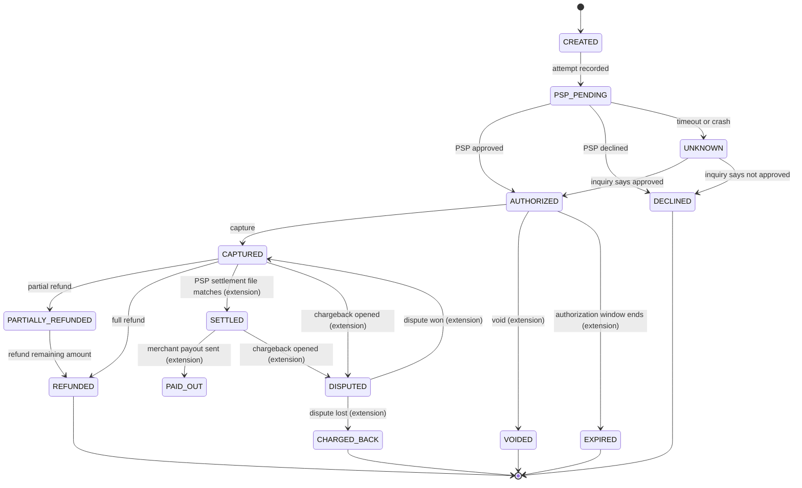

# Payment Lifecycle

Status: draft v1 · Companion to `payment-system-design.md` (sections 6 to 8), `failure-scenarios.md` and `deadlock-handling.md`

The states `CREATED` to `REFUNDED` match design section 6. Everything marked **(extension)** is a proposal and is not in the design yet. Column names follow design section 8 (`amount_minor`, `captured_minor`, `refunded_minor`, `version`).

A real payment is not one write. It moves through several states, each change is a transition with rules, and some transitions are driven by outside parties (the PSP, the card network, the customer's bank) and can arrive late, twice or out of order. This document describes those states and transitions and the rules that keep them safe.

States marked **(extension)** are not in `payment-system-design.md` section 6 yet. They are proposed here and need a design decision before they are built.

## 1. Overview

```
Customer pays
     |
     v
 CREATED --> PSP_PENDING --> AUTHORIZED --> CAPTURED --> SETTLED --> PAID_OUT
                 |   |           |   |          |
                 |   |           |   +--> VOIDED / EXPIRED (extension)
                 |   +--> UNKNOWN (timeout / crash) --> resolved by inquiry
                 +--> DECLINED
                                          CAPTURED --> PARTIALLY_REFUNDED --> REFUNDED
                                          CAPTURED / SETTLED --> DISPUTED (extension)
```

Three ideas run through the whole lifecycle:

1. **Money moves in two steps.** Authorization reserves funds. Capture takes them.
2. **Unknown is a real state.** A PSP timeout is not a failure; the outcome is not known yet.
3. **Every transition is a conditional, idempotent, ledgered write.**

## 2. State diagram



## 3. States

| State | Meaning | Final? | Money position | Who moves it out |
|---|---|---|---|---|
| `CREATED` | Payment record exists; no PSP call made yet | No | None | Our API (records the attempt) |
| `PSP_PENDING` | Attempt recorded; PSP call in flight | No | None | PSP answer, timeout, or crash recovery |
| `UNKNOWN` | PSP outcome not known (timeout or crash) | No | Maybe reserved | Reconciler or status inquiry |
| `AUTHORIZED` | PSP approved; funds reserved on the customer's side | No | Reserved, not taken | Capture, void, or expiry |
| `DECLINED` | PSP refused | Yes | None | n/a |
| `CAPTURED` | Funds taken from the customer | No | With the PSP, owed to the merchant | Refund, settlement, dispute |
| `PARTIALLY_REFUNDED` | Part of the captured amount returned | No | Partly returned | Further refund |
| `REFUNDED` | Full captured amount returned | Yes | Fully returned | n/a |
| `VOIDED` (extension) | Authorization cancelled before capture | Yes | Reservation released | n/a |
| `EXPIRED` (extension) | Authorization window ended without capture | Yes | Reservation released by the issuer | n/a |
| `SETTLED` (extension) | PSP settlement file confirms the money reached us | No | In our settlement account | Payout |
| `PAID_OUT` (extension) | Merchant has been paid | Yes (for the happy path) | With the merchant | Dispute may still apply |
| `DISPUTED` (extension) | Customer's bank opened a chargeback | No | Held back pending outcome | Dispute result |
| `CHARGED_BACK` (extension) | Dispute lost; funds reversed | Yes | Returned to the customer | n/a |

## 4. Transitions

Each row is one allowed transition. Anything not listed is forbidden.

| From | To | Trigger | Source | Ledger effect |
|---|---|---|---|---|
| `[*]` | `CREATED` | Create-payment request | Merchant | None |
| `CREATED` | `PSP_PENDING` | Attempt recorded | Internal | None |
| `PSP_PENDING` | `AUTHORIZED` | PSP approved | PSP response or callback | Authorization hold entries |
| `PSP_PENDING` | `DECLINED` | PSP declined | PSP response or callback | None |
| `PSP_PENDING` | `UNKNOWN` | Timeout or crash | Internal | None |
| `UNKNOWN` | `AUTHORIZED` | Inquiry says approved | Reconciler | Authorization hold entries |
| `UNKNOWN` | `DECLINED` | Inquiry says not approved | Reconciler | None |
| `AUTHORIZED` | `CAPTURED` | Capture request | Merchant or auto-capture | Debit customer funds, credit merchant payable |
| `AUTHORIZED` | `VOIDED` | Void request | Merchant | Release hold |
| `AUTHORIZED` | `EXPIRED` | Window ends | Timer job | Release hold |
| `CAPTURED` | `PARTIALLY_REFUNDED` | Refund below captured amount | Merchant | Reverse part of the entries |
| `CAPTURED` | `REFUNDED` | Refund of full amount | Merchant | Reverse all entries |
| `PARTIALLY_REFUNDED` | `REFUNDED` | Refund of the remainder | Merchant | Reverse remaining entries |
| `CAPTURED` | `SETTLED` | Settlement file matches | Reconciler | Move payable to settled |
| `SETTLED` | `PAID_OUT` | Payout sent | Payout service | Pay merchant from settled |
| `CAPTURED` / `SETTLED` | `DISPUTED` | Chargeback notice | PSP | Hold disputed amount |
| `DISPUTED` | `CAPTURED` | Dispute won | PSP | Release hold |
| `DISPUTED` | `CHARGED_BACK` | Dispute lost | PSP | Reverse entries, add dispute fee |

## 5. Transition rules

### 5.1 Every transition is a conditional update

```sql
UPDATE payments
SET    state = 'CAPTURED', version = version + 1, updated_at = now()
WHERE  id = :id AND state = 'AUTHORIZED';
```

- If zero rows are updated, someone else already moved the payment. The caller re-reads the state and decides; it never overwrites.
- This replaces long lock-holding with a single atomic statement, which also helps against deadlocks (see `deadlock-handling.md`).

### 5.2 State change, ledger entries and outbox event commit together

This is transaction B of design section 7. Transaction A (before the PSP call) creates the payment as `CREATED`, moves it to `PSP_PENDING`, and inserts the idempotency record and the attempt (with its own `attempt_id`) in one commit, so the two states are never visible separately.

Transaction B, in one short transaction:

1. Conditionally update the payment state.
2. Insert the ledger entries for that transition.
3. Insert the outbox event.

The PSP call happens **outside** this transaction (before it). Never hold a database lock across a network call.

### 5.3 Idempotency

- Every create, capture, void and refund request carries an `Idempotency-Key`.
- A retry with the same key returns the stored result and does not repeat the transition.
- A retry with the same key and a different body is rejected (`422`).
- A retry with the same key while the first request is still running returns `409` with `Retry-After`.
- Refunds have their own idempotency key (`refunds` table).

### 5.4 Late, duplicate and out-of-order events are ignored

PSP callbacks can repeat or arrive in the wrong order. Each PSP event is recorded once in `psp_events` (unique on `psp, psp_event_id`), which removes exact duplicates. A conditional update that finds the payment already in a later or final state does nothing; the event is logged, and an alert is raised if it contradicts the stored state (for example "declined" on a `CAPTURED` payment).

### 5.5 Amounts and currency are checked on every PSP answer

If the PSP's amount or currency differs from ours, the payment is held for review and no ledger entry is written for the disputed amount.

### 5.6 Refund limit

Total refunded must never exceed the captured amount. The design (section 8.3) enforces it with one atomic statement plus a table `CHECK (refunded_minor <= captured_minor)`:

```sql
update payments
   set refunded_minor = refunded_minor + $amount,
       state = case when refunded_minor + $amount = captured_minor
                    then 'REFUNDED' else 'PARTIALLY_REFUNDED' end,
       version = version + 1, updated_at = now()
 where id = $payment_id and merchant_id = $merchant_id
   and state in ('CAPTURED','PARTIALLY_REFUNDED')
   and refunded_minor + $amount <= captured_minor
returning refunded_minor;
-- 0 rows returned: reject; the limit was or would be exceeded.
```

Each refund also has its own row in `refunds` with a unique `(merchant_id, idempotency_key)`.

### 5.7 Final states are final

`DECLINED`, `VOIDED`, `EXPIRED`, `REFUNDED` and `CHARGED_BACK` accept no further transitions. A new attempt creates a new payment.

## 6. The Unknown state

A PSP timeout does not tell us whether the customer was charged.

- The API returns `202 Accepted` with the payment ID. The merchant learns the result by webhook or polling.
- The reconciler asks the PSP for the status of the attempt and moves the payment to `AUTHORIZED` or `DECLINED`.
- Never retry the charge as a fresh call to the PSP without the same PSP idempotency key (the `attempt_id`), or the customer can be charged twice. If the PSP reports an unknown attempt, the payment is declined or retried safely (design section 7).
- A payment stuck in `PSP_PENDING` or `UNKNOWN` beyond a time limit raises an alert.

## 7. Authorize, capture and auto-capture

| Mode | Behavior | Use when |
|---|---|---|
| Auth only, then capture | Funds are reserved at authorization; merchant captures later (for example when goods ship) | Physical goods, hotels, rentals |
| Auto-capture | Capture is triggered right after authorization | Digital goods, instant services |
| Partial capture | Capture less than the authorized amount; remainder is released | Partial shipment |

Rules:

- Capture amount must be less than or equal to the authorized amount.
- Capture after `VOIDED` or `EXPIRED` is rejected by the state machine.
- Capture and refund at the same moment are serialized by the conditional updates; one wins and the other re-reads.

## 8. Time-based transitions

| Timer | Applies to | Action |
|---|---|---|
| Attempt timeout | `PSP_PENDING` | Move to `UNKNOWN`, then inquire. Payments in `PSP_PENDING` or `UNKNOWN` are found through the partial index `payments_unresolved`. |
| Authorization window (for example 7 days, depends on card scheme) | `AUTHORIZED` | Move to `EXPIRED` and release the hold |
| Unknown age limit | `UNKNOWN` | Alert; escalate to manual review |
| Dispute response deadline | `DISPUTED` | Alert so evidence is submitted in time |

Timer jobs use the same conditional update, so a job and a manual capture cannot both win.

## 9. Worked example: happy path with a partial refund

| Step | Action | State after | Ledger |
|---|---|---|---|
| 1 | Merchant creates payment of 100.00 | `CREATED` | none |
| 2 | API records attempt, calls PSP | `PSP_PENDING` | none |
| 3 | PSP approves | `AUTHORIZED` | hold 100.00 |
| 4 | Merchant captures 100.00 | `CAPTURED` | customer funds to merchant payable, 100.00 |
| 5 | Customer returns an item; merchant refunds 30.00 | `PARTIALLY_REFUNDED` | reverse 30.00, `refunded_minor = 30.00` |
| 6 | Merchant refunds 70.00 | `REFUNDED` | reverse 70.00, `refunded_minor = 100.00` |

## 10. Worked example: timeout then recovery

| Step | Event | State after |
|---|---|---|
| 1 | API calls PSP; no answer within the deadline | `UNKNOWN` |
| 2 | API returns `202 Accepted` with payment ID | `UNKNOWN` |
| 3 | Reconciler asks PSP: "was attempt X approved?" | `UNKNOWN` |
| 4 | PSP says approved | `AUTHORIZED` (webhook sent to merchant) |
| 5 | Late "declined" callback arrives | no change; logged and alerted |

## 11. Webhooks to the merchant

An outbox event is written in the same transaction as every state change, and a relay delivers it.

| Event | Sent on |
|---|---|
| `payment.authorized` | `AUTHORIZED` |
| `payment.declined` | `DECLINED` |
| `payment.captured` | `CAPTURED` |
| `payment.voided` / `payment.expired` | `VOIDED` / `EXPIRED` |
| `payment.refunded` | `PARTIALLY_REFUNDED`, `REFUNDED` |
| `payment.disputed` | `DISPUTED` |

Delivery is at-least-once, so each event has a unique ID and the merchant de-duplicates.

## 12. Edge cases

The full edge-case list is E1 to E17 in `failure-scenarios.md` (suite C31). These LC cases are lifecycle-specific; LC1, LC2, LC4, LC5 and LC7 repeat E6, E8, E7, E10 and FS-07 on purpose, so the two documents must be changed together.

| # | Case | Handling |
|---|---|---|
| LC1 | Refund on a payment that is not captured, or is `UNKNOWN` | Reject with a clear error |
| LC2 | Capture after authorization expired or was voided | Reject; the state machine forbids it |
| LC3 | Duplicate create with the same key | Return the stored result |
| LC4 | Two refunds at the same moment above the captured amount | The atomic `refunded_minor` check rejects the later one |
| LC5 | PSP callback arrives before our state-change transaction commits | Conditional update finds the old state; the event is parked, retried briefly, then reconciled |
| LC6 | Customer disputes after a full refund | Reject or defend; refunded amount is shown in evidence |
| LC7 | PSP amount differs from ours | Hold for review; no ledger entry for the difference |
| LC8 | Process crashes between PSP call and state write | Payment stays `PSP_PENDING`; reconciler resolves it |

## 13. Metrics and alerts

| Metric | Why |
|---|---|
| Payments per state (gauge) | Spot pile-ups, for example many in `UNKNOWN` |
| Age of oldest payment in `PSP_PENDING` and `UNKNOWN` | Stuck-payment alert |
| Transition rate by from/to state | Detect abnormal flows |
| Ignored (late/duplicate) events | Spot PSP problems |
| Conditional-update zero-row count | Measures contention and races |
| Authorization-to-capture ratio | Business health |
| Dispute rate | Merchant and fraud risk |

## 14. Testing

Test IDs refer to design section 18 (C3, C4, C5 PSP and crash cases, C6 concurrent refunds, C31 edge cases, U2 and U3 property tests).

- **State machine tests:** for every state, try every transition; only the allowed ones succeed.
- **Property test:** the sum of ledger entries per payment equals the expected balance for the final state.
- **Idempotency test:** replay every request twice and with a crash in between.
- **Race test:** run capture and refund at the same moment; exactly one wins and the ledger balances.
- **Out-of-order test:** deliver PSP callbacks in all permutations; the final state is the same.
- **Timeout test:** force PSP timeouts and confirm the payment reaches a correct final state through the reconciler.

## 15. Open decisions

1. Which **extension** states to build first (`VOIDED`, `EXPIRED`, `SETTLED`, `DISPUTED`) and which wait for the settlement and payout phase.
2. Authorization window per card scheme and per PSP.
3. Whether auto-capture is a flag on the payment or a merchant setting.
4. How long a payment may stay `UNKNOWN` before manual review.
5. Whether `PAID_OUT` and `CHARGED_BACK` belong in the payment record or in a separate settlement record.
