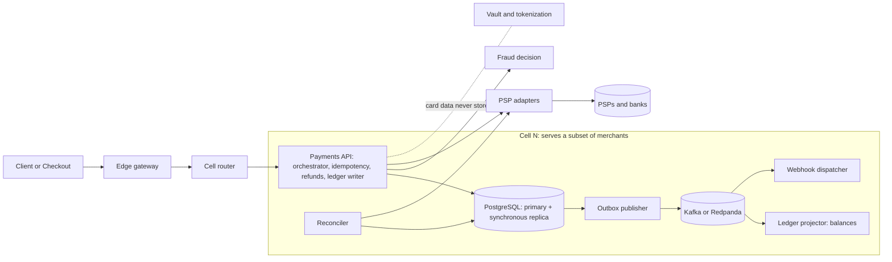
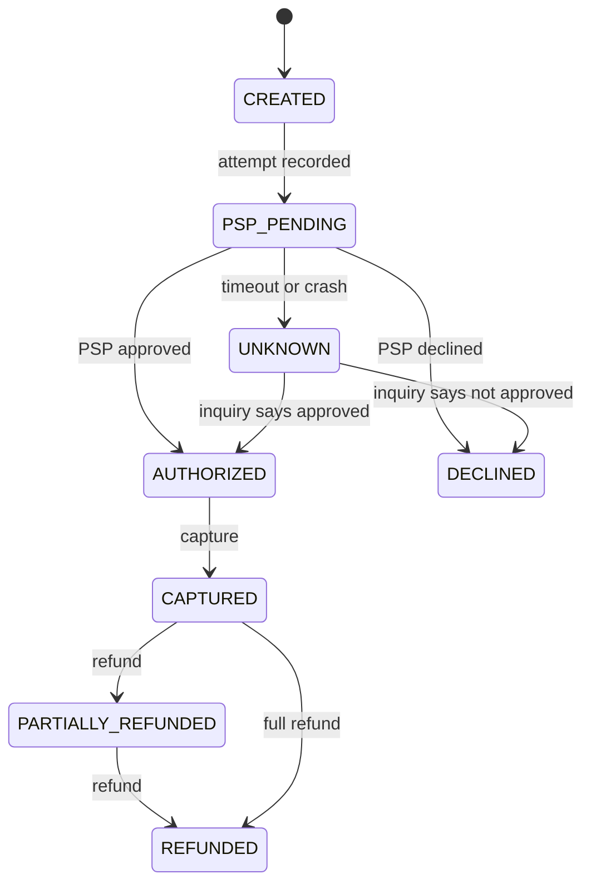

# Payment Processing System: Design for 5,000 TPS (Open Payments)

Status: draft v2 · Date: 2026-11-04 · Stack: C# / .NET 8, ASP.NET Core, PostgreSQL, Kafka-compatible broker, Kubernetes

Companions: `scaling-playbook.md` (ramp plan, decision gates, sizing, results log) · `failure-scenarios.md` (failure catalogue, edge cases, recovery runbooks, drills) · `payment-lifecycle.md` (states, transitions, rules, examples) · `deadlock-handling.md` (lock contention and deadlocks at high TPS) · `dotnet-for-payments.md` (why .NET)

## 0. How to read this document

The problem list this design answers is the 108 production problems for a C# payment system at 5,000 TPS (sections 1-9 of that list).

A design on paper cannot "pass" production problems. So this document does three things:

1. It names the **mechanism** that addresses each of the 108 problems (sections 6-17).
2. It names the **test or drill** that proves the mechanism works (section 18).
3. It leaves every checkbox in section 19 **unchecked** until that test passes with evidence (a run ID, a graph, a report).

"Design passes" therefore means: every problem has a mechanism and a proof, and every proof has passed. Until then the status is "designed, not verified".

## 1. Goals, SLOs and load assumptions

| Area | Target |
|---|---|
| Throughput | 5,000 committed payments/s sustained; design ceiling 15,000/s burst for 10 minutes (3x) |
| Latency | Platform overhead p99 ≤ 100 ms excluding PSP time; p50 ≤ 25 ms |
| Correctness | 0 duplicate charges, 0 lost financial records, ledger always balanced |
| Availability | 99.95% for the payments API |
| Durability | RPO 0 for committed payments (synchronous replica); RTO ≤ 60 s for database failover |
| Recovery | Automatic for loss of one node or one availability zone, with no manual step |

**What is counted.** Three rates are measured separately at every stage: *admitted* requests per second (passed admission control), *rejected* requests per second (shed with 429 or 503), and *completed payments* per second (reached a final committed state). The 5,000 TPS goal is completed payments, not HTTP requests.

**Two latency measures.** *Platform overhead* excludes time spent waiting on the PSP and carries the gated target above. *End to end* is recorded against the mock PSP at a fixed latency, and becomes a gate only once a target is chosen against the real PSP.

The latency, availability and RTO numbers are targets I set. They are validated by the tests in section 18, not measured yet.

**Derived load (assumptions to validate in test L1):**

- Each payment causes roughly 8-10 database writes: payment, attempt, idempotency record, outbox event, 2-4 ledger entries. That is about 40-50k writes/s across the fleet, or 10-12k per cell with 4 active cells.
- PSP latency of 200 ms to 2 s means about 5,000 requests in flight at a 1 s average (Little's law).
- Peak is sized at 3x so a lost node or a burst does not breach the SLO.

## 2. Design principles

1. **The database is the source of truth.** Nothing is confirmed to the payer before the commit.
2. **Intent before action.** The payment attempt is written to the database before the PSP is called.
3. **Every operation is idempotent end to end**, from client request to PSP call to event consumer. Idempotency is enforced by database constraints. Redis may speed up checks, but it is never the only protection against duplicate charges.
4. **Unknown is a first-class state.** A PSP timeout is not a failure.
5. **Never hold a database transaction across a network call.**
6. **Bound everything:** concurrency, queues, retries, timeouts, payload sizes.
7. **The ledger is append-only and written in the same transaction as the state change.**
8. **Anything not needed to answer the payer runs asynchronously** from the outbox.
9. **Isolate failures:** cells, bulkheads, one circuit breaker per PSP.
10. **Prove with tests, not opinion.**

## 3. Architecture



The payment path is deliberately short: API, one short transaction, PSP, one short transaction. Everything else hangs off the outbox, so a slow or broken consumer can never slow down or corrupt a payment.

## 4. Services

| Service | Responsibility | State it owns | Isolation notes |
|---|---|---|---|
| Edge gateway | TLS, authentication, per-merchant rate limiting, request size limits | none | Sheds load before the core |
| Cell router | Maps merchant to cell | merchant-to-cell table (control plane) | Thin, cached, no payment logic |
| Payments API (modular core) | Payment lifecycle, idempotency, refunds, ledger writes, outbox writes | payments, attempts, idempotency, refunds, ledger, outbox | The only writer of financial state |
| PSP adapters | One adapter per PSP behind one interface; deadline, breaker, rate limit, status inquiry | adapter metadata only | Separate bulkhead per PSP; may become a service later |
| Vault and tokenization | Keeps card data; issues tokens | encrypted card data | Own PCI scope, own network segment |
| Fraud decision | Synchronous rules with a strict time budget; async analytics | rules, counters (Redis) | Fallback policy if unavailable (section 16) |
| Outbox publisher | Moves committed events to the broker | none (reads outbox) | Can lag without affecting payments |
| Ledger projector | Builds balances and snapshots from ledger entries | balance snapshots | Read model only, rebuildable |
| Webhook dispatcher | Signed delivery to merchants with retries | delivery log | Per-endpoint isolation |
| Reconciler | Resolves unknown payments; compares against PSP settlement files | discrepancy records | Safety net, runs in every cell |
| Settlement and payouts | Later phase | payout records | Out of scope for the first build |

**Build order:** payments core, idempotency, ledger, one PSP adapter, outbox plus broker, reconciler. Start with the mock PSP and load harness (section 18) before the core.

## 5. Cells and routing

- A **cell** is a complete stack (API pods, database, broker, workers) serving a subset of merchants. Plan for about 1.5-2k TPS per cell: 4 active plus 1 spare for 5k.
- `merchant_id` is on every table from day one, so moving merchants between cells is a routing change, not a schema change.
- Cells share nothing on the payment path. The control plane (routing table, merchant config) is cached in each cell and can be stale without stopping payments.
- Each cell spans 3 availability zones. Active-active across regions is out of scope (see section 21).
- A very large merchant can be given its own cell, which bounds its blast radius and its hot-account effects.
- **Cells are a decision, not an assumption.** Build one cell first. Split into several only if gate G1 in `scaling-playbook.md` shows that one primary cannot sustain the measured write rate at 60% CPU or less with synchronous replication on.

## 6. Payment lifecycle

The full state, transition and rule tables, worked examples and proposed extra states (void, expiry, settlement, disputes) are in `payment-lifecycle.md`. The diagram below is the version this design commits to.



Rules:

- Every transition is a conditional update: `UPDATE ... WHERE id = $1 AND state = $expected`. Zero rows updated means someone else already moved it, and the caller re-reads instead of overwriting.
- Terminal and out-of-order events are ignored, not applied (for example a late "declined" callback on a captured payment is logged and alerted, never applied).
- A payment stuck in `PSP_PENDING` or `UNKNOWN` is always found by the reconciler (section 10).

## 7. Create-payment flow

1. **Admit.** Authenticate, rate-limit, take a concurrency permit. If none is available, reject at once with 429 or 503 and `Retry-After`.
2. **Fraud check** within a 50 ms budget. On timeout, apply the fallback policy for the payment's risk tier.
3. **Transaction A (short, no network calls).** Insert the idempotency record and the payment (`CREATED` to `PSP_PENDING`) and a payment attempt with its own `attempt_id`. Commit.
   - A unique violation on `(merchant_id, idempotency_key)` means a duplicate request. If the stored request hash matches, return the stored result. If it does not match, return 422. If the first request is still in flight, return 409 with `Retry-After`.
4. **Call the PSP** using `attempt_id` as the PSP idempotency key, with a hard deadline and the per-PSP circuit breaker and rate limiter.
5. **Transaction B (short).** Conditionally move the payment to its new state, insert the ledger entries for that state, and insert the outbox event. Commit.
6. **Respond.** On a PSP timeout the state is `UNKNOWN` and the API answers `202 Accepted` with the payment ID. The merchant gets the final result by webhook or by polling.

**Crash analysis:**

| Crash point | What the database holds | Recovery |
|---|---|---|
| Before transaction A commits | nothing | Client retries with the same key |
| After A, before the PSP call | attempt in `PSP_PENDING` | Reconciler inquires by `attempt_id`; the PSP reports "unknown attempt", so the payment is declined or retried safely |
| After the PSP call, before B | attempt in `PSP_PENDING` | Reconciler inquires by `attempt_id` and applies the PSP's real answer |
| After B commits, before the response | final state and outbox event | Client retries; the idempotency record returns the stored result |

## 8. Data model

All amounts are `bigint` minor units with a `currency` column. A currency table holds the exponent (for example 2 for USD, 0 for JPY) and the rounding rule. Floating point is never used for money. In code, a `readonly record struct Money(long Minor, CurrencyCode Currency)` prevents mixing currencies.

### 8.1 Core tables (PostgreSQL)

```sql
create table payments (
  id              uuid primary key,
  merchant_id     uuid not null,
  state           text not null,
  amount_minor    bigint not null check (amount_minor > 0),
  currency        char(3) not null,
  captured_minor  bigint not null default 0,
  refunded_minor  bigint not null default 0,
  version         int not null default 0,
  created_at      timestamptz not null default now(),
  updated_at      timestamptz not null default now(),
  check (refunded_minor <= captured_minor)
);
create index payments_merchant_created on payments (merchant_id, created_at desc);
create index payments_unresolved on payments (updated_at)
  where state in ('PSP_PENDING','UNKNOWN');

create table payment_attempts (
  attempt_id    uuid primary key,
  payment_id    uuid not null references payments(id),
  psp           text not null,
  state         text not null,
  psp_reference text,
  created_at    timestamptz not null default now()
);

-- hash-partitioned by merchant_id so the unique key includes the partition key
create table idempotency_keys (
  merchant_id    uuid not null,
  key            text not null,
  request_hash   bytea not null,
  payment_id     uuid,
  response_code  int,
  response_body  jsonb,
  created_at     timestamptz not null default now(),
  primary key (merchant_id, key)
) partition by hash (merchant_id);

-- time-partitioned; whole partitions are dropped once published and old
create table outbox (
  id            uuid not null,
  aggregate_id  uuid not null,
  event_type    text not null,
  payload       jsonb not null,
  created_at    timestamptz not null default now(),
  published_at  timestamptz,
  primary key (created_at, id)
) partition by range (created_at);

create table psp_events (
  psp          text not null,
  psp_event_id text not null,
  payload      jsonb not null,
  received_at  timestamptz not null default now(),
  primary key (psp, psp_event_id)
);
```

### 8.2 Refunds

```sql
create table refunds (
  id              uuid primary key,
  payment_id      uuid not null references payments(id),
  merchant_id     uuid not null,
  idempotency_key text not null,
  amount_minor    bigint not null check (amount_minor > 0),
  state           text not null,
  created_at      timestamptz not null default now(),
  unique (merchant_id, idempotency_key)
);
```

### 8.3 Atomic refund limit

```sql
update payments
   set refunded_minor = refunded_minor + $amount,
       state = case when refunded_minor + $amount = captured_minor
                    then 'REFUNDED' else 'PARTIALLY_REFUNDED' end,
       version = version + 1, updated_at = now()
 where id = $payment_id and merchant_id = $merchant_id
   and state in ('CAPTURED','PARTIALLY_REFUNDED')
   and refunded_minor + $amount <= captured_minor
returning refunded_minor;
-- 0 rows returned: reject; the limit was or would be exceeded.
```

The check lives in the `WHERE` clause and a table `CHECK` constraint, so concurrent refunds cannot exceed the captured amount no matter how many app instances run. The refund record's own idempotency key makes a retried refund return the same result.

## 9. Ledger

- **Append-only.** Corrections are new reversing entries. The application role has `INSERT` and `SELECT` only on ledger tables (`UPDATE` and `DELETE` are revoked).
- **Same transaction as the state change** (transaction B). So "payment succeeded but ledger failed" cannot happen by construction.
- **No balance column is updated on the payment path.** This is what removes the hot-row problem: inserting rows takes no lock on a shared account row.
- **Balances are derived:** a snapshot plus the entries since the snapshot, built by the ledger projector. Available balance for a refund or payout check reads the latest snapshot plus recent entries.
- **Hot accounts** (for example the platform fee account) are split into 64 sub-accounts chosen by `hash(payment_id) % 64` and summed on read.

```sql
create table ledger_transactions (
  id              uuid primary key,
  payment_id      uuid,
  kind            text not null,       -- authorization, capture, refund, fee, ...
  source_event_id uuid not null unique, -- one ledger transaction per business event
  created_at      timestamptz not null default now()
);

-- hash-partitioned by txn_id so the unique key includes the partition key
create table ledger_entries (
  txn_id       uuid not null,
  entry_no     smallint not null,
  account_id   uuid not null,
  direction    char(1) not null check (direction in ('D','C')),
  amount_minor bigint not null check (amount_minor > 0),
  currency     char(3) not null,
  created_at   timestamptz not null default now(),
  primary key (txn_id, entry_no)
) partition by hash (txn_id);
```

**Balance invariant.** The application inserts all entries of a transaction in one statement, and a deferred constraint trigger checks that debits equal credits per `txn_id` as a backstop. The trigger's cost is measured in test L1. If it costs too much, it is replaced by a continuous audit query that pages on any imbalance, and the property tests (U3) remain the main guard.

**Negative balance.** Refund and payout checks read the available balance and insert a reservation entry in the same transaction as the check. Reservation rules are part of the payout service design.

## 10. PSP adapters

One interface per PSP:

```csharp
public interface IPspAdapter
{
    Task<PspResult> AuthorizeAsync(AttemptId attempt, Money amount, CardToken token, CancellationToken ct);
    Task<PspResult> CaptureAsync(AttemptId attempt, Money amount, CancellationToken ct);
    Task<PspResult> RefundAsync(RefundId refund, Money amount, CancellationToken ct);
    Task<PspInquiry> InquireAsync(AttemptId attempt, CancellationToken ct); // status by our idempotency key
}
```

- **Idempotency:** `attempt_id` and `refund_id` are sent as the PSP's idempotency key. The same key is reused for any retry.
- **Deadline:** each call has an explicit deadline from the request budget (initially 2.5 s, configurable per PSP). `HttpClient.Timeout` is set to infinite and the deadline comes from `CancellationToken`.
- **Resilience pipeline (Polly v8 or `Microsoft.Extensions.Resilience`):** timeout, then circuit breaker (opens on a high failure ratio over a sampling window, then half-open probes), then a client-side token-bucket rate limiter sized to the PSP contract. The breaker is per PSP, never global.
- **Retries:** automatic only before the request was sent (connection failures) or when the PSP is called with the same idempotency key. Never a blind retry of a charge.
- **Failover:** when a PSP breaker is open, new payments route to a secondary PSP if the merchant allows it. In-flight attempts on the failed PSP stay with it and are resolved by inquiry.
- **Connections:** `IHttpClientFactory` with `SocketsHttpHandler` and `PooledConnectionLifetime` of a few minutes so DNS changes are picked up. Certificates are monitored for expiry.
- **Callbacks:** the receiver verifies the signature, inserts into `psp_events` with the primary key `(psp, psp_event_id)` (`ON CONFLICT DO NOTHING`), and applies the event through the same conditional state machine as any other transition. Duplicate callbacks are no-ops.
- **Reconciler:**
  - Every few seconds it selects payments in `PSP_PENDING` or `UNKNOWN` older than a threshold (using the partial index above), calls `InquireAsync`, and applies the answer.
  - Daily, it compares the PSP settlement file with ledger totals and writes any discrepancy to a table that pages on non-zero.

## 11. Events, outbox and webhooks

- **Transactional outbox.** The event row is inserted in the same transaction as the state change. The publisher reads unpublished rows in batches with `FOR UPDATE SKIP LOCKED`, publishes with `Acks.All` and idempotence enabled, then marks them published. If the broker is down, events wait in the outbox.
- **Topics:** keyed by `payment_id`, so one payment's events stay ordered. Each event has `event_id`, a per-payment `sequence`, and a schema version. Events carry IDs and state, not large blobs (maximum about 32 KB).
- **Broker:** replication factor 3, `min.insync.replicas=2`.
- **Consumers:**
  - Commit offsets only after the work is durably done.
  - Dedupe with an inbox table (`consumer`, `event_id` unique), so a redelivered event does nothing.
  - Reject events with a lower sequence than already applied.
  - Retry with backoff, then move to a dead-letter queue with an alert after N failures.
  - Use cooperative-sticky assignment and static membership to limit rebalance disruption.
- **Schemas:** a schema registry enforces backward compatibility. Consumer contract tests run in CI.
- **Webhooks to merchants:** signed (HMAC with timestamp), retried with exponential backoff and jitter, isolated per endpoint so one slow merchant cannot delay others, with a replay API.
- **Honest limit:** producer idempotence stops duplicates from producer retries only. End-to-end safety comes from the idempotent consumers and conditional state transitions, not from the broker alone.

## 12. Load control

### 12.1 Layers

1. Edge: per-merchant token-bucket rate limit.
2. Gateway and API: global concurrency limiter with no queue.
3. Per instance: an in-flight cap (starting at 500, tuned by tests L1 and L3).
4. Downstream: per-PSP rate limiter and per-dependency bulkheads.

When over the limit the system rejects immediately with 429 or 503 and `Retry-After`. Waiting in an unbounded queue is never allowed.

```csharp
// illustrative; values come from load tests
builder.Services.AddRateLimiter(o =>
{
    o.RejectionStatusCode = StatusCodes.Status503ServiceUnavailable;
    o.AddConcurrencyLimiter("payments", c =>
    {
        c.PermitLimit = 500;
        c.QueueLimit = 0; // reject instead of queueing
    });
});
```

### 12.2 Bounded concurrency inside the process

Work that fans out (webhook sends, event handling) uses a bounded `Channel<T>` with a fixed number of workers, or `Parallel.ForEachAsync` with `MaxDegreeOfParallelism`. There is no fire-and-forget `Task.Run`, and no unbounded `Task.WhenAll` over input-sized lists.

### 12.3 Deadlines

A request has a total budget (5 s). Slices: fraud 50 ms, PSP up to 2.5 s, each database call 200 ms. The `CancellationToken` is passed into every async call (analyzer CA2016 is enabled), so abandoned work stops.

### 12.4 Kestrel limits

```csharp
builder.WebHost.ConfigureKestrel(o =>
{
    o.Limits.MaxRequestBodySize = 64 * 1024;
    o.Limits.MaxConcurrentConnections = 10_000;
    o.Limits.RequestHeadersTimeout = TimeSpan.FromSeconds(5);
    o.Limits.MinRequestBodyDataRate = new MinDataRate(240, TimeSpan.FromSeconds(5));
    o.Limits.KeepAliveTimeout = TimeSpan.FromSeconds(60);
});
```

Load balancer idle timeouts are set longer than the Kestrel keep-alive so connections are not reset mid-request.

## 13. .NET runtime rules

**Async and threads**

- The request path is async end to end. An analyzer rule fails the build on `.Result`, `.Wait()`, and `.GetAwaiter().GetResult()` in request-path projects, and on synchronous database and HTTP APIs.
- No `lock` around an `await`. Use `SemaphoreSlim` for async mutual exclusion, and avoid locks on the hot path entirely.
- No `new Thread` or `Task.Run` in the request path.
- CPU-heavy work (batch signing, large hashing) runs in separate worker processes so it cannot starve I/O.

**Memory and GC**

- Server GC with concurrent GC enabled. `DOTNET_GCHeapHardLimitPercent` is set below the container limit so the GC reacts before the OOM killer does.
- Each hot-path request has an **allocation budget** enforced by BenchmarkDotNet in CI. Measure first, then optimize.
- Optimize only measured hot spots: `System.Text.Json` source generation, no LINQ or closures in hot loops, `Span<T>`, `ArrayPool<byte>` for large temporary buffers, `LoggerMessage` source-generated logging, `Money` as a struct to avoid boxing.
- Payload limits keep objects under the 85 KB large-object-heap threshold on the hot path.
- Caches are bounded (`MemoryCache` with `SizeLimit`). Nothing is held in static collections without a bound.
- `IDisposable` analyzers (for example CA2000) are on. Use `using` and `await using`.
- No pinning unless unavoidable.

**Data access**

- Hot write path: Dapper with parameterized SQL, and one connection per operation.
- EF Core only for dashboard reads, with `AsNoTracking`, scoped `DbContext`, no `DbContext` in singletons, and no concurrent use of one context.

## 14. Database

### 14.1 Connection budget

- Application connects to PgBouncer in transaction-pooling mode. PgBouncer connects to PostgreSQL with a fixed pool per cell (start at about 100 and tune in L1).
- Formula to check at each scale-out: `instances × Npgsql MaxPoolSize` must fit PgBouncer's client limit, and PgBouncer's pool must fit the database's `max_connections` with headroom for admin.
- A short pool wait timeout (for example 200 ms) turns exhaustion into fast failure, not hanging requests.
- Transaction pooling does not keep session state. Prepared statements need a PgBouncer version and Npgsql settings that support them; this is verified in the staging setup before relying on it.

### 14.2 Transactions

- At most about 5 statements, with a target of a few milliseconds. No PSP call, no HTTP call, and no broker call inside a transaction.
- Role-level settings on the API role: `lock_timeout` 200 ms, `statement_timeout` 1 s, `idle_in_transaction_session_timeout` 2 s.
- Rows are always touched in a consistent order. On serialization or deadlock errors (SQLSTATE 40001, 40P01) retry at most twice with jitter, within a retry budget, so retries cannot cause a storm. Causes, scenarios and automated mitigation for deadlocks are in `deadlock-handling.md`.

### 14.3 Queries

- Query-count tests per endpoint fail CI on N+1 patterns. `EXPLAIN` checks for hot queries run in CI against a representative dataset. Generated SQL from EF Core is logged and reviewed.

### 14.4 Capacity

- Target at most about 60% CPU on the primary at 5k TPS (the headroom is for peak and failover). NVMe storage, WAL on its own volume.
- Synchronous replication adds one network round trip to every commit. Its measured cost is recorded in L1; commits are kept short to limit lock time.

### 14.5 Maintenance

- Time or hash partitioning of append-heavy tables as in section 8. Old outbox partitions are dropped, not deleted row by row.
- Autovacuum is tuned for hot tables. Index bloat is monitored, with `REINDEX CONCURRENTLY` when needed.
- WAL archiving is on. Replication slot lag and disk usage alert at 70% and 85%.

### 14.6 High availability

- Patroni (or a managed multi-AZ service) with one synchronous standby so a committed transaction survives the loss of the primary.
- Reads that must be fresh (payment status, refund checks, idempotency checks) always go to the primary. Replicas serve dashboard and reporting reads where staleness is acceptable, and routing is lag-aware.

### 14.7 Migrations

- Expand then contract in separate releases. `lock_timeout` of about 2 s on migrations. Indexes are built with `CREATE INDEX CONCURRENTLY`. No table rewrites during deploys. Backfills run in small batches.

## 15. Platform (Kubernetes and operations)

- Each cell runs at least 3 API replicas spread across 3 availability zones (topology spread constraints), with PodDisruptionBudgets.
- Autoscaling (HPA) on in-flight requests per pod and consumer lag, plus about 40% standing headroom so scaling lag does not cause overload. The HPA maximum replica count is capped so that `max replicas × connections per pod` stays inside the connection budget in section 14.1; otherwise scaling out can overload the database.
- Memory limit leaves room above the GC hard limit. API pods use integer CPU requests equal to limits, and CPU throttling is monitored.
- Probes: **startup** (app initialized), **liveness** (process only, never depends on the database), **readiness** (database reachable, at least one PSP breaker not open, not draining).
- **Graceful shutdown:** on SIGTERM readiness turns false, the app stops accepting new requests, drains in-flight work through `IHostApplicationLifetime` (up to about 30 s), and publishes remaining outbox rows. `preStop` delay and `terminationGracePeriodSeconds` are set to match.
- **Deployments:** canary 5%, then 25%, then 100%, with automatic rollback on error rate or p99 breach.
- **Secrets and certificates:** external secrets with rotation, expiry alerts 30 days ahead, cert-manager for TLS.
- **Disk:** alerts at 70% and 85% for databases, brokers and logs.

## 16. Security, fraud and compliance

- **Credentials:** API keys are stored hashed, scoped (read, write, refund), optionally IP-restricted, and rolled with a grace period. Unusual usage raises alerts.
- **Tenant isolation:** `merchant_id` on every table and in every query through a shared repository layer. PostgreSQL row-level security is a backstop (`SET LOCAL app.merchant_id` inside each transaction, which works with transaction pooling).
- **Card data:** card numbers live only in the vault. The payment database stores tokens. This keeps PCI scope to the vault and the hosted checkout fields.
- **Logging:** redaction middleware, structured logs only, and tests that scan log output for card-number patterns.
- **Replay protection:** signed webhooks carry a timestamp and are rejected outside a window. Requests are also protected by idempotency keys.
- **Dashboard access:** MFA, RBAC, step-up authentication for key rolling and payouts, and an append-only audit log.
- **Fraud:**
  - Synchronous rules (velocity per IP, per card, per merchant; card-testing patterns) run within the 50 ms budget on Redis counters. Heavy analysis is asynchronous.
  - Fallback policy when the fraud service is unavailable: low-risk tier fails open up to an amount limit and is flagged for review. High-risk tier and amounts above the limit fail closed.

## 17. Observability

| Signal | Source | Alert |
|---|---|---|
| ThreadPool queue length and thread count | `dotnet-counters` / OpenTelemetry runtime metrics | Queue length above threshold for 30 s |
| Gen 2 GC rate, allocation rate, GC pause | runtime counters | Gen 2 rate or pause above baseline |
| Lock contention rate | runtime counters | Sustained increase |
| Platform overhead latency p50/p95/p99 | ASP.NET Core instrumentation | p99 above 100 ms |
| Database pool wait time and active connections | Npgsql metrics, PgBouncer stats | Wait time above threshold |
| Outbox age (oldest unpublished row) | database query metric | Older than 30 s |
| Consumer lag per group | Kafka exporter | Above threshold and growing |
| Circuit breaker state, PSP error and timeout rate | adapter metrics | Breaker open, rate above baseline |
| Unknown-payment count and age | business metric | Any older than reconciler threshold |
| Ledger imbalance (continuous audit query) | business metric | Any non-zero (pages) |
| Reconciliation discrepancies | reconciler | Any non-zero (pages) |
| Admitted, rejected and completed requests per second | gateway and API metrics | Completed rate diverges from admitted rate without matching rejections |
| Payment success rate, idempotency conflict rate, decline rate | business metrics | Deviation from baseline |
| Disk, WAL and replication lag | infrastructure | 70% and 85% disk, lag above threshold |

Thresholds are initial values and are tuned after test L1. Tracing (OpenTelemetry) follows a payment from API through PSP call to the consumer. Runbooks for `dotnet-counters`, `dotnet-trace` and `dotnet-dump` are drilled (O2).

## 18. Test and drill catalogue

Every checklist row in section 19 points to one or more of these IDs. A test counts as passed only when its run is recorded with a run ID, commit, configuration and result link.

### 18.1 Correctness checks (run after every load and chaos test)

| ID | Check |
|---|---|
| CK1 | Ledger is balanced for every transaction and no ledger row was changed or deleted |
| CK2 | Every payment has at most one successful charge at the PSP (compared by `attempt_id`) |
| CK3 | `refunded_minor ≤ captured_minor` for every payment |
| CK4 | Every outbox row is eventually published, and every event had exactly one effect in each consumer |
| CK5 | No payment remains in `PSP_PENDING` or `UNKNOWN` past the reconciler threshold |
| CK6 | No sustained growth in queue depth, outbox age or consumer lag |

### 18.2 Load tests

| ID | Test | Pass criteria |
|---|---|---|
| L1 | Ramp per `scaling-playbook.md` (1 req/s up to 5k, one step at a time, mixed workload), against the mock PSP with realistic latency and 2-5% errors | Gates met at every step: p99 platform overhead ≤ 100 ms; error rate (excluding deliberate rejections) < 0.1%; CK1-CK6 pass; results logged for the capacity model |
| L2 | Soak: 5k TPS for 24 h | Memory and Gen 2 GC rate show no upward trend; ThreadPool queue stable; no pool wait growth; CK1-CK6 pass |
| L3 | Burst: 15k TPS for 10 min | Excess load rejected with 429/503 within the limit; no OOM or restart; SLO restored within 2 min after the burst; CK pass |
| L4 | Abuse: slow-body clients, oversized bodies, connection floods | Abusive clients are cut off; normal traffic keeps its SLO |
| L5 | Sustained: 5k TPS for 60 min | Gates met throughout; memory, queues and pool wait stay flat |
| L6 | Stress: 5k rising to 10k TPS for 15 min | Overload is shed with 429 or 503; the first resource to fail is identified and recorded |

### 18.3 Chaos and failure tests

| ID | Fault injected | Expected behavior |
|---|---|---|
| C1 | Database 5x slower | Backpressure and fast rejection; no ThreadPool starvation; no retry storm; CK pass |
| C2 | Database connection pool exhausted | Bounded wait, then controlled failure; recovery without restart |
| C3 | PSP approves, then the response times out | Payment becomes `UNKNOWN`, reconciler resolves it; exactly one charge |
| C4 | API process killed (`kill -9`) after the PSP approved | Reconciler recovers the real state; exactly one charge |
| C5 | Same idempotency key sent 100 times concurrently | One payment, one charge, identical stored response to all |
| C6 | 50 concurrent refunds totaling more than the captured amount | Total refunded never exceeds captured; the rest rejected |
| C7 | Database primary killed during load | Failover within RTO; all committed payments present (RPO 0); fresh reads served by the new primary |
| C8 | Broker down 10 min, and one broker killed | Outbox retains events; backlog drains after recovery; CK4 passes |
| C9 | Duplicate, delayed and out-of-order PSP callbacks | One logical state transition each; stale events ignored and logged |
| C10 | Kubernetes node killed | Remaining replicas serve traffic within SLO |
| C11 | Availability zone lost | Cell keeps serving from the other zones; no data loss |
| C12 | PSP returns 429 | Client-side limiter and backoff hold; no duplicate charges |
| C13 | PSP outage for 5 min | Breaker opens, failover to secondary PSP where allowed, fast failures otherwise |
| C14 | Fraud service unavailable | Fallback policy applied per tier; decisions logged |
| C15 | Failure injected into transaction B (state, ledger and outbox write) | Payment not confirmed to the client; remains pending; reconciler completes it; no partial ledger |
| C16 | PSP DNS failure and TLS certificate expiry | Alerts fire; connections recover after DNS or certificate is fixed |
| C17 | Consumer killed mid-batch, plus a rebalance | No lost events and no double effects (inbox dedupe) |
| C18 | Poison message in a topic | Retried, then dead-lettered with alert; the partition keeps moving |
| C19 | Deliberately bad release | Canary stops promotion and auto-rolls back on SLO breach |
| C20 | SIGTERM during load | In-flight requests complete; no lost work; outbox drained |
| C21 | Secret or credential expiry | Expiry alert fired in advance; rotation succeeds without downtime |
| C22 | Disk fill on database, broker and log volumes | Alerts fire at 70% and 85%; documented action prevents outage |
| C23 | PSP latency raised to 2 s at 5k TPS | In-flight work stays bounded; limiter sheds excess; slow calls become `UNKNOWN` and are reconciled; no memory growth, no duplicate charge |
| C24 | Cache or Redis unavailable | Rate limits fall back to in-process limits; idempotency still enforced by the database; CK pass |
| C25 | Clock skew of 5 min on one node | Signatures and token checks use tolerance; ordering uses database time; no wrong state transitions |
| C26 | Reconciler stopped for 30 min, then two reconcilers run at once | Backlog drains with a rate cap; only one worker acts on a batch; no double ledger entry |
| C27 | Merchant webhook endpoint slow or down for 24 h | Backoff with jitter; that merchant's queue is isolated; other merchants' delivery is unaffected; resend works afterwards |
| C28 | Full outage, then restart of all services | Staged ramp and capped backlog drain; no second outage; CK pass before recovery is declared |
| C29 | Replica lag of 30 s | Reads that must be fresh go to the primary; no stale payment status after create |
| C30 | One merchant sends 50% of all traffic | Per-merchant limits protect others; other merchants keep their SLO |
| C31 | Edge-case suite for payment handling (E1-E17 in `failure-scenarios.md`) | Each case returns its defined result; no state or ledger corruption |
| C32 | PSP returns an amount or currency that differs from ours | Payment held for review; no ledger entry for the disputed amount; alert fires |
| C33 | Cell router or its config store unavailable (only if cells are adopted) | Routers keep the last mapping; mapping changes frozen; traffic keeps flowing |

### 18.4 Unit, property and fraud tests

| ID | Test |
|---|---|
| U1 | Money arithmetic and currency rounding property tests (no floating point; exponent per currency) |
| U2 | State machine: every legal transition, every illegal and out-of-order event |
| U3 | Ledger property tests: always balanced, append-only, reservations never produce a negative balance |
| U4 | Idempotency unit and integration tests (same key, same hash; same key, different hash; in-flight) |
| U5 | Contract tests: event schemas (backward compatibility, size limit), PSP adapter recorded fixtures |
| U6 | Tenant isolation: a key for merchant A can never read or change merchant B's data |
| U7 | Webhook and request signature, timestamp window and replay tests |
| U8 | Log redaction: scanning logs for card-number patterns finds none |
| F1 | Card-testing simulation: velocity rules block the pattern and alert |

### 18.5 Static gates and reviews (in CI or at release)

| ID | Gate |
|---|---|
| S1 | Analyzer fails the build on `.Result`, `.Wait()`, `.GetAwaiter().GetResult()`, sync I/O, `new Thread` and `Task.Run` in request-path projects |
| S2 | Allocation and performance gate: BenchmarkDotNet budgets for hot-path requests; review of closures, LINQ, string and buffer use |
| S3 | SQL gate: `EXPLAIN` on hot queries, query-count tests for N+1, review of generated SQL, tracking mode review |
| S4 | Migration review: expand/contract, `lock_timeout`, `CONCURRENTLY` indexes |
| S5 | Code analyzers and review: `IDisposable`, `CancellationToken` flow, async locking rule, bounded concurrency, scoped `DbContext` |
| S6 | Dependency, license and secret scanning |

### 18.6 Operational drills

| ID | Drill |
|---|---|
| O1 | Dashboards and alerts from section 17 exist and fire in drills |
| O2 | Profiling runbooks (`dotnet-counters`, `dotnet-trace`, `dotnet-dump`) and heap-dump analysis exercised |
| O3 | Capacity model (pool sizes, partitions, headroom, cell count) reviewed against L1-L3 results |
| O4 | Security and access review: RBAC, audit log, key scopes, PCI scope, MFA and step-up |
| O5 | Backup restore and disaster-recovery drill |
| O6 | Secret or key leak response drill (runbook R6 in `failure-scenarios.md`) |

## 19. Traceability checklist: the 108 production problems

Legend: the **Design response** column points to the section that holds the mechanism. The **Proof** column lists the tests from section 18. The box is ticked only when every listed proof has passed with a recorded run.

### 19.1 ASP.NET Core and HTTP server

| # | Production problem | Design response | Proof | Verified |
|---|---|---|---|---|
| 1 | Sudden traffic spike | §12.1 per-merchant rate limit, global limiter, fast rejection | L3 | ☐ |
| 2 | Too many concurrent requests | §12.1 concurrency limiter, in-flight cap, no queue | L3 | ☐ |
| 3 | ThreadPool starvation | §13 async end to end; ThreadPool queue alert (§17) | S1, L2, O1 | ☐ |
| 4 | Blocking synchronous I/O | §13 analyzer bans sync I/O in request path | S1 | ☐ |
| 5 | Long-running HTTP requests | §12.3 total request budget and deadlines | C3, C1 | ☐ |
| 6 | Large request payload | §12.4 64 KB body limit | L4 | ☐ |
| 7 | Slow clients | §12.4 header timeout and minimum data rate | L4 | ☐ |
| 8 | Connection exhaustion | §12.4 connection limit; load balancer timeouts above keep-alive | L3, L4 | ☐ |
| 9 | HTTP connection reset | §7 state committed before PSP call; safe client retry via idempotency | C4, C5 | ☐ |
| 10 | Application instance crashes | §15 at least 3 replicas across 3 zones, PodDisruptionBudgets | C10 | ☐ |

### 19.2 .NET runtime, GC and memory

| # | Production problem | Design response | Proof | Verified |
|---|---|---|---|---|
| 11 | Excessive allocations | §13 allocation budget enforced in CI | S2 | ☐ |
| 12 | Large Object Heap pressure | §13 payload caps, `ArrayPool` where measured | S2, L2 | ☐ |
| 13 | Gen 2 GC frequency | §13 Server GC; Gen 2 rate alert (§17) | L2, O1 | ☐ |
| 14 | Large GC pauses | §13 concurrent Server GC, heap hard limit, p99 alert | L2, L1 | ☐ |
| 15 | Memory leak | §13 bounded caches; soak memory trend; heap-dump runbook | L2, O2 | ☐ |
| 16 | Unbounded task creation | §12.2 bounded `Channel<T>` and fixed workers | S5, L3 | ☐ |
| 17 | Excessive closures | §13 no closures in hot loops, profile-driven | S2 | ☐ |
| 18 | Excessive LINQ allocations | §13 no LINQ in hot loops; Dapper on write path | S2 | ☐ |
| 19 | Excessive string allocations | §13 source-generated JSON and logging, spans | S2 | ☐ |
| 20 | Array copying | §13 `ArrayPool` and `Span<T>` where measured | S2 | ☐ |
| 21 | Large object retention | §13 scoped lifetimes; `MemoryCache` with size limit | L2 | ☐ |
| 22 | Incorrect `IDisposable` usage | §13 analyzers, `using` and `await using` | S5 | ☐ |
| 23 | Excessive boxing | §13 `Money` as struct, generics | S2 | ☐ |
| 24 | Pinned objects | §13 no pinning unless unavoidable | S2, L2 | ☐ |
| 25 | Excessive logging allocations | §13/§17 source-generated logging, sampling | S2 | ☐ |

### 19.3 ThreadPool and concurrency

| # | Production problem | Design response | Proof | Verified |
|---|---|---|---|---|
| 26 | ThreadPool starvation | §13 no sync-over-async; queue-length alert | S1, L2, O1 | ☐ |
| 27 | Excessive Task creation | §12.2 bounded concurrency | S5, L3 | ☐ |
| 28 | Unbounded `Task.WhenAll` | §12.2 `Parallel.ForEachAsync` with limit or bounded channel | S5 | ☐ |
| 29 | Lock contention | §13 no locks on hot path; §9 append-only avoids shared rows | L1 (lock-contention counter) | ☐ |
| 30 | Deadlocks | §13 no sync-over-async; §14.2 consistent row order | L1, C6 | ☐ |
| 31 | Incorrect async locking | §13 `SemaphoreSlim` only, never `lock` around `await` | S5 | ☐ |
| 32 | Cancellation ignored | §12.3 `CancellationToken` in every call, CA2016 | S5, C1 | ☐ |
| 33 | Race conditions | §6 conditional updates; §8 constraints, not in-memory checks | C5, C6, U2 | ☐ |
| 34 | Excessive thread creation | §13 no `new Thread` or `Task.Run` in request path | S1 | ☐ |
| 35 | CPU-bound work on ThreadPool | §13 CPU-heavy work in separate workers | L1 | ☐ |

### 19.4 Database

| # | Production problem | Design response | Proof | Verified |
|---|---|---|---|---|
| 36 | Connection pool exhaustion | §14.1 connection budget, short wait timeout, fast failure | C2 | ☐ |
| 37 | Too many open connections | §14.1 PgBouncer with fixed per-cell pool | C2, O3 | ☐ |
| 38 | Slow EF Core queries | §14.3/§13 Dapper on hot path; `EXPLAIN` gate | S3 | ☐ |
| 39 | N+1 queries | §14.3 query-count tests | S3 | ☐ |
| 40 | Change tracking overhead | §13 `AsNoTracking` for reads | S3, S5 | ☐ |
| 41 | Large `DbContext` lifetime | §13 scoped `DbContext`, never in singletons | S5 | ☐ |
| 42 | `DbContext` concurrent access | §13 one connection and context per operation | S5 | ☐ |
| 43 | Lock contention | §14.2 short transactions, `lock_timeout`; §9 no hot rows | L1, C6 | ☐ |
| 44 | Deadlocks | §14.2 consistent ordering, bounded retry on 40P01 | C6, L1 | ☐ |
| 45 | Long-running transactions | §14.2 `statement_timeout`, idle-in-transaction timeout; no PSP call in a transaction | L2, C1 | ☐ |
| 46 | Database CPU saturation | §14.4 60% CPU target with headroom; alerts | L1, O3 | ☐ |
| 47 | Database I/O saturation | §14.4 NVMe, separate WAL volume; commit measurements | L1, O3 | ☐ |
| 48 | WAL / transaction log growth | §14.5 archiving, replication-slot and disk alerts | C22, O1 | ☐ |
| 49 | Primary database failure | §14.6 synchronous standby, automatic failover | C7 | ☐ |
| 50 | Replica lag | §14.6 fresh reads on primary; lag-aware replica routing | C7 | ☐ |
| 51 | Index fragmentation and bloat | §14.5 partitioning, autovacuum tuning, `REINDEX CONCURRENTLY` | L2 | ☐ |
| 52 | Database migration locks | §14.7 expand/contract, `lock_timeout`, concurrent indexes | S4 | ☐ |
| 53 | Hot rows | §9 append-only ledger, 64 sub-accounts, no balance updates on payment path | L1 (hot-merchant scenario) | ☐ |
| 54 | Excessive ORM-generated SQL | §14.3 generated SQL reviewed; Dapper on write path | S3 | ☐ |
| 55 | Transaction retry storms | §14.2 retries at most twice with jitter and a retry budget | C1, C7 | ☐ |

### 19.5 Kafka and asynchronous processing

| # | Production problem | Design response | Proof | Verified |
|---|---|---|---|---|
| 56 | Kafka broker crashes | §11 replication factor 3, `min.insync.replicas=2`, `acks=all` | C8 | ☐ |
| 57 | Consumer lag | §11/§15 lag-based autoscaling, lag alert | L1, O1, CK6 | ☐ |
| 58 | Consumer crashes | §11 offsets committed after durable work | C17 | ☐ |
| 59 | Duplicate messages | §11 inbox table dedupe by `event_id` | C17, U4 | ☐ |
| 60 | Out-of-order events | §11 key by `payment_id`, per-payment sequence, stale events ignored | C9, U2 | ☐ |
| 61 | Poison messages | §11 retry then dead-letter queue with alert | C18 | ☐ |
| 62 | Consumer rebalancing | §11 cooperative-sticky, static membership | C17 | ☐ |
| 63 | Producer bottleneck | §11 batched outbox publisher, compression | L1 | ☐ |
| 64 | Event schema changes | §11 schema registry with backward compatibility | U5 | ☐ |
| 65 | Message acknowledged too early | §11 commit offset only after durable processing | C17 | ☐ |
| 66 | Kafka unavailable | §11 transactional outbox | C8 | ☐ |
| 67 | Consumer memory growth | §11/§12.2 bounded prefetch and channels | L2 | ☐ |
| 68 | Excessive partitions | §11 partition plan per cell reviewed | O3 | ☐ |
| 69 | Large messages | §11 32 KB event limit, IDs not blobs | U5 | ☐ |

### 19.6 External payment provider

| # | Production problem | Design response | Proof | Verified |
|---|---|---|---|---|
| 70 | PSP timeout | §10 `UNKNOWN` state, status inquiry by reconciler | C3 | ☐ |
| 71 | PSP outage | §10 per-PSP breaker, failover to secondary | C13 | ☐ |
| 72 | PSP rate limiting | §10 client-side token bucket, 429 handling | C12 | ☐ |
| 73 | Duplicate authorization | §10 `attempt_id` as PSP idempotency key | C3, C5 | ☐ |
| 74 | Delayed callbacks | §10 reconciler polls stuck payments | C9, CK5 | ☐ |
| 75 | Duplicate callbacks | §10 `psp_events` primary key dedupe | C9 | ☐ |
| 76 | Provider API changes | §10 versioned adapters, recorded-fixture contract tests | U5 | ☐ |
| 77 | TLS / certificate issues | §15 expiry alerts, cert-manager | C16, C21 | ☐ |
| 78 | DNS failures | §10 connection lifetime and DNS refresh; retry on connect failure | C16 | ☐ |
| 79 | Incorrect retry | §10 retry only with the same idempotency key; attempt recorded before call | C3, C4 | ☐ |

### 19.7 Financial correctness and ledger

| # | Production problem | Design response | Proof | Verified |
|---|---|---|---|---|
| 80 | Duplicate charges | §7/§8 idempotency key unique constraint plus PSP idempotency | C5, CK2 | ☐ |
| 81 | Lost payment records | §7 intent written before PSP call; synchronous replica | C4, C7 | ☐ |
| 82 | Duplicate ledger entries | §9 `source_event_id` unique; `(txn_id, entry_no)` primary key | C17, U3, CK1 | ☐ |
| 83 | Unbalanced ledger | §9 single-statement insert, deferred trigger backstop, audit query | U3, CK1 | ☐ |
| 84 | Concurrent refunds | §8.3 conditional update and `CHECK` constraint | C6, CK3 | ☐ |
| 85 | Incorrect decimal arithmetic | §8 integer minor units, no floating point | U1 | ☐ |
| 86 | Currency precision errors | §8 currency exponent and rounding rule table | U1 | ☐ |
| 87 | Negative merchant balance | §9 reservation entry inserted with the balance check | U3, C6 | ☐ |
| 88 | Payment succeeds but ledger fails | §9 same transaction; cannot occur by construction | C15, C4 | ☐ |
| 89 | Refund succeeds but response times out | §8.2/§10 refund idempotency key; PSP refund key; inquiry | C3, C6 | ☐ |
| 90 | Historical ledger mutation | §9 append-only, update/delete revoked, reversing entries | O4, U3, CK1 | ☐ |

### 19.8 Kubernetes, infrastructure and networking

| # | Production problem | Design response | Proof | Verified |
|---|---|---|---|---|
| 91 | Container OOMKilled | §15/§13 memory limit above GC hard limit | L2 | ☐ |
| 92 | CPU throttling | §15 integer CPU requests equal to limits; throttling metric | L1, O1 | ☐ |
| 93 | Node failure | §15 topology spread, PodDisruptionBudgets | C10 | ☐ |
| 94 | Availability zone failure | §5/§15 each cell spans 3 zones; spare cell | C11 | ☐ |
| 95 | Autoscaling too slowly | §15 HPA on in-flight requests plus 40% headroom | L3 | ☐ |
| 96 | Bad deployment | §15 canary with automatic rollback | C19 | ☐ |
| 97 | Incorrect readiness probe | §15 separate liveness and readiness; readiness reflects dependencies | C20, C7 | ☐ |
| 98 | Graceful shutdown failure | §15 drain via `IHostApplicationLifetime`; outbox drained | C20 | ☐ |
| 99 | Disk exhaustion | §14.5/§15 alerts at 70% and 85% | C22 | ☐ |
| 100 | Secret expiration | §15 rotation and 30-day expiry alerts | C21 | ☐ |

### 19.9 Security, fraud and compliance

| # | Production problem | Design response | Proof | Verified |
|---|---|---|---|---|
| 101 | Stolen API credentials | §16 hashed scoped keys, roll with grace period, anomaly alerts | O4, U7 | ☐ |
| 102 | Card testing attacks | §16 velocity rules on Redis counters | F1 | ☐ |
| 103 | Account takeover | §16 MFA and step-up for key roll and payouts | O4 | ☐ |
| 104 | Replay attacks | §16 signed requests and webhooks with timestamp; idempotency | U7, U4 | ☐ |
| 105 | Cross-merchant access | §16 `merchant_id` everywhere, row-level security backstop | U6 | ☐ |
| 106 | Sensitive information in logs | §16 redaction; card data only in vault | U8 | ☐ |
| 107 | Unauthorized financial operations | §16 scoped keys, RBAC, append-only audit log | O4, U6 | ☐ |
| 108 | Fraud service unavailable | §16 explicit fallback policy per risk tier | C14 | ☐ |

### 19.10 Progress

Verified: **0 / 108**. Update this line as rows are ticked. A row is ticked only when all its proofs have passed with a recorded run.

## 20. Production readiness checklist (25 items)

| # | Item | Where in design | Proof | Done |
|---|---|---|---|---|
| 1 | Rate limiting and bounded concurrency | §12.1, §12.2 | L3 | ☐ |
| 2 | No sync-over-async in request paths | §13 | S1 | ☐ |
| 3 | ThreadPool starvation testing | §13, §17 | L2, C1 | ☐ |
| 4 | GC and allocation profiling | §13 | S2, L2, O2 | ☐ |
| 5 | Task lifecycle and memory monitoring | §13, §17 | L2, O1 | ☐ |
| 6 | Graceful shutdown | §15 | C20 | ☐ |
| 7 | Connection pool sizing | §14.1 | C2, O3 | ☐ |
| 8 | Query optimization (Dapper hot path, EF read side) | §14.3 | S3 | ☐ |
| 9 | Deadlock and lock contention tests | §14.2 | L1, C6 | ☐ |
| 10 | Database HA failover | §14.6 | C7 | ☐ |
| 11 | Transactional outbox | §11 | C8, CK4 | ☐ |
| 12 | Broker consumer recovery | §11 | C17, C18 | ☐ |
| 13 | Bounded channels and backpressure | §12 | L3 | ☐ |
| 14 | End-to-end idempotency | §7, §8 | C5, U4, CK2 | ☐ |
| 15 | Double-entry ledger | §9 | U3, CK1 | ☐ |
| 16 | Atomic refund limits | §8.3 | C6, CK3 | ☐ |
| 17 | Unknown payment state handling | §6, §10 | C3, C4, CK5 | ☐ |
| 18 | Provider status inquiry | §10 | C3 | ☐ |
| 19 | Reconciliation | §10 | C9, CK5 | ☐ |
| 20 | Multi-AZ Kubernetes deployment | §5, §15 | C10, C11 | ☐ |
| 21 | Autoscaling with headroom | §15 | L3 | ☐ |
| 22 | Circuit breakers and bulkheads | §10 | C13 | ☐ |
| 23 | Canary deployments | §15 | C19 | ☐ |
| 24 | Security and PCI DSS controls | §16 | O4, U6, U8 | ☐ |
| 25 | 5,000 TPS load and failure testing | §18 | L1-L6, C1-C33 | ☐ |

## 21. Assumptions, limits and open decisions

- **Numbers are targets, not measurements.** SLOs, thresholds, pool sizes and the 60% CPU target are starting values. Test L1 and drill O3 replace them with measured values.
- **The PSP contract is outside this design.** The acquirer or PSP must allow the throughput. If it caps below 5k TPS, the design needs more PSPs or negotiation, not more code.
- **Synchronous replication costs latency.** It adds a round trip to each commit. If p99 is breached, the options are tuning commit batching or adding cells to lower per-cell load. Switching to asynchronous replication would give up RPO 0, which is a decision for the owner, not a tuning step.
- **Exactly-once is not claimed.** The design achieves effectively-once outcomes through idempotency keys and conditional state transitions. Broker idempotence alone is not relied on.
- **The ledger balance trigger may be too costly** at full load. The fallback is the continuous audit query plus property tests (section 9).
- **Single region.** Surviving the loss of a whole region (with RPO above 0) needs a cross-region replica or restore process. It is out of scope for the first version; drill O5 covers backup restore only.
- **Mock PSP is not a real PSP.** Latency and failure shapes can differ. Add a run against the real PSP sandbox before sign-off.
- **Not covered here:** settlement and payouts, Connect and KYC, billing, fraud machine learning, and the formal PCI DSS assessment. This design reduces PCI scope by keeping card data in the vault, but it is not a compliance assessment.
- **Database choice.** This document uses PostgreSQL, and the SQL is PostgreSQL-specific. SQL Server can meet the same requirements with different syntax and settings.

## 22. Build order and exit criteria

| Phase | Build | Exit when these pass |
|---|---|---|
| 0 | Mock PSP, k6 load scripts, automated CK1-CK5 checks, dashboards (§17) | CK checks run automatically after every test |
| 1 | Payments core, idempotency, ledger, refunds, outbox table (written in the same transaction from the start) | U1-U4, C5, C6, C31, S1, S3 |
| 2 | PSP adapter, reconciler, callbacks | C3, C4, C9, C12, C13, C15, C16, C23, C26, C32, U5 |
| 3 | Outbox publisher, broker, consumers, webhooks | C8, C17, C18, C27, U5, CK6 |
| 4 | Hardening: limits, HA, deployment, and cells only if gate G1 requires them | L1-L6, C1, C2, C7, C10, C11, C19-C22, C24, C25, C28-C30, C33 (cells only), S2, S4, O3 |
| 5 | Security, fraud rules, operations | U6-U8, F1, C14, O1, O2, O4, O5, O6 |

Sign-off: all 108 rows in section 19 and all 25 rows in section 20 are ticked, each with a recorded run.

